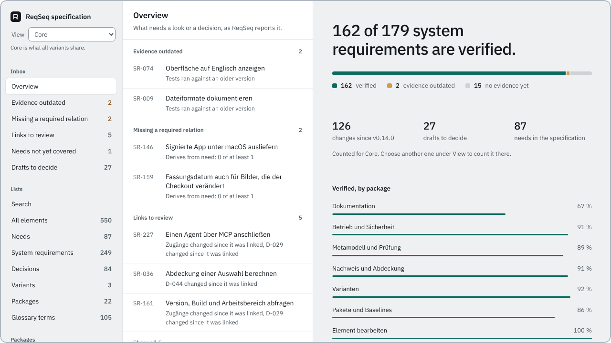

# ReqSeq

Requirements engineering for agents and people: describe a need in plain words, and your agent breaks it down into system requirements, acceptance criteria and tests, which ReqSeq traces through to the evidence record of each test run.

For spec-driven development, your agent works through ReqSeq's CLI or MCP server: every command reports what your elements still lack under your metamodel, such as a parent need or an acceptance criterion, and every relation and evidence record keeps the version it was made against.

The CLI, API and MCP run the same commands with the same result, and the web UI in your browser runs them too, so you can also work by hand; only people approve, and ReqSeq never writes to Git or opens a network connection.

[](https://github.com/ThomasBirkmaier/ReqSeq/actions/workflows/ci.yml)
[](https://github.com/ThomasBirkmaier/ReqSeq/releases/latest)
[](#license)
[](https://thomasbirkmaier.github.io/ReqSeq/)

<picture>
  <source media="(prefers-color-scheme: dark)" srcset="docs/guide/images/chain-dark.svg">
  
</picture>

Each command names what the elements still lack under the metamodel, such as `trace.no-parent` or `element.missing-required`, and `reqseq workspace check --fail-on warning` turns that into a failed pipeline. The metamodel is yours: a new workspace starts with a standard model you can extend. ReqSeq keeps its own more than 200 system requirements this way, in [`spec/`](spec/README.md).

## How you connect

<picture>
  <source media="(prefers-color-scheme: dark)" srcset="docs/guide/images/ways-dark.svg">
  
</picture>

The AI agents section of the web UI's settings, or `reqseq workspace connect-agent --client <client>`, prints the setup that lets your agent's client, such as Claude Code, VS Code, Codex CLI, Claude Desktop or Cursor, start the MCP server for your workspace. [Connect an AI agent](https://thomasbirkmaier.github.io/ReqSeq/how-to/connect-an-ai-agent/) shows each client.

## Get started

1. Download the artifact for your system from the [latest release](https://github.com/ThomasBirkmaier/ReqSeq/releases/latest) and unpack it. [Install ReqSeq](https://thomasbirkmaier.github.io/ReqSeq/how-to/install-reqseq/) says how to check and start it, how to put the `reqseq` launcher on your path, and gives the MCP line for your agent on each system; ReqSeq needs `git` on the PATH.
2. In an empty folder, these are the steps your agent runs, or you by hand. `workspace init` also writes the skill file `managing-requirements`, which tells your AI agent how to work with ReqSeq, to `.claude/skills/` for Claude Code and to `.agents/skills/` for other clients. In a workspace you already have, `reqseq tool guide --skill --write` writes it; a file there that ReqSeq did not write, or that was changed since, is overwritten only with `--replace`. Use the short IDs that ReqSeq prints in place of `N-7fe707` and `SR-c67baa`:

```sh
reqseq --version
reqseq workspace init . "Weather station"
reqseq element create need "See the wind speed" --text "As a sailor, I want to see the wind speed before I leave the harbour."
reqseq element create system-requirement "Show the wind speed" --text "The station must show the wind speed in knots, updated every 10 seconds."
reqseq relation add SR-c67baa derives-from N-7fe707
reqseq trace chain N-7fe707
reqseq workspace check
```

[Get started](https://thomasbirkmaier.github.io/ReqSeq/start/get-started/) explains each step. [Name the requirement in a test](https://thomasbirkmaier.github.io/ReqSeq/how-to/name-the-requirement-in-a-test/), [Check a workspace in CI](https://thomasbirkmaier.github.io/ReqSeq/how-to/check-a-workspace-in-ci/) and [Record test evidence](https://thomasbirkmaier.github.io/ReqSeq/how-to/record-test-evidence/) connect your tests and your pipeline.

## The web UI



You can also work by hand, without an agent: `reqseq ui` in a workspace starts the web UI on your computer and opens it in your browser. It works on the same files through the same commands. Its overview shows what needs a look or a decision; it lists, searches and edits elements, shows the trace graph, the trace matrix and the evidence, and records your decisions on what changed since a baseline. Only your computer reaches it, and only with the address `reqseq ui` prints. [The web UI](https://thomasbirkmaier.github.io/ReqSeq/concepts/the-web-ui/) says more.

## Share the requirements

`reqseq html export <folder>`, or **Export HTML** in the web UI, writes the workspace as a folder of HTML pages that people read in a browser without ReqSeq, Git or network: a page per element with its acceptance criteria, evidence and neighbourhood, lists, baselines and a search. ReqSeq publishes nothing; where you put the folder decides who reads it. [Publish the workspace as HTML](https://thomasbirkmaier.github.io/ReqSeq/how-to/publish-the-workspace-as-html/) says more. ReqSeq's own specification is published this way with each release: [thomasbirkmaier.github.io/ReqSeq/spec](https://thomasbirkmaier.github.io/ReqSeq/spec/).

## More

[Documentation](https://thomasbirkmaier.github.io/ReqSeq/) · [Report a bug](https://github.com/ThomasBirkmaier/ReqSeq/issues) · [How ReqSeq is built](CONTRIBUTING.md). A pilot built this way: [reqseq-weight-and-balance](https://github.com/ThomasBirkmaier/reqseq-weight-and-balance).

## License

ReqSeq is free to try. We plan to publish it under a source-available license before 1.0. Feedback and [issues](https://github.com/ThomasBirkmaier/ReqSeq/issues) are very welcome.

Copyright (c) 2026 Thomas Birkmaier. The current terms are in [LICENSE](LICENSE).
