# ReqSeq

ReqSeq is a local, Git-based requirements tool: one Markdown file per element, traceability, coverage and evidence.

[](https://github.com/ThomasBirkmaier/ReqSeq/actions/workflows/ci.yml)
[](https://github.com/ThomasBirkmaier/ReqSeq/releases/latest)
[](#license)
[](https://thomasbirkmaier.github.io/ReqSeq/)

You keep your requirements as plain files in your own folders and repositories. ReqSeq reads them, checks them against a metamodel, follows their relations and shows what is covered and verified, from a desktop app, a command line, a local API and an MCP server.

<picture>
  <source media="(prefers-color-scheme: dark)" srcset="docs/guide/images/context-dark.svg">
  
</picture>

That makes it a tool for spec-driven development with coding agents: the specification lives in the repository next to the code, agents read and change it through the command line or the MCP server, and the pipeline checks it and records which requirement each test run verified. ReqSeq itself is built that way.


## What it does

- **Plain files.** Each need, use case, system requirement, decision, variant and package is one Markdown file with its properties in the frontmatter, in folders you keep in Git. ReqSeq reads Git but never writes to it, and it never deletes an element: it supersedes it.
- **Your metamodel.** Types, properties, relation kinds and statuses belong to the workspace; a new workspace starts with the standard model. Statuses are set by people; ReqSeq never computes them.
- **Traceability.** A relation keeps the version of its target, so a changed target shows the relation as outdated. Trace chains, related and affected elements, a traceability matrix and a graph.
- **Evidence and coverage.** Verification and validation records, and JUnit XML results of tests that name the requirement they test; coverage, verification degree and the requirements without a passed test.
- **Checks in pipelines.** `reqseq workspace check` checks the whole workspace, or only the changed files, and exits with 1 on errors.
- **Variants, baselines and exchange.** Variants that exclude or replace requirements of the core, baselines to compare against, ReqIF import and export, and data export.
- **Four ways in, one result.** The desktop app, the `reqseq` command line, a local HTTP API on loopback and an MCP server for AI agents run the same commands.

## Spec-driven development with coding agents

A spec that an agent writes code from is only half of the job. ReqSeq keeps it after that: each requirement has a version, its relations follow it down to the tests, and every pull request shows what the change breaks and what is still unverified.

1. **Give the agent the workspace.** Either the `reqseq` command line in the repository, or the MCP server, one tool per command with the same result as the CLI:

   ```json
   { "mcpServers": { "reqseq": { "command": "/Applications/ReqSeq.app/Contents/Resources/bin/reqseq", "args": ["mcp", "--workspace", "/path/to/repo/spec"] } } }
   ```

   This is the macOS launcher. Give absolute paths of the launcher and the workspace, since MCP clients often start the server without your shell's path; [Install ReqSeq](https://thomasbirkmaier.github.io/ReqSeq/how-to/install-reqseq/#mcp) has the line for each system.

2. **Let it change the spec with commands.** `element create`, `element update`, `relation add` and `element supersede` keep IDs, versions and relations consistent; `element search` and `trace chain` let it read before it writes. A requirement is never deleted, only superseded, and a status is only ever set, never computed, so approving stays a decision someone makes.
3. **Name the requirement in the test.** `[SR-c67baa] shows the wind speed` in any test tool that writes JUnit XML, or a name pattern such as `sr_c67baa_ak1` where brackets do not fit.
4. **Check it in CI.** On every pull request, as steps of a GitHub Actions job (checkout with `fetch-depth: 0`, workspace in `spec/`):

   ```yaml
   - run: reqseq workspace check --workspace spec --changed-since origin/${{ github.base_ref }} --fail-on warning
   - run: reqseq evidence enrich-junit spec/evidence/ci/results.xml ${{ github.sha }} --workspace spec
   - run: reqseq evidence without-passed-test --workspace spec
   ```

   The check fails the job on a broken relation, a missing property or an outdated link; the enriched JUnit file ties each passed test to the version of the requirement it ran against, and the last command lists what no test shows yet.

Where this runs today:

- **ReqSeq itself.** `spec/` holds the more than 200 system requirements of this repository as a ReqSeq workspace. The agents that build ReqSeq change it only through ReqSeq, every pull request checks it, and each acceptance criterion with the method Test has a test named after it (`[SR-036/AK2] ...`), which `pnpm trace-check` enforces.
- **A pilot.** [reqseq-weight-and-balance](https://github.com/ThomasBirkmaier/reqseq-weight-and-balance) is a small web app built by agents that had not used ReqSeq before, from stakeholders and hazards down to Rust and Playwright tests. Its CI checks the workspace and enriches the JUnit results of both test suites.

[Check a workspace in CI](https://thomasbirkmaier.github.io/ReqSeq/how-to/check-a-workspace-in-ci/) and [Record test evidence](https://thomasbirkmaier.github.io/ReqSeq/how-to/record-test-evidence/) in the documentation have the details.

## Get started

1. Download the artifact for your system from the [latest release](https://github.com/ThomasBirkmaier/ReqSeq/releases/latest) and unpack it. [Install ReqSeq](https://thomasbirkmaier.github.io/ReqSeq/how-to/install-reqseq/) says how to check, unpack and start it and how to put the `reqseq` launcher on your path; ReqSeq needs `git` on the PATH.
2. In an empty folder, create a workspace, a first need and a requirement derived from it, look at the chain and check the workspace. Use the short IDs that ReqSeq prints in place of `N-7fe707` and `SR-c67baa`:

```sh
reqseq --version
reqseq workspace init . "Weather station"
reqseq element create need "See the wind speed" --text "As a sailor, I want to see the wind speed before I leave the harbour."
reqseq element create system-requirement "Show the wind speed" --text "The station must show the wind speed in knots, updated every 10 seconds."
reqseq relation add SR-c67baa derives-from N-7fe707
reqseq trace chain N-7fe707
reqseq workspace check
```

[Get started](https://thomasbirkmaier.github.io/ReqSeq/start/get-started/) in the documentation explains each step and how the app does the same.

## Documentation

The documentation is at **[thomasbirkmaier.github.io/ReqSeq](https://thomasbirkmaier.github.io/ReqSeq/)**: Get started, and a reference of every command with its call in the app, the CLI, the API and MCP, every problem and error code, and every file format. Every delivery also carries the documentation of its version for reading without network: **Help > ReqSeq Documentation** in the app, or `reqseq serve docs`.

## Reporting bugs

Open an [issue](https://github.com/ThomasBirkmaier/ReqSeq/issues) with the version (`reqseq --version`), your system, what you did and what happened.

## Data and privacy

ReqSeq works on your files only. It opens no network connections and sends no telemetry; the local API listens on loopback only.

## Development

This repository is built almost entirely by Claude agents, against its own specification in `spec/`. The rules they follow are in [CLAUDE.md](CLAUDE.md), the architecture in [docs/architecture/](docs/architecture/README.md) and the decisions on how to build it in [docs/adr/](docs/adr/).

Build and test with Node 22.12 or later and pnpm: `pnpm install`, `pnpm build`, `pnpm test`. The checks a pull request must pass are in [.claude/skills/verify/SKILL.md](.claude/skills/verify/SKILL.md).

| Folder | Content |
|---|---|
| `spec/` | The specification, a ReqSeq workspace. Changed only with ReqSeq, see [spec/README.md](spec/README.md). |
| `docs/guide/` | The user documentation's hand-written pages, built into a site by `packages/docs` (`pnpm docs:build`, ADR-0017) |
| `docs/architecture/`, `docs/adr/` | arc42 (short), architecture decision records |
| `schemas/` | JSON Schemas for all file formats, OpenAPI, MCP tool list |
| `packages/` | `core`, `cli`, `api`, `mcp`, `app`, `docs` (the documentation site), `testkit` (shared test helpers) |
| `verification/` | Records for analysis, inspection and demonstration |
| `toolchain/` | `junit/` connects a test tool that writes JUnit XML (SR-063); `packaging/` builds the release archives; `reqif/` lists the ReqIF 1.2 XSDs that CI downloads and pins by hash for the tests |
| `fixtures/` | Small test data per system requirement, generator for large data sets |
| `scripts/` | `trace-check`, `spec-migrate` (the one-time migration from Logseq), `spec-export` (obsolete) |

Test data for realistic scenarios lives in the separate repository `ReqSeq-testdata`.

## License

ReqSeq is free to try. We plan to publish it under a source-available license before 1.0. Feedback and [issues](https://github.com/ThomasBirkmaier/ReqSeq/issues) are very welcome.

Copyright (c) 2026 Thomas Birkmaier. The current terms are in [LICENSE](LICENSE).
