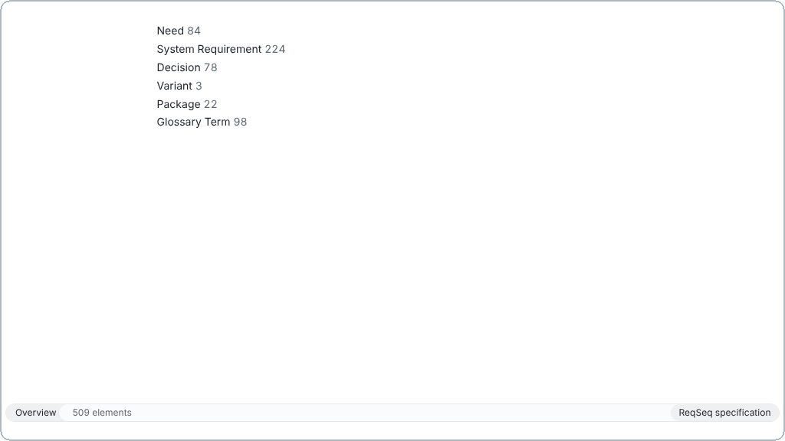

# ReqSeq

You tell your coding agent what you need, and it writes it down as requirements, acceptance criteria and tests, as Markdown files in your repository, through ReqSeq's CLI or MCP server.
Every element and every link between them carries a version, from the need down to the test run that proves it, so a change shows at once which requirement must be reviewed and which test must run again.
Only people approve; ReqSeq never sets a status, never writes to Git and opens no network connection.

[](https://github.com/ThomasBirkmaier/ReqSeq/actions/workflows/ci.yml)
[](https://github.com/ThomasBirkmaier/ReqSeq/releases/latest)
[](#license)
[](https://thomasbirkmaier.github.io/ReqSeq/)

<picture>
  <source media="(prefers-color-scheme: dark)" srcset="docs/guide/images/chain-dark.svg">
  
</picture>

## Get started

1. Download the artifact for your system from the [latest release](https://github.com/ThomasBirkmaier/ReqSeq/releases/latest) and unpack it. [Install ReqSeq](https://thomasbirkmaier.github.io/ReqSeq/how-to/install-reqseq/) says how to check and start it, how to put the `reqseq` launcher on your path, and gives the MCP line for your agent on each system; ReqSeq needs `git` on the PATH.
2. In an empty folder, these are the steps your agent runs, or you by hand. Use the short IDs that ReqSeq prints in place of `N-7fe707` and `SR-c67baa`:

```sh
reqseq --version
reqseq workspace init . "Weather station"
reqseq element create need "See the wind speed" --text "As a sailor, I want to see the wind speed before I leave the harbour."
reqseq element create system-requirement "Show the wind speed" --text "The station must show the wind speed in knots, updated every 10 seconds."
reqseq relation add SR-c67baa derives-from N-7fe707
reqseq trace chain N-7fe707
reqseq workspace check
```

[Get started](https://thomasbirkmaier.github.io/ReqSeq/start/get-started/) explains each step. [Name the requirement in a test](https://thomasbirkmaier.github.io/ReqSeq/how-to/name-the-requirement-in-a-test/), [Check a workspace in CI](https://thomasbirkmaier.github.io/ReqSeq/how-to/check-a-workspace-in-ci/) and [Record test evidence](https://thomasbirkmaier.github.io/ReqSeq/how-to/record-test-evidence/) connect your tests and your pipeline.

## The app



The desktop app works on the same files, with one command prompt for every function, and shows the graph, the traceability matrix and the evidence.

## More

[Documentation](https://thomasbirkmaier.github.io/ReqSeq/) · [Report a bug](https://github.com/ThomasBirkmaier/ReqSeq/issues) · [How ReqSeq is built](CONTRIBUTING.md). ReqSeq keeps its own specification this way in [`spec/`](spec/README.md), and so does the pilot [reqseq-weight-and-balance](https://github.com/ThomasBirkmaier/reqseq-weight-and-balance).

## License

ReqSeq is free to try. We plan to publish it under a source-available license before 1.0. Feedback and [issues](https://github.com/ThomasBirkmaier/ReqSeq/issues) are very welcome.

Copyright (c) 2026 Thomas Birkmaier. The current terms are in [LICENSE](LICENSE).
