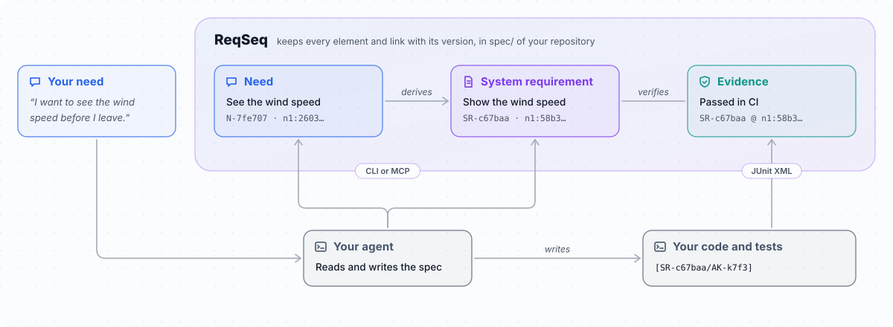

# ReqSeq

Requirements engineering for agents and people: describe a need in plain words, and your agent breaks it down into system requirements, acceptance criteria and tests, which ReqSeq traces through to the evidence record of each test run.

For spec-driven development, your agent works through ReqSeq's CLI or MCP server: every command reports what your metamodel still misses, such as a parent need or an acceptance criterion, and every relation and evidence record keeps the version it was made against.

The app, CLI, API and MCP run the same commands with the same result, so you can also do all of it by hand; only people approve, and ReqSeq never writes to Git or opens a network connection.

[](https://github.com/ThomasBirkmaier/ReqSeq/actions/workflows/ci.yml)
[](https://github.com/ThomasBirkmaier/ReqSeq/releases/latest)
[](#license)
[](https://thomasbirkmaier.github.io/ReqSeq/)

<picture>
  <source media="(prefers-color-scheme: dark)" srcset="docs/guide/images/chain-dark.svg">
  
</picture>

## What it looks like

A need, a system requirement derived from it, and the test that verifies its acceptance criterion, as the CLI prints it (shortened). The requirement starts with gaps that ReqSeq names:

```text title="Output"
$ reqseq element create system-requirement "Show the wind speed" --text "…"
SR-7205cc  draft  Show the wind speed  [verification: core open]
warning  element.missing-required  SR-7205cc  Required property Acceptance Criteria (acceptance-criteria) … has no value
warning  trace.no-parent  SR-7205cc  System Requirement SR-7205cc has no parent
$ reqseq relation add SR-7205cc derives-from N-db340b
$ reqseq element update SR-7205cc --set requirement-type=functional --set 'acceptance-criteria=[{"text":"Given …"}]'
$ reqseq evidence enrich-junit evidence/results.xml build-1     # test named [SR-7205cc/AK-h1rf]
$ reqseq trace chain N-db340b
N-db340b  draft  See the wind speed
children:
  1  SR-7205cc  draft  Show the wind speed
  2    test case  station › [SR-7205cc/AK-h1rf] shows the wind speed in knots
         2026-11-18T21:26:18Z  passed  build-1  evidence/results.xml:2  [criteria AK1 (h1rf)]
```

The reports come from the metamodel of the workspace: a new workspace starts with the standard model of needs, use cases, system requirements, decisions, variants and packages, and you can extend it with your own types, properties and relations. `reqseq workspace check --fail-on warning` turns each report into a failed pipeline, and a changed need shows every relation to it as outdated until someone confirms it. ReqSeq keeps its own specification this way: the more than 200 system requirements in [`spec/`](spec/README.md), each acceptance criterion traced to the test that verifies it.

## How you connect

<picture>
  <source media="(prefers-color-scheme: dark)" srcset="docs/guide/images/context-dark.svg">
  
</picture>

All four ways in run the same commands with the same result.

## Get started

1. Download the artifact for your system from the [latest release](https://github.com/ThomasBirkmaier/ReqSeq/releases/latest) and unpack it. [Install ReqSeq](https://thomasbirkmaier.github.io/ReqSeq/how-to/install-reqseq/) says how to check and start it, how to put the `reqseq` launcher on your path, and gives the MCP line for your agent on each system; ReqSeq needs `git` on the PATH.
2. In an empty folder, these are the steps your agent runs, or you by hand. Use the short IDs that ReqSeq prints in place of `N-7fe707` and `SR-c67baa`:

```sh
reqseq --version
reqseq workspace init . "Weather station"
reqseq element create need "See the wind speed" --text "As a sailor, I want to see the wind speed before I leave the harbour."
reqseq element create system-requirement "Show the wind speed" --text "The station must show the wind speed in knots, updated every 10 seconds."
reqseq relation add SR-c67baa derives-from N-7fe707
reqseq trace chain N-7fe707
reqseq workspace check
```

[Get started](https://thomasbirkmaier.github.io/ReqSeq/start/get-started/) explains each step. [Name the requirement in a test](https://thomasbirkmaier.github.io/ReqSeq/how-to/name-the-requirement-in-a-test/), [Check a workspace in CI](https://thomasbirkmaier.github.io/ReqSeq/how-to/check-a-workspace-in-ci/) and [Record test evidence](https://thomasbirkmaier.github.io/ReqSeq/how-to/record-test-evidence/) connect your tests and your pipeline.

## The app


You can also do all of your requirements engineering by hand, without an agent: the desktop app works on the same files and offers every function the CLI and MCP offer, with the same result. One command prompt reaches each of them, and the app shows the graph, the traceability matrix and the evidence.

## More

[Documentation](https://thomasbirkmaier.github.io/ReqSeq/) · [Report a bug](https://github.com/ThomasBirkmaier/ReqSeq/issues) · [How ReqSeq is built](CONTRIBUTING.md). A pilot built this way: [reqseq-weight-and-balance](https://github.com/ThomasBirkmaier/reqseq-weight-and-balance).

## License

ReqSeq is free to try. We plan to publish it under a source-available license before 1.0. Feedback and [issues](https://github.com/ThomasBirkmaier/ReqSeq/issues) are very welcome.

Copyright (c) 2026 Thomas Birkmaier. The current terms are in [LICENSE](LICENSE).
