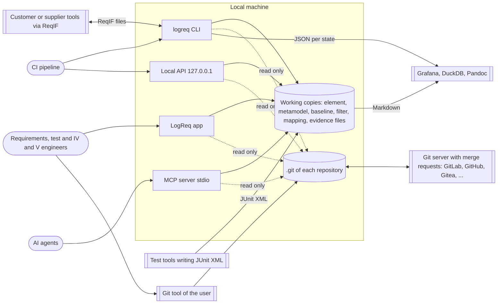
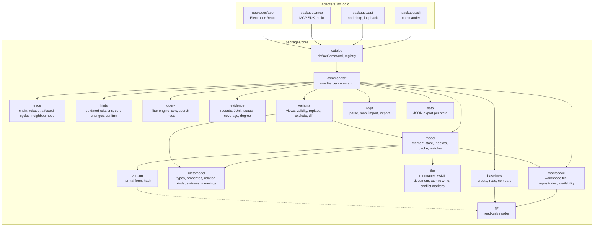
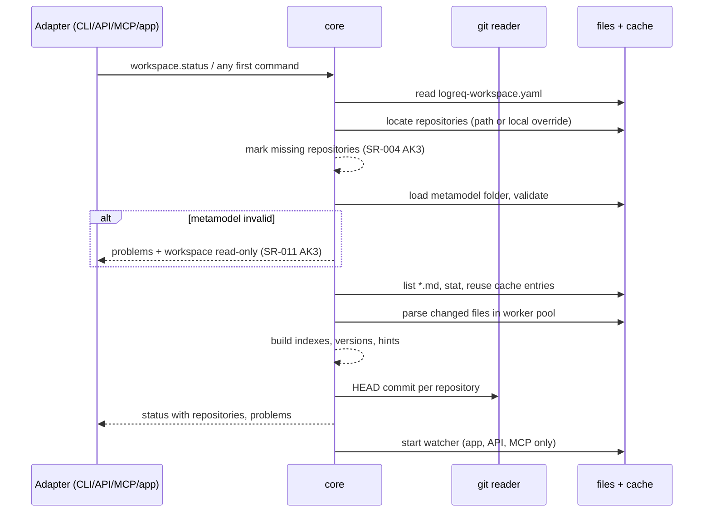

# LogReq architecture (arc42, short)

Status: stage 0 (D-052). The specification is the LogReq workspace in `spec/` (German, maintained with LogReq since #326, D-064); decisions `D-xxx` say **what**, the ADRs in `docs/adr/` say **how**. This document connects them. It uses only the arc42 chapters LogReq needs.

## 1. Goals

LogReq is a local requirements tool on plain files in Git: one Markdown file per element, traceability, coverage and evidence, usable from a desktop app, a CLI, a local API and an MCP server. It deliberately leaves collaboration, review, history, rights, documents and dashboards to existing tools (D-008, D-014, D-016, D-018, D-024).

### Quality goals

| Priority | Goal | Measured by |
|---|---|---|
| 1 | **Readable, mergeable files.** Files make sense without LogReq; different elements never conflict. | SR-001, SR-009, SR-010, SR-102, D-015, D-056 |
| 2 | **Same function everywhere.** App, CLI, API and MCP give the same result. | SR-080, D-029 |
| 3 | **Large workspaces stay fluid.** 50,000 elements, 200,000 relations: start ≤ 3 s (cached) / ≤ 30 s, open ≤ 200 ms, filter or chain ≤ 500 ms, search ≤ 300 ms, check ≤ 60 s. | SR-020, SR-068, SR-082, N-036 |
| 4 | **Closed networks.** No outgoing connection, ever; API and MCP only on the local machine. | SR-077, SR-078, SR-079 |
| 5 | **Trustworthy traceability.** Outdated relations and evidence are always detected; nothing changes status by itself. | SR-017, SR-021, SR-025, SR-031, D-013 |

## 2. Constraints

- TypeScript and Electron (D-004); Windows 11, macOS 14, Ubuntu 24.04 (SR-076).
- Git is the storage; LogReq reads Git and writes only files (D-024, D-036, SR-083).
- English UI and standard model (D-019); the spec stays German.
- No user or rights management (D-016); no deletion of elements (D-045); status set only by people (D-030).
- Built by agents in stages (D-035) with this architecture as fixed frame (D-052).

## 3. Context



LogReq talks only to the local file system and the local `git` program. Everything across the network is done by the Git tool and the Git server.

## 4. Solution strategy

| Problem | Approach | ADR |
|---|---|---|
| Four accesses, one behaviour | A **command catalog**: each function is one command with input and output schema; CLI, API, MCP and app are generic adapters generated from it. | 0002, 0009 |
| Fixed interfaces before parallel work | **Contracts first**: JSON Schema for every file and command, examples, generated OpenAPI and MCP list, all checked in CI. | 0003 |
| Mergeable, readable storage | One Markdown file per element, YAML frontmatter, relations only in the source file, one line per relation, stable writing. | 0004, 0007 |
| Detect outdated links without Git history | **Version = content hash** with a versioned normal form. | 0005 |
| Stay out of collaboration | Git through a read-only allowlist; no commit, push or merge. | 0006 |
| Speed at 50,000 elements | Files are the database; in-memory model and indexes, per-copy cache, debounced file watching, worker threads for cold start. | 0008 |
| Offline and secure desktop app | Electron with sandboxed renderer, core in a utility process, all requests blocked. | 0010 |
| Evidence from any tool | Open record format plus a JUnit property convention, enriched by the CLI. | 0012 |

## 5. Building blocks



| Block | Responsibility | Stage |
|---|---|---|
| `catalog`, `commands` | Registry and implementations of all catalog commands | 1 onward |
| `workspace` | Read `logreq-workspace.yaml`, locate repositories, report missing and not writable ones (SR-004, SR-006, SR-018) | 1 |
| `metamodel` | Load and merge metamodel files, inheritance, meanings, standard model (SR-011..SR-015) | 1 |
| `files` | Parse and write element and YAML files losslessly (ADR-0007, SR-008, SR-016) | 1 |
| `version` | Normal form and hash (SR-021) | 1 |
| `model` | Element store, indexes, cache, watcher (SR-003, SR-007, SR-081, SR-082) | 1 |
| `git` | Commits, dirty state, history, old contents, read-only (SR-083) | 1 |
| `trace`, `hints` | Chains, related, affected, outdated relations, confirm (SR-021..SR-027) | 2 |
| `query` | Filter language, sort, full-text search (SR-068..SR-070, SR-075) | 3 |
| `evidence`, `data` | Records, JUnit, status, coverage, degree, JSON export (SR-028..SR-038, SR-061, SR-062) | 4 |
| `variants`, `baselines` | Views, replace, exclude, diff, baselines (SR-039..SR-051); validity and its hints first (SR-040, stage 1) | 1, 5 |
| `reqif` | ReqIF 1.2 import and export with mapping (SR-052..SR-059) | 6 |

Rules: adapters depend only on `@logreq/core`'s public exports; inside `core`, `commands` may use every block, blocks never import `commands`; `git` is the only module that spawns processes; `files` is the only module that writes to disk.

## 6. Runtime scenarios

### 6.1 Open a workspace



### 6.2 Edit an element and confirm a hint

1. The app calls `element.update` with a new text. `core` checks the file on disk is unchanged since read, rewrites only the changed frontmatter lines and the text (ADR-0007), writes atomically and recomputes the version.
2. The version changed, so every relation pointing at the element is now outdated. `core` returns `affected` (direct count, SR-024 AK2); the hints index gets one `relation.outdated` hint per relation.
3. Later someone reviews a child and calls `hint.confirm`. `core` writes the new `version` into that relation line of the child's file, and the target's current title within the same repository (D-042, SR-027, decision on #307); any write of a file also refreshes the stored titles of its same-repository targets. The person commits both files with their Git tool; the merge request shows exactly these lines.

### 6.3 Check in a merge request and record test evidence

```mermaid
sequenceDiagram
  participant P as Pipeline
  participant L as logreq CLI
  participant T as Test tool
  P->>L: logreq workspace check --changed-since origin/main --json
  L-->>P: problems as JSON, exit 1 if errors (warnings too with --fail-on warning; SR-019, SR-025)
  P->>T: run tests (names contain [SR-46fb54])
  T-->>P: results.xml (JUnit)
  P->>L: logreq evidence enrich-junit results.xml --item build-512
  L-->>P: results.xml with UUID, version, item, date (SR-029)
  P->>P: store results.xml in the evidence location (outside LogReq)
  P->>L: logreq data store --folder out/
  L-->>P: out/<commit>.json for Grafana (SR-062)
```

## 7. Deployment

One installer per platform with app, CLI and MCP server, all offline (ADR-0014). Instances on separate working copies are independent; caches are per copy in the OS cache folder (SR-081). The API runs only when started (`logreq serve api` or app setting) and binds to loopback.

## 8. Cross-cutting concepts

- **Problems, not exceptions.** Findings and hints are data with stable codes (`common.schema.json#/$defs/problemCode`), the same in every access. Errors are `CommandError` with codes from `#/$defs/error`.
- **Never lose user data.** Write only what a command is about; atomic writes; refuse when the file changed on disk; never write a file that failed to parse.
- **Status is human.** Only `element.setStatus` and `element.supersede` change a status.
- **Missing access is normal.** A missing repository or target is shown with its short ID and marks results `incomplete`; nothing blocks (SR-006).
- **Performance budget.** Every command touching many elements has a perf test at 50,000 elements before its stage is accepted.
- **Security.** No network; loopback-only API with token; sandboxed renderer; Git read-only allowlist.
- **Language.** All UI, CLI messages, errors and docs in English (SR-074). Content is shown unchanged (SR-074 AK2).
- **Logging.** Local only, to the cache folder, rotated; never content of elements at info level.

## 9. Decisions

See [docs/adr](../adr/README.md).

## 10. Risks and open points

| Risk or open point | Handling |
|---|---|
| Electron performance with large lists | Virtualised lists in the app; perf tests from stage 3. |
| Version date needs Git history; shallow clones | Date shown as unknown; documented. |
| CI runners differ from the reference machine | Times are recorded as analysis, nightly and on PRs labelled `perf`; tagged AK tests assert their threshold, and the record names the runner's cores and memory (ADR-0011). |
| The spec lies in a subfolder of the code repository | LogReq sees no Git there: no version dates and no `workspace check --changed-since` on `spec/` (#377). |

## 11. Glossary

The glossary is part of the spec (type `glossary-term`, `spec/glossary-term/`). English terms used in code: element, need, requirement, variant, package, baseline, relation, reference (inline link), version (Fassung), evidence record (Datensatz), evidence (Beleg), item (Prüfling), test case, execution (Durchführung), hint (Hinweis), coverage (Abdeckung), verification degree (Nachweisgrad), workspace (Arbeitsbereich), state (Stand), core (Kern), validity (Gültigkeit).
