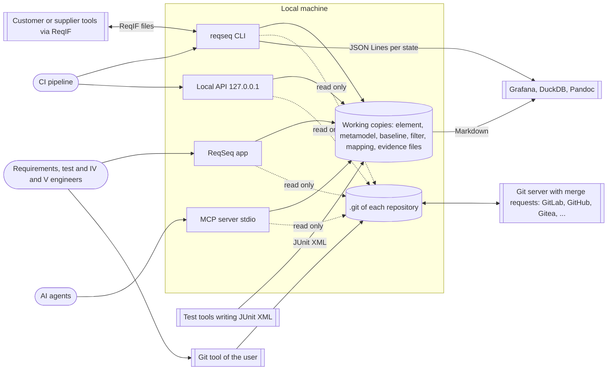
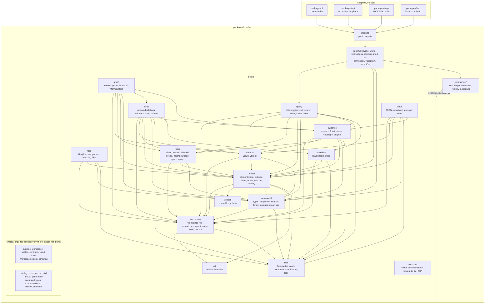
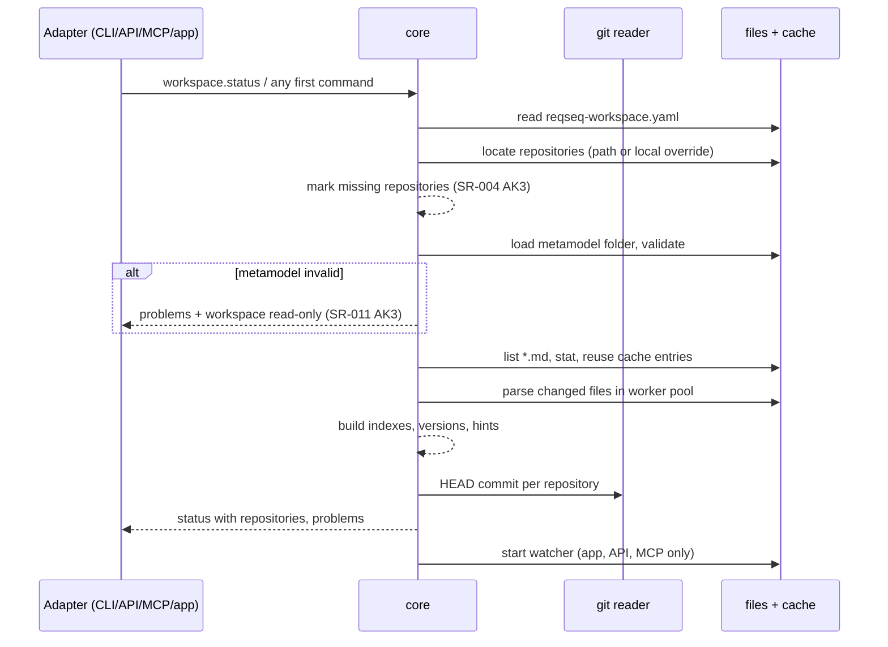
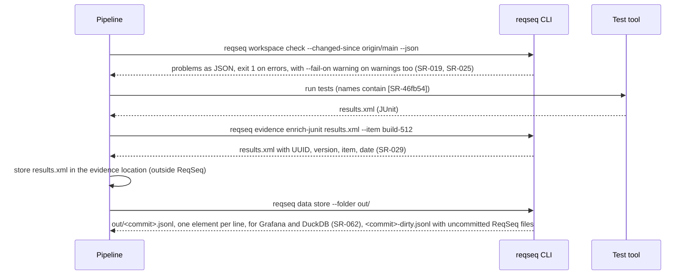

# ReqSeq architecture (arc42, short)

Status: written before the first implementation; §5 updated to the code on 2026-10-28 (ThomasBirkmaier/ReqSeq-archive#635). The specification is the ReqSeq workspace in `spec/` (German, maintained with ReqSeq since ThomasBirkmaier/ReqSeq-archive#326); decisions `D-xxx` say **what**, the ADRs in `docs/adr/` say **how**. This document connects them. It uses only the arc42 chapters ReqSeq needs.

## 1. Goals

ReqSeq is a local requirements tool on plain files in Git: one Markdown file per element, traceability, coverage and evidence, usable from a desktop app, a CLI, a local API and an MCP server. It deliberately leaves collaboration, review, history, rights, documents and dashboards to existing tools (D-008, D-014, D-016, D-018, D-024).

### Quality goals

| Priority | Goal | Measured by |
|---|---|---|
| 1 | **Readable, mergeable files.** Files make sense without ReqSeq; different elements never conflict. | SR-001, SR-009, SR-010, SR-102, D-015, D-056 |
| 2 | **Same function everywhere.** App, CLI, API and MCP give the same result. | SR-080, D-029 |
| 3 | **Large workspaces stay fluid.** 50,000 elements, 200,000 relations: start ≤ 3 s (cached) / ≤ 30 s, open ≤ 200 ms, filter or chain ≤ 500 ms, search ≤ 300 ms, check ≤ 60 s. | SR-020, SR-068, SR-082, N-036 |
| 4 | **Closed networks.** No outgoing connection, ever; API and MCP only on the local machine. | SR-077, SR-078, SR-079 |
| 5 | **Trustworthy traceability.** Outdated relations and evidence are always detected; nothing changes status by itself. | SR-017, SR-021, SR-025, SR-031, D-013 |

## 2. Constraints

- TypeScript and Electron (D-004); Windows 11, macOS 26, Ubuntu 24.04 (SR-076).
- Git is the storage; ReqSeq reads Git and writes only files (D-024, D-036, SR-083).
- English UI and standard model (D-019); the spec stays German.
- No user or rights management (D-016); no deletion of elements (D-045); status set only by people (D-030).
- Built by agents with this architecture as fixed frame.

## 3. Context

ReqSeq talks only to the local file system and the local `git` program. Everything across the network is done by the Git tool and the Git server.

## 4. Solution strategy

| Problem | Approach | ADR |
|---|---|---|
| Four accesses, one behaviour | A **command catalog**: each function is one command with input and output schema; CLI, API, MCP and app are generic adapters generated from it. | 0002, 0009 |
| Fixed interfaces before parallel work | **Contracts first**: JSON Schema for every file and command, examples, generated OpenAPI and MCP list, all checked in CI. | 0003 |
| Mergeable, readable storage | One Markdown file per element, YAML frontmatter, relations only in the source file, one line per relation, stable writing. | 0004, 0007 |
| Detect outdated links without Git history | **Version = content hash** with a versioned normal form. | 0005 |
| Stay out of collaboration | Git through a read-only allowlist; no commit, push or merge. | 0006 |
| Speed at 50,000 elements | Files are the database; in-memory model and indexes, per-copy cache, debounced file watching, worker threads for cold start. | 0008 |
| Offline and secure desktop app | Electron with sandboxed renderer, core in a utility process, all requests blocked. | 0010 |
| Evidence from any tool | Open record format plus a JUnit property convention, enriched by the CLI. | 0012 |

## 5. Building blocks

The workspace packages and their dependencies, generated from `packages/*/package.json`:

The diagram and the table below follow the imports of the product code in `packages/core/src` (relative imports across block folders, test files and test helpers `*.test-helper.ts` left out) as of 2026-10-28 (ThomasBirkmaier/ReqSeq-archive#635). A block is a folder of `packages/core/src`; `runtime` is split into its entry modules and its state modules because they sit at opposite ends of the graph.

An arrow means that at least one module of the source imports a value (a function, a class, a constant) from the target. Imports of types only (`import type`, today only `data` → `git`, `query` and runtime state) are not drawn, nor are the imports of the shared modules; the table lists both. Besides `runtime/invoke.ts`, `index.ts` re-exports helpers of `catalog`, `product`, `runtime`, `workspace`, `model`, `files`, `query`, `evidence` and `version` for the adapters.

| Block | Imports (values) | Imports (types only) |
|---|---|---|
| runtime entry (`invoke`, `warm`, `instructions`, `element-short-ids`, `local-path-fields`) | commands, metamodel, model, query, runtime state, workspace | |
| `commands` | baselines, data, evidence, files, graph, hints, metamodel, model, query, reqif, runtime state, trace, variants, version, workspace | |
| `data` | evidence, files, metamodel, model, variants, workspace | git, query, runtime state |
| `reqif` | files, metamodel, model, runtime state, workspace | |
| `graph` | evidence, hints, metamodel, model, runtime state, trace, variants, workspace | |
| `query` | baselines, evidence, files, metamodel, model, runtime state, trace, variants, workspace | |
| `hints` | baselines, evidence, files, metamodel, model, runtime state, trace, variants, workspace | |
| `evidence` | files, metamodel, model, runtime state, trace, variants, workspace | |
| `trace` | metamodel, model, runtime state, workspace | |
| `variants` | metamodel, model, runtime state, workspace | |
| `baselines` | files, model, runtime state, workspace | |
| `model` | files, git, metamodel, runtime state, version, workspace | |
| `metamodel` | files, runtime state, workspace | |
| `workspace` | files, git, runtime state | |
| `files`, `version`, `git`, `docs-site`, runtime state (`workspace`, `settled`, `contracts`, `input-errors`) | no other block | |

`workspace` imports `git` for one question: whether Git tracks `.reqseq/local.yaml` before the layout uses it (SR-004 AK8, #1456); the layout is the workspace block's, and `git` is a lower layer.

Every block may also import the root modules `catalog.ts`, `product.ts` and `build-info.ts` (the build of a delivery, SR-161) and the generated types and data in `generated/`; `catalog.ts` imports only the type `Workspace` of `runtime/workspace.ts`.

With `runtime` split, the imports have no cycle and form these layers, from the bottom: `files`, `version`, `git`, `docs-site` and runtime state; `workspace`; `metamodel`; `model`; `trace`, `variants`, `baselines`; `evidence`; `hints`, `query`; `data`, `reqif`, `graph`; `commands`; runtime entry. Every import points to a lower layer. The test `packages/core/src/block-layers.test.ts` holds these layers and the table below and fails on any relative import of the product code that goes to the same or a higher layer or that the table does not list, naming the file, the import and the rule (ThomasBirkmaier/ReqSeq-archive#635); a new block, runtime module or allowed import is added to this section and to that test.

| Block | Responsibility |
|---|---|
| `catalog.ts`, `commands` | Command types, `defineCommand`, `CommandError` (`catalog.ts`); implementations of all catalog commands and their registry (`commands/index.ts`) |
| `runtime` | Entry: `invoke` (the one entry point of the adapters: validate input, run the command, map errors, add short IDs, record agent accesses, confine the local paths of API and MCP calls to the repositories, SR-142), `warmWorkspace` (SR-082), agent instructions for MCP. State: the `Workspace` object that holds all state of one workspace (SR-081), kept async states, contracts loaded for validation, readable input errors |
| `workspace` | Read `reqseq-workspace.yaml`, locate repositories, report missing and not writable ones (SR-004, SR-006, SR-018); cache folder, recent workspaces |
| `metamodel` | Load and merge metamodel files, inheritance, meanings, standard model (SR-011..SR-015) |
| `files` | Parse and write element and YAML files losslessly (ADR-0007, SR-008, SR-016) |
| `version` | Normal form and hash (SR-021) |
| `model` | Element store, indexes, cache, watcher (SR-003, SR-007, SR-081, SR-082). Sub-areas in the one folder: the store and its cold load (`store`, `contribution`, `discover`, `read-pool`, `model-cache`), writes (`write`, `relation-write`, `targets`, `status`, `supersede`, `bulk-update`), the Markdown scanner (`markdown-links`, `references`), file findings (`duplicates`, `missing-targets`, `required`, `values`, …), the Git-facing modules (`version-date`, `changed`, `uncommitted`, `repository-commit`), the watcher (`watch`, `watch-tree`, `watch-change`) and agent activity (`activity`, SR-117) |
| `git` | Commits, dirty state, history, old contents, read-only (SR-083) |
| `docs-site` | The offline documentation site of a delivery: which file a request names, media types, the CSP, command page paths; only `node:*`, reads only (SR-141, ADR-0017) ([block file](../../packages/core/docs/docs-site.md)) |
| `trace`, `hints` | Chains, related, affected, outdated relations, confirm (SR-021..SR-027) |
| `graph` | The graph of an element with its marks and verification (SR-111), the words the app's graph shows, and the Mermaid text of the element and metamodel graphs (SR-151) ([block file](../../packages/core/docs/graph.md)) |
| `query` | Filter language, sort, full-text search (SR-068..SR-070, SR-075) |
| `evidence`, `data` | Records (`record`, `folders`, `state`, `by-element` index), readers (`markdown`, `junit`), record findings (`match`), status, coverage, degree, JSON export (SR-028..SR-038, SR-061, SR-062; ADR-0012) |
| `variants`, `baselines` | Views, replace, exclude, diff, baselines (SR-039..SR-051); validity and its hints (SR-040); the read-only reader of baseline files (SR-032 AK2) |
| `reqif` | ReqIF 1.2 import and export with mapping (SR-052..SR-059, ADR-0013); so far the model and the parser on the XML scanner of `files`, and the mapping files (`mapping`: where they are written, reading and checking them against the metamodel, SR-054) ([block file](../../packages/core/docs/reqif.md)) |

Rules: adapters depend on `@reqseq/core`'s public exports (`index.ts` and the subpaths `list-folder`, `os-cache`, `recent-workspaces`, `verification-degree`, `pasted-markdown`, `docs-site` and `command-error` in `package.json`; the lint rule `no-restricted-imports` in `eslint.config.js` rejects imports of core's source folders), and on no other package, with two exceptions that reuse a server instead of a second one: the CLI starts the API and the docs server of `@reqseq/api` (`reqseq serve api`, `reqseq serve docs`), and the app's main process starts only the docs server, through the subpath `@reqseq/api/docs-server`, which loads `node:*`, core's `command-error` and `docs-site` and nothing of the catalog runtime (SR-141, ADR-0010). Inside `core`, `commands` may use every block; no block imports `commands`, except `runtime/invoke.ts`, which runs them. `git` is the only module that spawns processes (the cold load of `model` uses worker threads, not processes); `files` is the only module that writes to disk.

## 6. Runtime scenarios

### 6.1 Open a workspace

### 6.2 Edit an element and confirm a hint

1. The app calls `element.update` with a new text. `core` checks the file on disk is unchanged since read, rewrites only the changed frontmatter lines and the text (ADR-0007), writes atomically and recomputes the version.
2. The version changed, so every relation pointing at the element is now outdated. `core` returns `affected` (direct count, SR-024 AK2); the hints index gets one `relation.outdated` hint per relation.
3. Later someone reviews a child and calls `hint.confirm`. `core` writes the new `version` into that relation line of the child's file, and the target's current title within the same repository (D-042, SR-027, decision on ThomasBirkmaier/ReqSeq-archive#307); any write of a file also refreshes the stored titles of its same-repository targets. The person commits both files with their Git tool; the merge request shows exactly these lines.

### 6.3 Check in a merge request and record test evidence

## 7. Deployment

One portable artifact per platform (zip for Windows and macOS, tar.gz for Linux) with app, CLI and MCP server, all offline; installing means unpacking (ADR-0014). Instances on separate working copies are independent; caches are per copy in the OS cache folder (SR-081). The API runs only when started (`reqseq serve api` or app setting) and binds to loopback.

## 8. Cross-cutting concepts

- **Problems, not exceptions.** Findings and hints are data with stable codes (`common.schema.json#/$defs/problemCode`), the same in every access. Errors are `CommandError` with codes from `#/$defs/error`.
- **Never lose user data.** Write only what a command is about; atomic writes; refuse when the file changed on disk; never write a file that failed to parse.
- **Status is human.** Only `element.setStatus` and `element.supersede` change a status.
- **Missing access is normal.** A missing repository or target is shown with its short ID and marks results `incomplete`; nothing blocks (SR-006).
- **Performance budget.** Every command touching many elements gets a perf test at 50,000 elements (N-036).
- **Security.** No network; loopback-only API with token; sandboxed renderer; Git read-only allowlist. CI tooling downloads test inputs before the tests (the ReqIF XSDs), never the product.
- **Language.** All UI, CLI messages, errors and docs in English (SR-074). Content is shown unchanged (SR-074 AK2).
- **Logging.** Local only, to the cache folder, rotated; never content of elements at info level.

### Continuous integration

The workflows in `.github/workflows/`, their triggers, jobs, `needs` and runner systems, and the checks `main` requires (`.claude/skills/merge/SKILL.md`):

The step `ReqIF XSDs` of `checks` brings the ReqIF 1.2 XSDs into the runner before the network-blocked tests: cache first, each file checked against its pinned SHA-256, a failed download and a hash mismatch as separate errors; nightly and manual runs also download them fresh in `ReqIF XSD upstream` (`toolchain/reqif/README.md`).

Both pictures are generated: `pnpm docs:diagrams` writes them from the sources, and `packages/docs/src/diagrams.test.ts` fails when a committed one is stale.

## 9. Decisions

See [docs/adr](../adr/README.md).

## 10. Risks and open points

| Risk or open point | Handling |
|---|---|
| Electron performance with large lists | Virtualised lists in the app, with perf tests (`packages/app/test/perf/`). |
| Version date needs Git history; shallow clones | Date shown as unknown; documented. |
| CI runners differ from the reference machine | Times are recorded as analysis, nightly and on PRs labelled `perf`; tagged AK tests assert their threshold, and the record names the runner's cores and memory (ADR-0011). |

## 11. Glossary

The glossary is part of the spec (type `glossary-term`, `spec/glossary-term/`). English terms used in code: element, need, requirement, variant, package, baseline, relation, reference (inline link), version (Fassung), evidence record (Datensatz), evidence (Beleg), item (Prüfling), test case, execution (Durchführung), hint (Hinweis), coverage (Abdeckung), verification degree (Nachweisgrad), workspace (Arbeitsbereich), state (Stand), core (Kern), validity (Gültigkeit).
