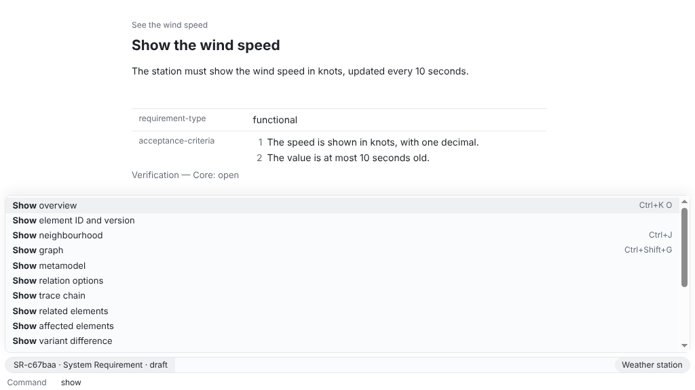
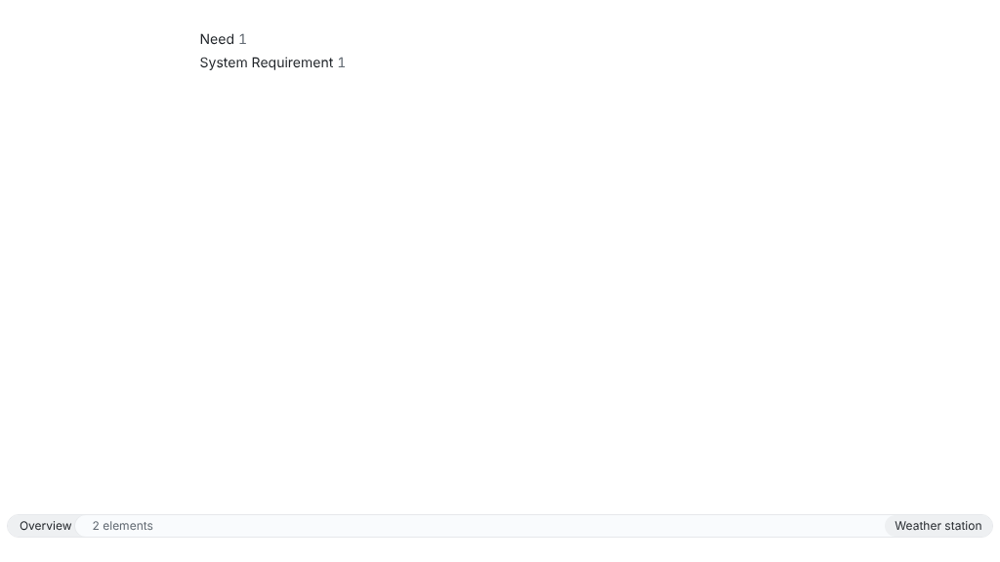

The app works like a text editor: you run everything from one command prompt, and what you open is a buffer. On macOS, read ⌘ for Ctrl and ⌥ for Alt in every key on this page except Ctrl+click.

## Open a workspace

On Windows and Linux the menu bar is hidden until you press Alt. Ctrl+O, the key of **File > Open Workspace…**, opens the folder dialog. **Open workspace** in the command prompt offers the workspaces you opened last, or takes a folder path.

## The command prompt

Ctrl+Shift+P, or a click on the bottom line, opens the command prompt. It lists actions and commands, those for the shown buffer and those you use most first. The search is fuzzy (`tr ch` finds **Show trace chain**). Enter runs the selection, Escape steps back, then closes.

An entry with a key shows it, so the prompt teaches you the keys. The most frequent commands have one of their own, such as Ctrl+Shift+F for **Search elements**; others follow the prefix key Ctrl+K, such as Ctrl+K E for **Create element**. Press Ctrl+K and wait to see the letters that may follow.

The prompt's ReqSeq commands are those of the CLI, the API and MCP, with the same result ([command reference](/reference/commands/)); F1 on one opens its reference page.

## The minibuffer and the modeline

The bottom line is the minibuffer. It shows the last message, and a command that needs input asks there, one argument after another, with the candidates above it. Enter takes an answer, Ctrl+Enter also offers the optional arguments.

Above it, the modeline describes the buffer (a list by filter, sort and count, an element by ID, type, status and hints) and names the workspace.

## Buffers

Lists, search results, elements, neighbourhoods, graphs, matrices, the metamodel and command output each open in a buffer, and opening one again shows it. Ctrl+P goes to any buffer or element by name; Alt+P and Alt+N, like the mouse buttons Back and Forward, go back and forth with a sideways slide. **Close buffer** (Ctrl+K B) saves an element's input first.

A workspace opens on the overview, with the number of elements per type and the elements you opened last; Enter or a click opens a line. Your buffers come back behind it.

**Split window** shows two buffers side by side; the other side previews the element you select in a list or graph, until you work in it. Alt+O switches sides, **Unsplit window** ends the split.

## Context menus

A right-click (on macOS also Ctrl+click) on a row, the text, a field, a graph node or a matrix cell opens the commands for that place, named and keyed as in the prompt. Its last entry, **All commands…**, opens the prompt.

## Help

**Help > ReqSeq Documentation**, or **Open documentation** in the command prompt, opens this documentation, which comes with the app in its version, in your browser without network.

## Light and dark

The app follows your system; **Toggle dark mode** switches until it quits, **Follow system light or dark mode** goes back.

## Following an agent

While an agent works through MCP or the API, **Follow agent** (Ctrl+Shift+O) shows the element it read or changed last, in one buffer that its next step replaces (never one you typed in); in a split window, on the inactive side. Unsaved input holds it back. The modeline says `following agent`, and the same key stops it.

All keys: [keyboard shortcuts](/reference/keyboard-shortcuts/).
