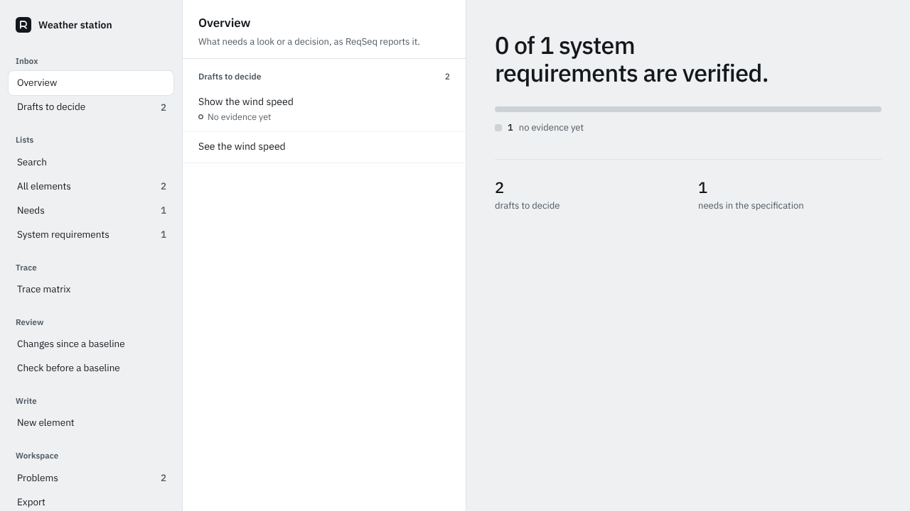
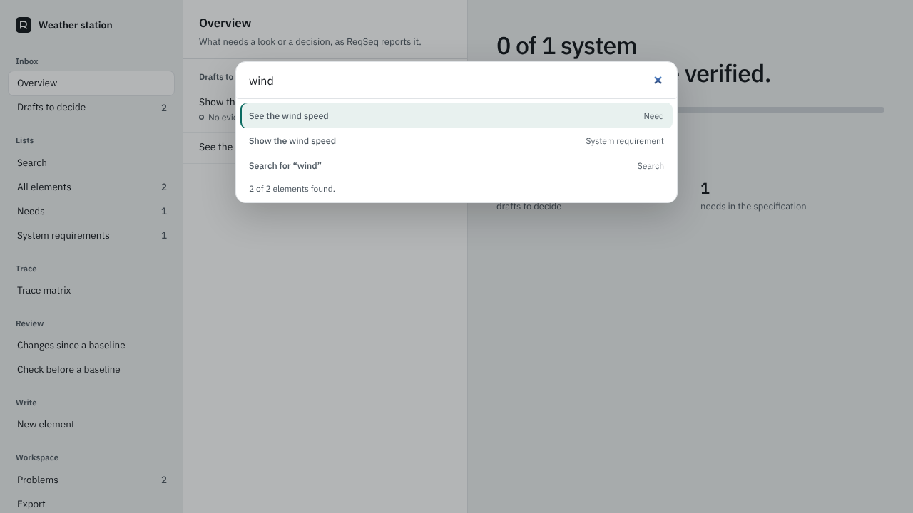

The web UI shows a workspace in your browser. It runs the same commands as the CLI, the API and MCP and shows their results; it has no logic of its own, and it never writes to Git.

## Start it

In a workspace folder, or with `--workspace <folder>`, run `reqseq ui`. It prints its address and opens it in your browser; `--no-open` only prints it, and `--port` chooses the port ([Servers](/reference/commands/servers/)). It runs until Ctrl-C. Only your computer reaches it, and only with the token in the address, which is new on every start. Without a workspace found or named, it starts on the workspaces page. The [desktop shell](/concepts/the-desktop-shell/) shows the same pages in a window of its own.

A change to the files reaches every open page without a reload.

## The rail

The left side lists where to go, with a count where there is one:

- **Inbox:** the overview and its queues, such as the drafts to decide or the links to review.
- **Lists:** search, all elements and one list per type; below it the packages, saved filters and perspectives.
- **Trace:** the trace matrix.
- **Review:** the changes since a baseline and the check before a baseline.
- **Variants:** each variant compared with the core, in a workspace with variants. **View** at the top chooses whether lists and counts show the core or one variant.
- **Write:** a new element.
- **Workspace:** its problems, export, the ReqIF import, the workspaces to open or create, and the settings.

Workspaces open on the overview: queue heads, how much is verified, and how much changed since the newest baseline.

## Find

Ctrl+K (⌘K on macOS) finds a list or an element by name, short ID or title words; Enter opens the marked hit, or searches for the words.

A list narrows by the values on its right, sorts and groups. **Save as filter** and **Save as perspective** keep it for the rail ([Find and filter elements](/how-to/find-and-filter-elements/)).

## An element

An element's page shows its text, properties and acceptance criteria (**Copy** and **Copy all** copy them with test name references), its verification status, and the elements it relates to, in both directions. Its tabs show its **Evidence** per acceptance criterion, its **Trace graph** over one or more levels, and its **Impact**: the elements a change of it can affect. **Edit** opens its form.

## Write

**New element** and **Edit** open a form with a field per property of the type, its acceptance criteria and its relations. In a text, `[[` and a word of a title link another element, and an image you paste or drop is added to the workspace next to the element file ([Write the text of an element](/how-to/write-the-text-of-an-element/)). **Check** shows what ReqSeq would report before you save. A form never changes a status.

## Decide

Only people set a status. An element's page has **Approve**, **Set status** and **Supersede**. **Changes since** (with the name of the baseline) lists what changed since a baseline, word by word, with the same buttons; there you also decide on several at once and change a property of many. Each writes after a confirmation that names what is written ([Review and approve a requirement](/how-to/review-and-approve-a-requirement/)). **Check before a baseline** shows what ReqSeq reports before a baseline, and creates one.

## Settings

**Settings** shows the workspace, its metamodel (read only), how to connect an AI agent, the colours (system, light or dark, kept in this browser) and the version of ReqSeq.
