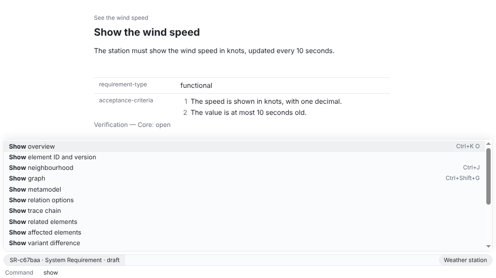

`workspace check` checks the workspace against its metamodel: files, required properties, statuses, missing targets, cycles, duplicate IDs, outdated relations and evidence files. In a pipeline it decides by its exit code whether the step passes.

## App

Not possible in the app: a pipeline runs without one. To see the same findings while you work, run **Check workspace** in the command prompt (Ctrl+Shift+P, ⌘⇧P on macOS).



## CLI

The commands start from a new workspace; in a pipeline, run them in the checkout of yours.

```sh
reqseq workspace init . "Weather station"
reqseq element create need "See the wind speed" --text "As a sailor, I want to see the wind speed before I leave the harbour."
```

```text title="Output"
N-7fe707  draft  See the wind speed  [validation: open]
files:
  need/N-d0e44b7fe707.md
No problems.
```

```sh
reqseq workspace check --fail-on warning
```

```text title="Output"
ok: true
checkedElements: 1
No problems.
```

By default only errors fail the check. `--fail-on warning` lets warnings fail it too, and `--fail-on info` every finding. `--severity` only changes what is shown, never the result.

The exit code is what the pipeline reads:

| Exit code | Meaning |
|---|---|
| 0 | No finding at or above `--fail-on` |
| 1 | A finding at or above `--fail-on`: `ok` is false |
| 2 | Wrong usage or input, such as an unknown option value |
| 3 | Internal error |
| 4 | The revision of `--changed-since` is not in any repository of the workspace |

In a large workspace, check only what a change touches: the elements whose files differ from a Git revision, plus the elements they point to. In a merge request, that is the target branch, for example `--changed-since origin/main`. The pipeline needs the history up to that revision, so fetch it (in GitHub Actions `fetch-depth: 0`). You can also name the files yourself:

```sh
reqseq workspace check --changed-files need/N-d0e44b7fe707.md
```

```text title="Output"
ok: true
checkedElements: 1
No problems.
```

A GitHub Actions job for merge requests, with the CLI tarball of a release at hand in the repository or a cache ([Install ReqSeq](/how-to/install-reqseq/)):

```yaml
jobs:
  requirements:
    runs-on: ubuntu-24.04
    steps:
      - uses: actions/checkout@v4
        with:
          fetch-depth: 0
      - run: npm install -g --offline ./reqseq-cli-<version>.tgz
      - run: reqseq workspace check --changed-since origin/${{ github.base_ref }} --fail-on warning
```

### Gate on evidence

`workspace check` does not fail on missing evidence. To let a pipeline fail while a requirement is not verified at its current version, list the requirements whose verification status is `open`, `failed` or `outdated`, leaving out the obsolete ones, and fail when `total` is not 0:

```sh
reqseq element create system-requirement "Show the wind speed" --text "The station shows the wind speed."
reqseq element list --input '{"selection":{"where":{"all":[{"not":{"status":["obsolete"]}},{"verification":["open","failed","outdated"]}]}}}'
```

```text title="Output"
elements:
  SR-9d35ce  draft  Show the wind speed
total: 1
```

The status counts the newest record of the current version, so a passed test of an older version, or a later failed run, keeps the requirement in the list. It counts a passed record of any method, not only a test, and a requirement without records of its own is `indirect` when its children are verified. `evidence without-passed-test` is not a gate: a passed test of any version takes a requirement off its list. Name the status keys your metamodel marks invalid in the `not` condition. To gate only approved requirements, use `{"status":["approved"]}` instead. The list checks the core; for a variant, add `"view"` to the selection and run it once per variant. In the job, read `total` from `--json`:

```yaml
- run: test "$(reqseq element list --json --input '{"selection":{"where":{"all":[{"not":{"status":["obsolete"]}},{"verification":["open","failed","outdated"]}]}}}' | jq .total)" = 0
```

## API

With the [local API](/concepts/cli-api-and-mcp/#api) running in the workspace:

```http
POST /v1/commands/workspace.check

{ "changedSince": "origin/main", "failOn": "warning" }
```

The answer has status 200 with the check's output, also when the check fails: read `ok` and `problems`. An unknown revision gives an error object with the code `git.commit-not-found` instead.

## MCP

```json
{ "name": "workspace_check", "arguments": { "changedSince": "origin/main", "failOn": "warning" } }
```

The result is the same output; the agent reads `ok` and `problems`. The reference has every option of [workspace.check](/reference/commands/workspace-check/) and the meaning of each [problem code](/reference/problem-codes/).
