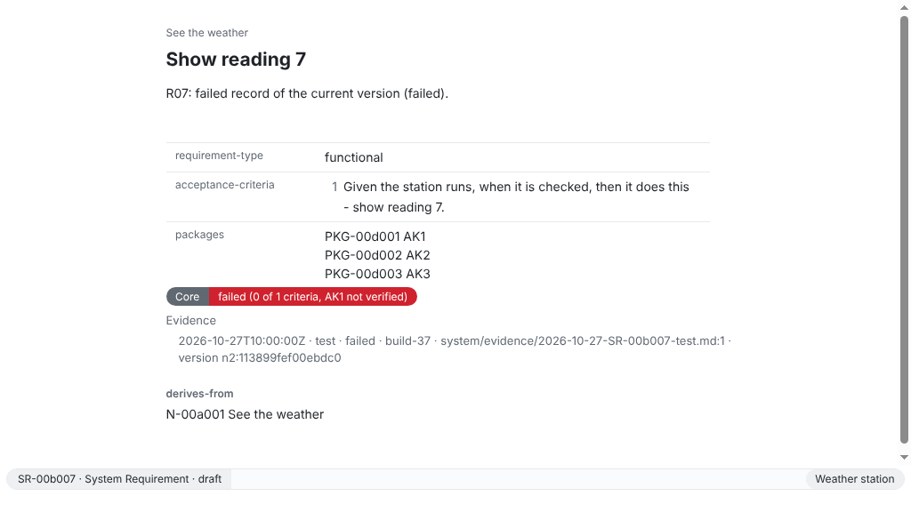

Any test tool that writes JUnit XML (Vitest, pytest, Jest, the Node test runner with `--test-reporter=junit`, Maven, Gradle, CTest and others) can show that requirements are met, without a converter or plugin:

1. Each test names the requirement it checks by its short ID, for example `[SR-c67baa] shows the wind speed`. [Name the requirement in a test](/how-to/name-the-requirement-in-a-test/) has the forms for each tool.
2. The test tool writes its JUnit file into an evidence folder of the workspace, one file per run.
3. ReqSeq enriches the file once: it adds the UUID and the current version of each named requirement, the item under test and the date. [Record test results in CI](/how-to/record-test-results-in-ci/) has the pipeline step for GitHub Actions and GitLab CI.

The tests name only the ID, never the version. When a requirement changes, the next run records the new version, and until then it shows as `outdated`. For tests of a variant, and for the evidence as it stood at a baseline, see [Record evidence for a variant](/how-to/record-evidence-for-a-variant/). Dashboards and other evaluation tools read the requirements with their evidence and status from `reqseq data export`.

The workspace file `reqseq-workspace.yaml` must list the evidence folder, under the name of one of its repositories:

```yaml
evidence:
  - { repository: system, path: evidence }
```

`reqseq workspace status` lists the evidence locations, each with `available: false` when ReqSeq does not read it; `reqseq workspace check` says why.

## App

Run **Enrich JUnit file** in the command prompt (Ctrl+Shift+P, ⌘⇧P on macOS); it asks for the file and the item under test. A file a pipeline writes shows up within seconds.

A requirement's page has a badge for the core and each variant: open, verified, indirect, or in colour failed or outdated, with how many acceptance criteria are verified. A list row shows the status too. **Show evidence status** lists each requirement with its status, **Show evidence coverage** counts per level.



## CLI

The commands start from a new workspace; in yours, use your own short IDs.

```sh
reqseq workspace init . "Weather station"
reqseq element create system-requirement "Show the wind speed" --text "The station must show the wind speed in knots."
```

```text title="Output"
SR-c67baa  draft  Show the wind speed  [verification: core open]
...
```

With the evidence folder in the workspace file:

```yaml title="reqseq-workspace.yaml"
reqseq-workspace: 1
name: Weather station
repositories:
  - name: system
    url: ""
    main: true
metamodel:
  repository: system
  path: metamodel
evidence:
  - { repository: system, path: evidence }
```

A run of the test tool then writes, for example with `vitest run --reporter=junit --outputFile=evidence/ci/results-build-1.xml`:

```xml title="evidence/ci/results-build-1.xml"
<?xml version="1.0" encoding="UTF-8"?>
<testsuites>
  <testsuite name="wind" tests="1" failures="0">
    <testcase classname="wind" name="[SR-c67baa] shows the wind speed in knots" time="0.01"/>
  </testsuite>
</testsuites>
```

After the test run:

```sh
reqseq evidence enrich-junit evidence/ci/results-build-1.xml build-1
```

```text title="Output"
testCases: 1
withoutReference: 0
notInView: 0
unknown: none
files:
  evidence/ci/results-build-1.xml
No problems.
```

`withoutReference` counts the test cases that name no requirement; it does not change the exit code. The command exits with 1 when a test names an ID the workspace does not have, usually a typo, and lists those test cases; the others are still enriched. A test that names a need or another element that is no requirement is enriched too, with an `evidence.kind-mismatch` warning: its result counts for no status, so name the requirement instead, or record the validation of the need with `evidence record`. Commit the enriched file: ReqSeq never commits.

```sh
reqseq evidence status
```

```text title="Output"
elements:
  SR-c67baa  draft  Show the wind speed  [verification: core verified]
total: 1
```

The status is `verified` when the newest result for the current version passed, `failed` when it failed, `outdated` with results for an older version only, and `open` without results. `reqseq evidence coverage` counts the requirements with and without verification.

For a check that is no automated test, such as an inspection, write a verification record by hand. `--criteria` limits it to some acceptance criteria, by key or number (the file holds their keys); without it the record holds for all:

```sh
reqseq evidence record SR-c67baa verification passed --method inspection --item build-1
```

A validation that cannot be judged yet is recorded as `inconclusive`, with the reason, which `evidence status` and `element get` then show:

```sh
reqseq evidence record SR-c67baa validation inconclusive --reason "The field test needs a winter with frost"
```

## API

With the [local API](/concepts/cli-api-and-mcp/#api) running in the workspace, and its token:

```http
POST /v1/commands/evidence.enrichJunit

{ "file": "evidence/ci/results-build-1.xml", "item": "build-1" }
```

```http
POST /v1/commands/evidence.status

{}
```

```http
POST /v1/commands/evidence.record

{ "ref": "SR-c67baa", "kind": "verification", "result": "passed", "method": "inspection", "item": "build-1" }
```

## MCP

```json
{ "name": "evidence_enrichJunit", "arguments": { "file": "evidence/ci/results-build-1.xml", "item": "build-1" } }
```

```json
{ "name": "evidence_status", "arguments": {} }
```

```json
{ "name": "evidence_record", "arguments": { "ref": "SR-c67baa", "kind": "verification", "result": "passed", "method": "inspection", "item": "build-1" } }
```

The reference has every option of [evidence.enrichJunit](/reference/commands/evidence-enrich-junit/), [evidence.status](/reference/commands/evidence-status/), [evidence.coverage](/reference/commands/evidence-coverage/) and [evidence.record](/reference/commands/evidence-record/), and the [JUnit format](/reference/formats/) ReqSeq reads.
