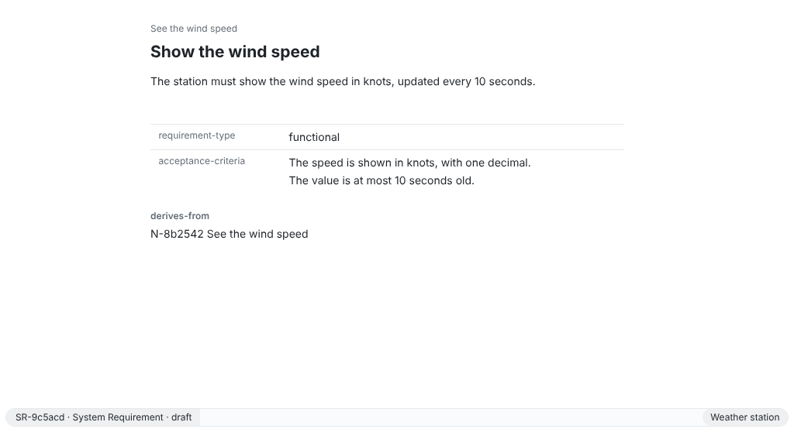
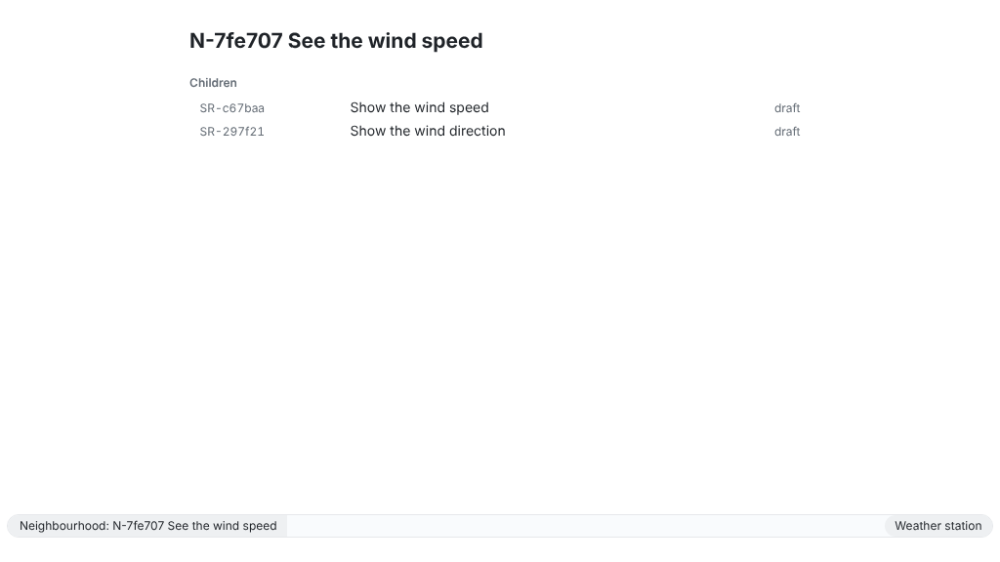
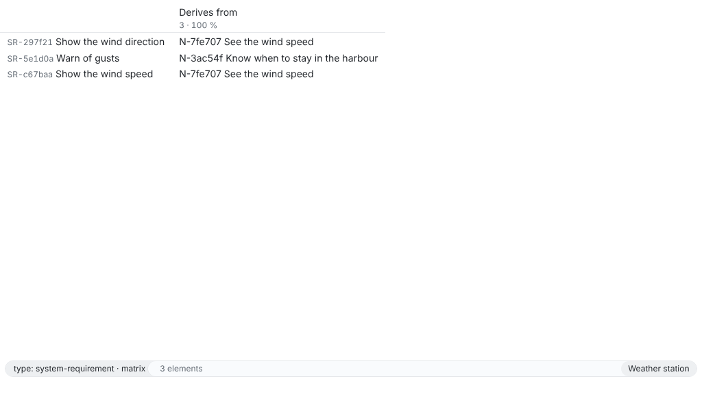

A system requirement traces to the need it meets through a relation stored in its own file. This page links two requirements to a need, follows the chain down, looks up the parents of one requirement and shows the links of the whole workspace as a matrix. The relation keeps the version of the need; when the need changes later, ReqSeq marks the relation as outdated, so you know to review the requirement.

## App

1. Create the need and the requirements with **Create element** (Ctrl+K E, ⌘K E on macOS).
2. In the element buffer of a requirement, run **Create relation** (Ctrl+K R) and choose the kind `derives-from` and the need.
3. Open the command prompt with Ctrl+Shift+P (⌘⇧P) and run **Show trace chain** for the need, or **Show related elements** with `parents` for a requirement. **Show neighbourhood** (Ctrl+J) shows the children of the open element in place.
4. In a list of elements, **Show traceability matrix** (Ctrl+T, ⌘T) shows the list as a matrix, one column per relation kind and direction.







## CLI

The commands start from a new workspace; in yours, use your own short IDs.

```sh
reqseq workspace init . "Weather station"
reqseq element create need "See the wind speed" --text "As a sailor, I want to see the wind speed before I leave the harbour."
```

```text title="Output"
N-7fe707  draft  See the wind speed
...
```

```sh
reqseq element create system-requirement "Show the wind speed" --text "The station must show the wind speed in knots."
```

```text title="Output"
SR-c67baa  draft  Show the wind speed
...
```

```sh
reqseq element create system-requirement "Warn of gusts" --text "The station must warn when a gust exceeds 25 knots."
```

```text title="Output"
SR-5e1d0a  draft  Warn of gusts
...
```

```sh
reqseq relation add SR-c67baa derives-from N-7fe707
reqseq relation add SR-5e1d0a derives-from N-7fe707
reqseq trace chain N-7fe707
```

```text title="Output"
N-7fe707  draft  See the wind speed
children:
  1  ...  [gap: no evidence]
  1  ...  [gap: no evidence]
total: 3
No problems.
```

Both requirements are children of the need; the number is their depth below it, and the order of elements at the same depth may differ. A gap says what is missing, here evidence that the requirement is met.

A relation can also be set in the same call that creates or changes the element, by any reference `relation add` takes, one target or a JSON list per kind:

```sh
reqseq element create system-requirement "Warn of gusts" --relations derives-from=N-7fe707
reqseq element update SR-c67baa --add-relations derives-from='["N-7fe707"]' --remove-relations based-on=D-1a2b3c
```

```sh
reqseq trace related parents --refs SR-5e1d0a
```

```text title="Output"
elements:
  N-7fe707  draft  See the wind speed
total: 1
```

```sh
reqseq trace matrix
```

```text title="Output"
columns:
...
    name: Derives from
    count: 2
...
rows:
...
total: 3
```

`count` says how many rows have a link in a column. With `--json`, each row has its cells: the elements at the other end, each with `outdated`.

## API

Start the API in the workspace with `reqseq serve api`, and send each command with the token of `api.json` as `Authorization: Bearer <token>`:

```http
POST /v1/commands/relation.add

{ "source": "SR-c67baa", "kind": "derives-from", "target": "N-7fe707" }
```

```http
POST /v1/commands/trace.chain

{ "ref": "N-7fe707" }
```

```http
POST /v1/commands/trace.related

{ "direction": "parents", "refs": ["SR-5e1d0a"] }
```

```http
POST /v1/commands/trace.matrix

{}
```

The answer is the output of the command as JSON, the same as `--json` of the CLI.

## MCP

An agent connected to `reqseq mcp` calls the same commands as tools:

```json
{ "name": "relation_add", "arguments": { "source": "SR-c67baa", "kind": "derives-from", "target": "N-7fe707" } }
```

```json
{ "name": "trace_chain", "arguments": { "ref": "N-7fe707" } }
```

```json
{ "name": "trace_related", "arguments": { "direction": "parents", "refs": ["SR-5e1d0a"] } }
```

```json
{ "name": "trace_matrix", "arguments": {} }
```

The reference has every option of [relation.add](/reference/commands/relation-add/), [trace.chain](/reference/commands/trace-chain/), [trace.related](/reference/commands/trace-related/) and [trace.matrix](/reference/commands/trace-matrix/).
