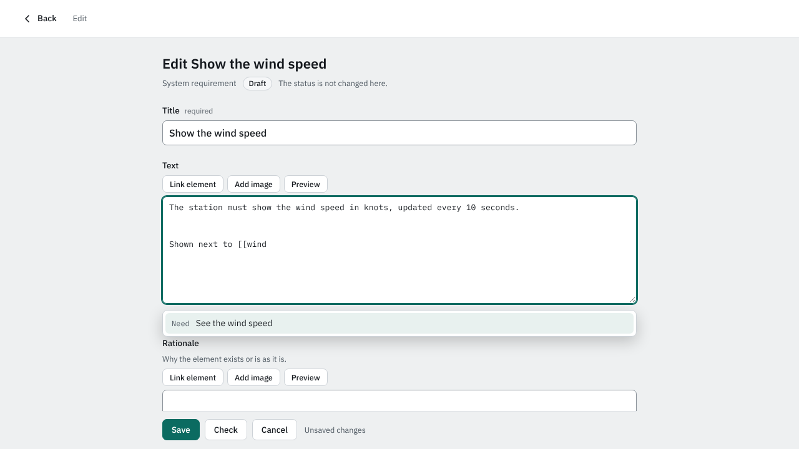

The text of an element is Markdown (CommonMark with the GitHub extensions) in its file, below the properties. The web UI shows it formatted on the element's page and as plain Markdown in its form. ReqSeq writes nothing but plain Markdown, so the file reads the same in any editor and on the Git server. The text counts to the version of the element: a relation to it is marked outdated when the text changes.

## Web UI

1. Open the element and click **Edit**. The text is a field of plain Markdown; **Save** writes it.
2. Type `[[` and a word of a title, or click **Link element**, for a reference to another element, and pick it in the list that opens. The reference keeps the version of its target, so it is marked outdated when the target changes. On the element's page a click on it opens the target.
3. Paste or drop an image file, or click **Add image**. ReqSeq copies the file into a folder next to the element file, named like that file without its extension, and writes a relative Markdown link. The image counts to the version too. An image from the network is never loaded.
4. **Preview** shows the text formatted, as the element's page does.



## CLI

The CLI has no editor: change the file in any text editor, or set the whole text with `--text`. A reference is a Markdown link whose destination is `reqseq:` and a short ID; ReqSeq writes it with the UUID and the version of the target.

```sh
reqseq workspace init . "Weather station"
reqseq element create need "See the wind speed"
```

```text title="Output"
Created Need N-7fe707; 1 file written.
N-7fe707  draft  See the wind speed  [validation: open]
...
```

```sh
reqseq element create system-requirement "Show the wind speed" --text "The station must show the wind speed, as [the need](reqseq:N-7fe707) asks."
```

```text title="Output"
Created System Requirement SR-c67baa; 1 file written; 3 problems.
SR-c67baa  draft  Show the wind speed  [verification: core open]
...
```

```sh
reqseq element get SR-c67baa
```

```text title="Output"
SR-c67baa is of type System Requirement with status draft; 3 problems.
SR-c67baa  draft  Show the wind speed  [verification: core open]
...
  text: |
    The station must show the wind speed, as [the need](reqseq:...) asks.
...
```

`reqseq:N-7fe707` without the Markdown link is no reference, nor is a reference-style link (`[the need][n]` with `[n]: reqseq:N-7fe707`); `workspace check` warns about both (`relation.not-a-link`, `relation.reference-style`).

For an image, `reqseq element add-attachment SR-c67baa --source-path layout.png` copies the file next to the element and prints the Markdown to put into the text.

## API

With the [local API](/concepts/cli-api-and-mcp/#api) running in the workspace, and its token, the text is set as a whole:

```http
POST /v1/commands/element.update

{ "ref": "SR-c67baa", "text": "The station must show the wind speed, as [the need](reqseq:N-7fe707) asks." }
```

An image goes in with `element.addAttachment`, from a file or as base64 `content` with a `name`.

## MCP

An agent connected to `reqseq mcp` calls the same commands as tools:

```json
{ "name": "element_update", "arguments": { "ref": "SR-c67baa", "text": "The station must show the wind speed." } }
```

```json
{ "name": "element_addAttachment", "arguments": { "ref": "SR-c67baa", "sourcePath": "layout.png" } }
```

The reference has every option of [element.update](/reference/commands/element-update/) and [element.addAttachment](/reference/commands/element-add-attachment/).
