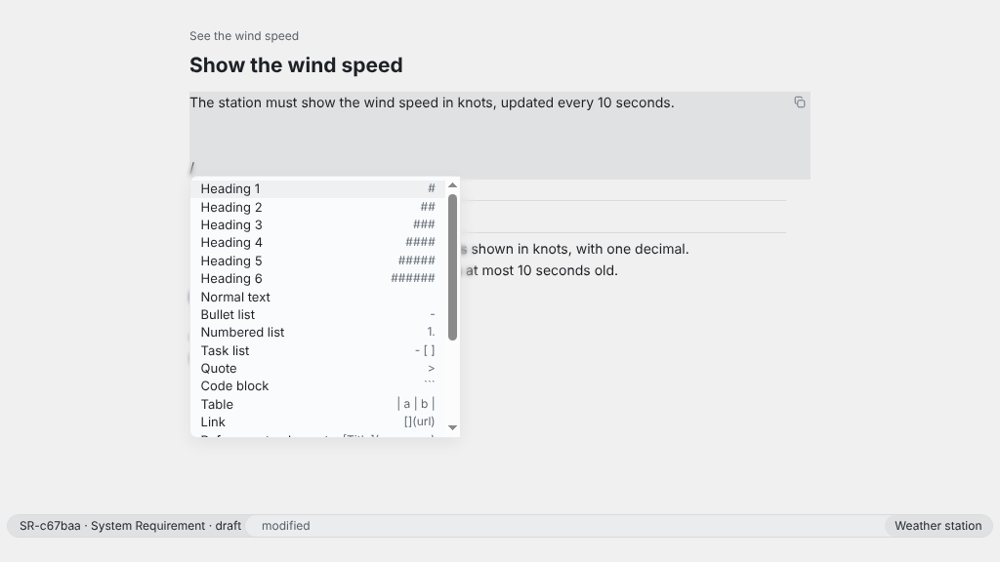

The text of an element is Markdown (CommonMark with the GitHub extensions) in its file, below the properties. The app shows it formatted, with the source of the cursor's line. It writes nothing but plain Markdown, so the file reads the same in any text editor and on the Git server. The text counts to the version of the element: a relation to it is marked outdated when the text changes. The keys are in [In the text editor](/reference/keyboard-shortcuts/#in-the-text-editor); on macOS, read ⌘ for Ctrl and ⌥ for Alt.

## App

1. Open the element with Ctrl+P and press Enter to put the cursor into its text. Ctrl+S saves, Escape leaves the text.
2. Type `/` at the start of a line or after a space for the slash menu: headings, normal text, lists, a task list, a quote, a code block, a math block, a diagram, a table, a link, a reference to an element, an image, bold and italic text, today's date and a calendar. Typing narrows the list, Enter takes the entry.
3. Type `[[` for a reference to another element and pick it in the prompt that opens. The reference keeps the version of its target, so it is marked outdated when the target changes. A click on it opens the target.
4. Paste or drop an image file, or take “Image” in the slash menu. ReqSeq copies the file into a folder next to the element file, named like that file without its extension, and links it relatively. The image counts to the version too. An image from the network is never loaded.
5. Paste formatted text from a browser or a word processor: it arrives as Markdown, never as HTML.
6. In a list, Enter continues it, Tab and Shift+Tab indent and outdent an item with its sub-items, and Alt+Up and Alt+Down move it; you can also drag it with the mouse. A click on the box of a task ticks it, as does the action “Toggle task”.
7. In a table, Tab goes to the next cell and adds a row after the last one. The actions “Align table”, “Insert row”, “Insert column”, “Delete row” and “Delete column” work on the table at the cursor.
8. Tab on a heading folds its section, and again unfolds it; “Go to heading” jumps to one by name. Folding changes only the view, never the file.
9. “Bold” (Ctrl+B), “Italic” (Ctrl+I), “Inline code” and “Link” format the selection, and “Find in element” and “Replace” search the text.



## CLI

The CLI has no editor: change the file in any text editor, or set the whole text with `--text`. A reference is a Markdown link whose destination is `reqseq:` and a short ID; ReqSeq writes it with the UUID and the version of the target.

```sh
reqseq workspace init . "Weather station"
reqseq element create need "See the wind speed"
```

```text title="Output"
N-7fe707  draft  See the wind speed  [validation: open]
...
```

```sh
reqseq element create system-requirement "Show the wind speed" --text "The station must show the wind speed, as [the need](reqseq:N-7fe707) asks."
```

```text title="Output"
SR-c67baa  draft  Show the wind speed  [verification: core open]
...
```

```sh
reqseq element get SR-c67baa
```

```text title="Output"
SR-c67baa  draft  Show the wind speed  [verification: core open]
...
  text: |
    The station must show the wind speed, as [the need](reqseq:...) asks.
...
```

`reqseq:N-7fe707` without the Markdown link is no reference, nor is a reference-style link (`[the need][n]` with `[n]: reqseq:N-7fe707`); `workspace check` warns about both (`relation.not-a-link`, `relation.reference-style`).

For an image, `reqseq element add-attachment SR-c67baa --source-path layout.png` copies the file next to the element and prints the Markdown to put into the text.

## API

With the [local API](/concepts/cli-api-and-mcp/#api) running in the workspace, and its token, the text is set as a whole:

```http
POST /v1/commands/element.update

{ "ref": "SR-c67baa", "text": "The station must show the wind speed, as [the need](reqseq:N-7fe707) asks." }
```

An image goes in with `element.addAttachment`, from a file or as base64 `content` with a `name`.

## MCP

An agent connected to `reqseq mcp` calls the same commands as tools:

```json
{ "name": "element_update", "arguments": { "ref": "SR-c67baa", "text": "The station must show the wind speed." } }
```

```json
{ "name": "element_addAttachment", "arguments": { "ref": "SR-c67baa", "sourcePath": "layout.png" } }
```

The reference has every option of [element.update](/reference/commands/element-update/) and [element.addAttachment](/reference/commands/element-add-attachment/).
