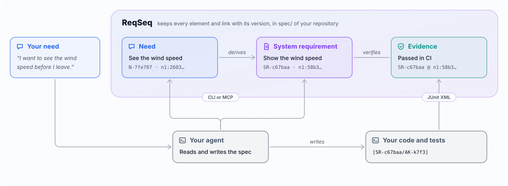
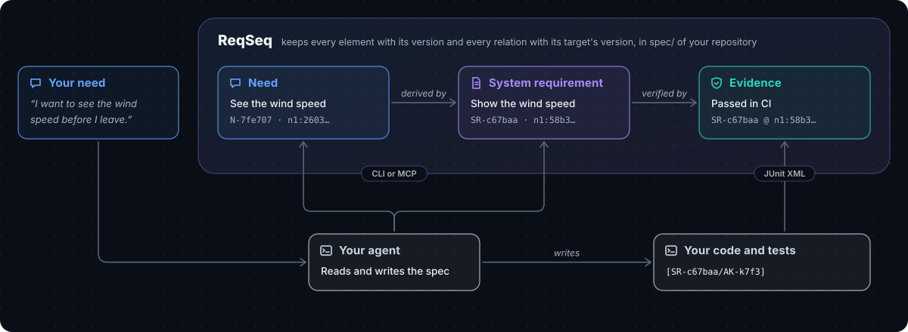
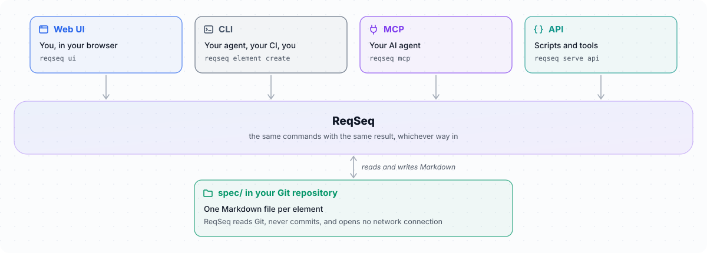
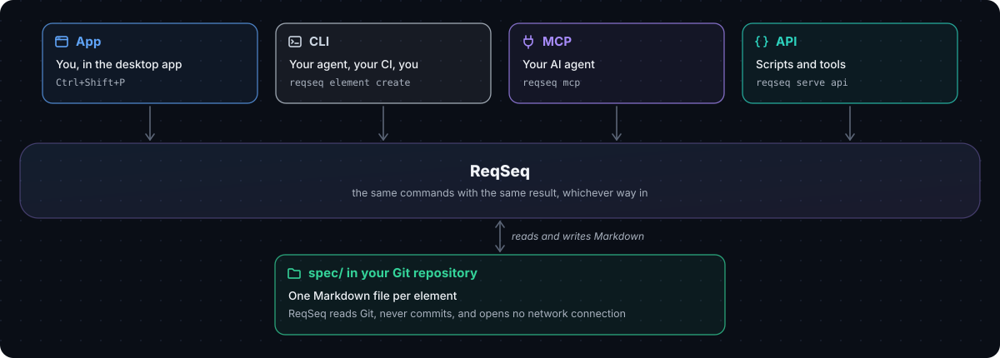
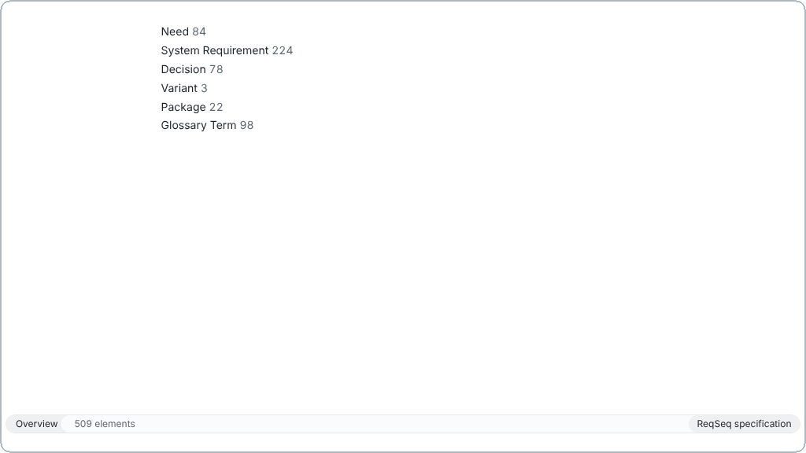

Requirements engineering for agents and people: describe a need in plain words, and your agent breaks it down into system requirements, acceptance criteria and tests, which ReqSeq traces through to the evidence record of each test run.

For spec-driven development, your agent works through ReqSeq's CLI or MCP server: every command reports what your metamodel still misses, such as a parent need or an acceptance criterion, and every relation and evidence record keeps the version it was made against.

The app, CLI, API and MCP run the same commands with the same result, so you can also do all of it by hand; only people approve, and ReqSeq never writes to Git or opens a network connection.

[CLI, API and MCP](/concepts/cli-api-and-mcp/) explains the three ways in besides the app, and [Install ReqSeq](/how-to/install-reqseq/) says how to unpack and start it.

## What it does

- **Plain files.** Each need, use case, system requirement, decision, variant and package is one Markdown file with its properties in the frontmatter, in folders you keep in Git. ReqSeq reads Git but never writes to it, and it never deletes an element: it supersedes it.
- **Your metamodel.** Types, properties, relation kinds and statuses belong to the workspace; a new workspace starts with the standard model. Statuses are set by people; ReqSeq never computes them.
- **Traceability.** A relation keeps the version of its target, so a changed target shows the relation as outdated. Trace chains, related and affected elements, a traceability matrix and a graph.
- **Evidence and coverage.** Verification and validation records, and JUnit XML results of tests that name the requirement they test; coverage, verification degree and the requirements without a passed test.
- **Variants, baselines and exchange.** Variants that exclude or replace requirements of the core, baselines to compare against, ReqIF import and export, and data export.

## Where to read on

New to ReqSeq? [Get started](/start/get-started/) takes you from an empty folder to a first traced requirement. The [command reference](/reference/commands/) shows every command with its input, its output and its call in each of the four ways in. [The app](/concepts/the-app/) explains the command prompt, buffers and the other parts of the desktop app, with its [keyboard shortcuts](/reference/keyboard-shortcuts/). The how-to guides in the menu each show one task in all four, from [connecting an AI agent](/how-to/connect-an-ai-agent/) to [publishing the workspace as HTML](/how-to/publish-the-workspace-as-html/).

The source code, the releases and the issues are on [GitHub](https://github.com/ThomasBirkmaier/ReqSeq).
