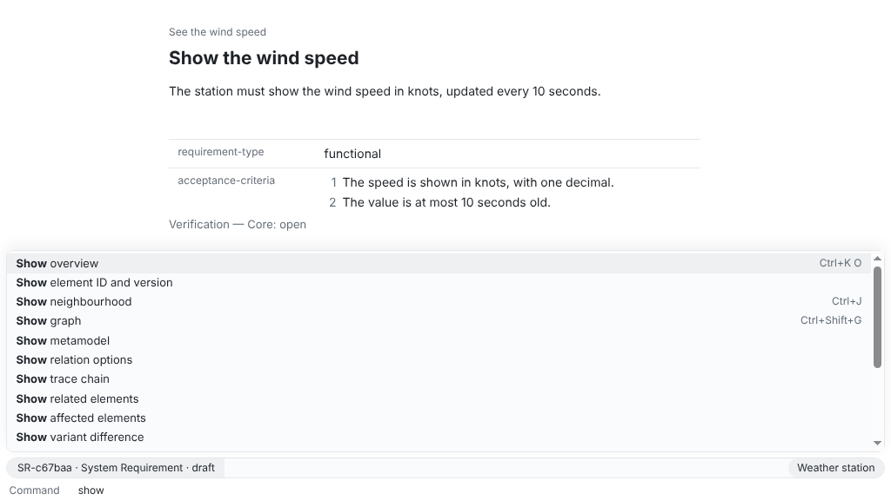
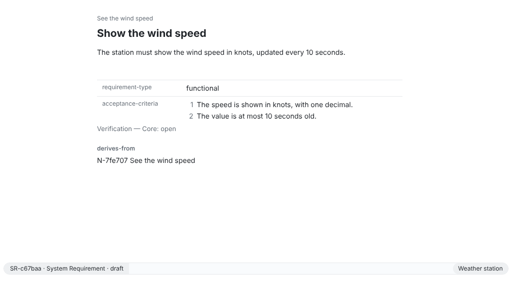
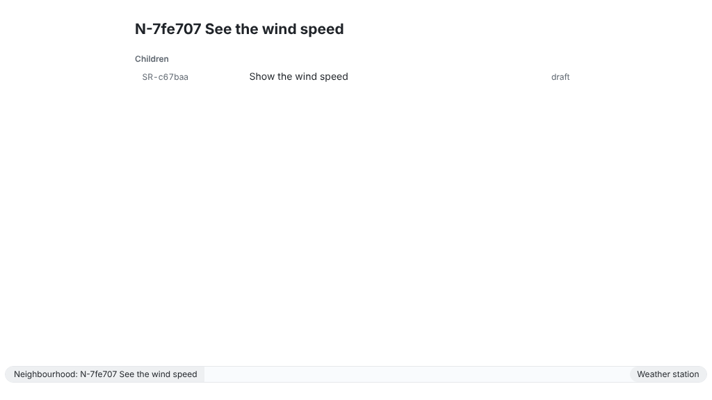
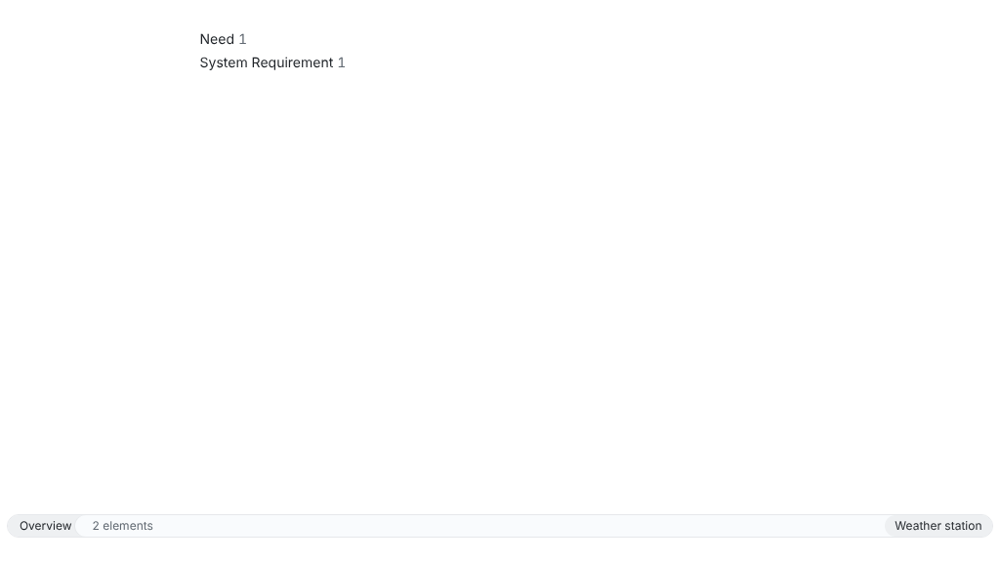

This page creates a workspace with a need and a system requirement derived from it, in the app and on the command line. The commands run when the documentation is built, so they work with its ReqSeq version. On macOS, read ⌘ for Ctrl.

## Install

[Install ReqSeq](/how-to/install-reqseq/), then check that it runs:

```sh
reqseq --version
```

## Create a workspace

A workspace is a folder with a `reqseq-workspace.yaml` and a metamodel, which defines the types of your elements. In an empty folder, run:

```sh
reqseq workspace init . "Weather station"
```

```text title="Output"
files:
  metamodel/standard-model.yaml
  reqseq-workspace.yaml
  .gitignore
No problems.
```

ReqSeq never commits: put the folder under Git yourself.

In the app: Ctrl+O and choose the folder, then run **Initialise workspace** in the command prompt (Ctrl+Shift+P). The command prompt at the bottom asks for the path (`.`) and the name. Details: [Open or create a workspace](/how-to/open-a-workspace/).



## Write a first need

A need says what someone wants. Each element is one Markdown file.

```sh
reqseq element create need "See the wind speed" --text "As a sailor, I want to see the wind speed before I leave the harbour."
```

```text title="Output"
N-7fe707  draft  See the wind speed  [validation: open]
files:
  need/N-d0e44b7fe707.md
No problems.
```

`N-7fe707` is its short ID; use yours in its place below. A new element starts as draft; only people change a status.

In the app: run **Create element** (Ctrl+K E). The command prompt asks for the type (`Need`) and the title. The need opens in its own buffer: press Enter to write its text, and Ctrl+S to save.

## Derive a system requirement

A system requirement says what the system must do to meet the need.

```sh
reqseq element create system-requirement "Show the wind speed" --text "The station must show the wind speed in knots, updated every 10 seconds."
```

```text title="Output"
SR-c67baa  draft  Show the wind speed  [verification: core open]
files:
  system-requirement/SR-58b371c67baa.md
warning  element.missing-required  ...
warning  element.missing-required  ...
warning  trace.no-parent  ...
```

A system requirement also needs a requirement type and acceptance criteria, which ReqSeq never fills in for you: set them in the file or with `reqseq element update SR-c67baa --set requirement-type=functional`. The third, a hint, says that it has no parent yet.

Relate the requirement to the need it derives from, with your own short IDs:

```sh
reqseq relation add SR-c67baa derives-from N-7fe707
```

```text title="Output"
files:
  system-requirement/SR-58b371c67baa.md
No problems.
```

The relation keeps the version of the need. When the need changes, ReqSeq marks the relation as outdated, so you know to review the requirement.

In the app: **Create element** with the type `System Requirement` asks after the title for the requirement type and the acceptance criteria, one per Enter; an empty Enter ends the list or skips the property; **Add property** fills a skipped one later. Then run **Create relation** (Ctrl+K R) on the requirement: Enter takes it as source, choose `Derives from` and type a word of the need's title.



## Look at the chain

```sh
reqseq trace chain N-7fe707
```

```text title="Output"
N-7fe707  draft  See the wind speed
children:
  1  SR-c67baa  draft  Show the wind speed  [gap: no evidence]
total: 2
No problems.
```

The chain runs from the need to its requirements and their evidence records; the gap says that no test shows the requirement yet.

In the app: open the need with Ctrl+P and a word of its title, then press Ctrl+J for its neighbourhood, or run **Show trace chain**.



## Check the workspace

```sh
reqseq workspace check
```

```text title="Output"
ok: true
checkedElements: 2
...
```

`ok: true` means no errors. In a pipeline the command exits with 1 on errors, with `--fail-on warning` on warnings too.

In the app: **Check workspace**. The overview, where a workspace opens, counts the elements per type.



## The same through the API and MCP

Each step is a command with the same result in the app, the CLI, the [local API](/concepts/cli-api-and-mcp/#api) (`POST /v1/commands/element.create`) and the [MCP server](/concepts/cli-api-and-mcp/#mcp) (tool `element_create`); the [command reference](/reference/commands/) shows all four. [Write the text of an element](/how-to/write-the-text-of-an-element/) shows the app's text editor.
