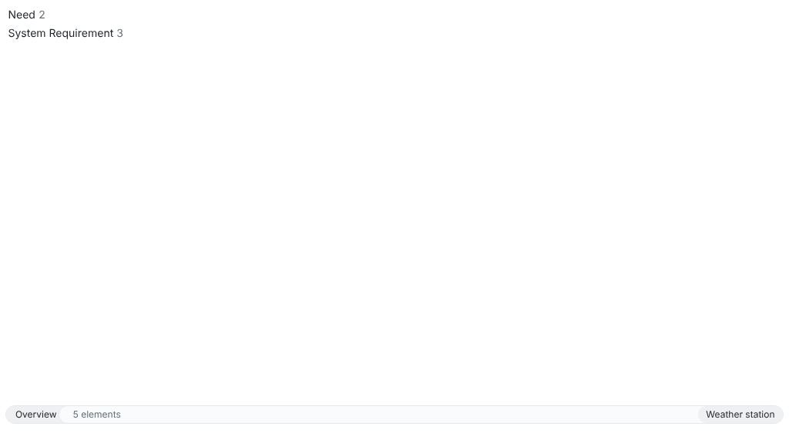
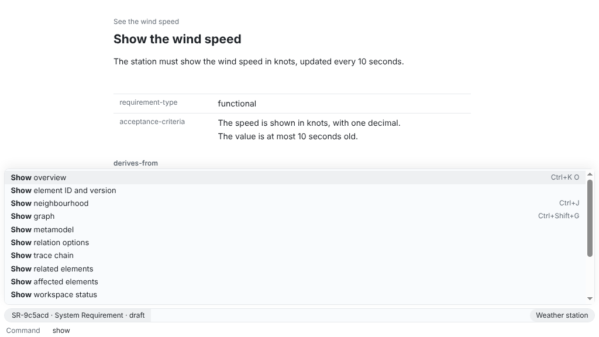

At the end of this page you have a workspace with a need, a system requirement derived from it and the trace chain between them. Every command on this page runs when the documentation is built, so it works with the version the documentation belongs to.

## Install

Unpack the delivery for your system and put `reqseq` on your path: [Install ReqSeq](/how-to/install-reqseq/) says how. Then check that it runs:

```sh
reqseq --version
```

## Create a workspace

A workspace is a folder with a `reqseq-workspace.yaml` and a metamodel: the types, properties, relation kinds and statuses of your elements. Make an empty folder, open a terminal in it and run:

```sh
reqseq workspace init . "Weather station"
```

```text title="Output"
files:
  metamodel/standard-model.yaml
  reqseq-workspace.yaml
No problems.
```

ReqSeq reads Git but never commits. Put the folder under Git yourself when you want its history.

In the app: open the command prompt with Ctrl+Shift+P (⌘⇧P on macOS) and run **Initialise workspace**. The reference has the details of [workspace.init](/reference/commands/workspace-init/).





## Write a first need

A need says what someone wants, in their own words. Each element is one Markdown file in the workspace.

```sh
reqseq element create need "See the wind speed" --text "As a sailor, I want to see the wind speed before I leave the harbour."
```

```text title="Output"
N-7fe707  draft  See the wind speed
files:
  need/N-d0e44b7fe707.md
No problems.
```

`N-7fe707` is the short ID of the need. Yours differs: use it in place of `N-7fe707` below. A new element starts as draft. Only people change a status; ReqSeq never does.

In the app: **Create element**. Reference: [element.create](/reference/commands/element-create/).

## Derive a system requirement

A system requirement says what the system must do to meet the need.

```sh
reqseq element create system-requirement "Show the wind speed" --text "The station must show the wind speed in knots, updated every 10 seconds."
```

```text title="Output"
SR-c67baa  draft  Show the wind speed
files:
  system-requirement/SR-58b371c67baa.md
warning  element.missing-required  ...
warning  element.missing-required  ...
```

The two warnings say that a system requirement also needs a requirement type and acceptance criteria. Fill them in later, in the file or in the app; ReqSeq never fills them in for you.

Now link the requirement to the need it derives from, again with your own short IDs:

```sh
reqseq relation add SR-c67baa derives-from N-7fe707
```

```text title="Output"
files:
  system-requirement/SR-58b371c67baa.md
No problems.
```

The relation is stored in the file of the requirement, with the version of the need it points to. When the need changes later, ReqSeq shows the relation as outdated, so you know to review the requirement. In the app, the mark "link outdated" stands at the other end of the link: on the requirement next to the need, and in the neighbourhood of the need next to the requirement. Both mark the same relation; the hover text says which element points to an older version of which.

In the app: **Create relation**. Reference: [relation.add](/reference/commands/relation-add/).


## Look at the chain

```sh
reqseq trace chain N-7fe707
```

```text title="Output"
N-7fe707  draft  See the wind speed
children:
  1  SR-c67baa  draft  Show the wind speed  [gap: no evidence]
total: 2
No problems.
```

The chain runs from the need down to its requirements and on to their evidence. The gap says that no test or other evidence shows the requirement yet.

In the app: **Show trace chain**, or **Show neighbourhood** (Ctrl+J) on the need. Reference: [trace.chain](/reference/commands/trace-chain/).


## Check the workspace

```sh
reqseq workspace check
```

```text title="Output"
ok: true
checkedElements: 2
...
```

`ok: true` means there are no errors. The warnings about the two empty properties stay until you fill them in. In a pipeline, the command exits with 1 when there are errors; with `--fail-on warning`, warnings count too.

In the app: **Check workspace**. Reference: [workspace.check](/reference/commands/workspace-check/).

## The same through the API and MCP

Every step on this page is a command, and the app, the CLI, the API and the MCP server give the same result for it. The local API (`reqseq serve api`) runs a command as `POST /v1/commands/element.create`. The MCP server (`reqseq mcp`) offers it as the tool `element_create`. The [command reference](/reference/commands/) shows the call of every command in each of the four.
