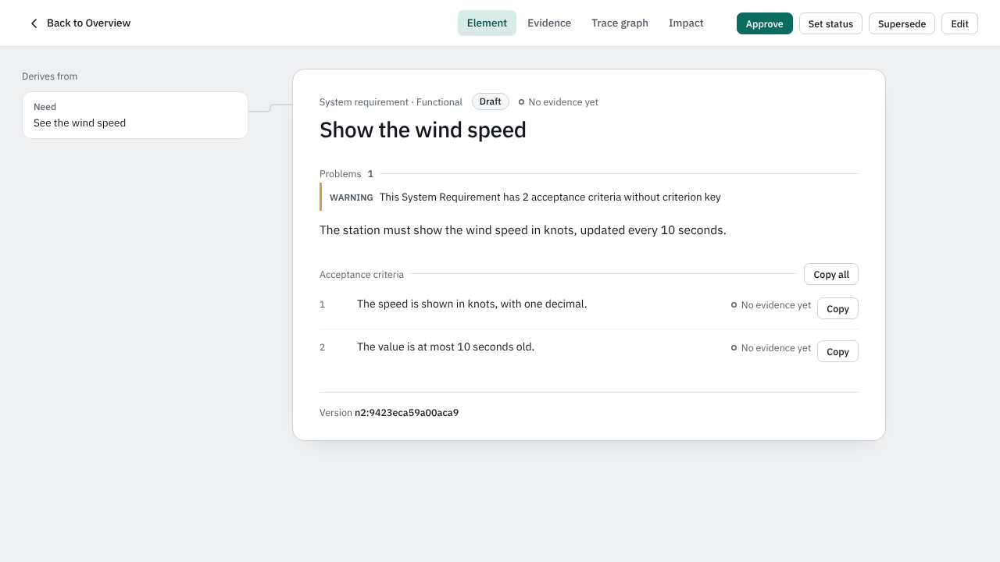
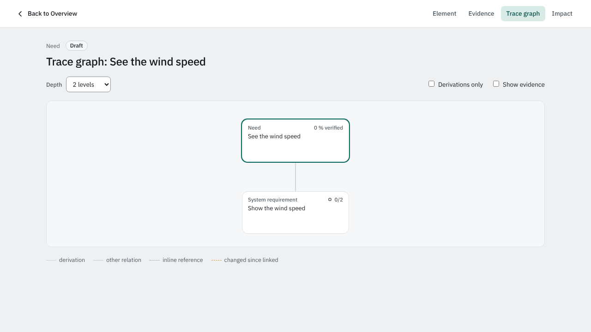
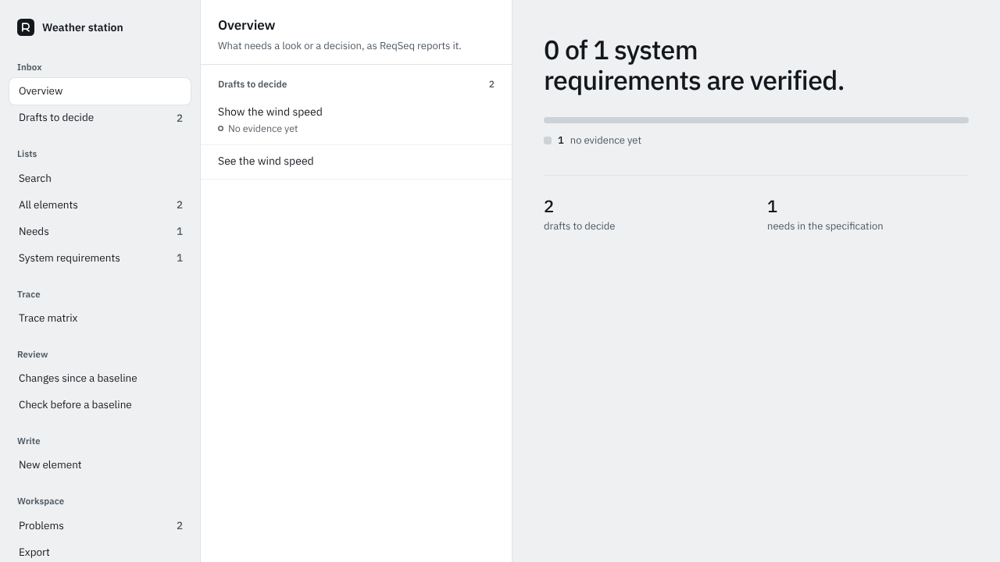

This page creates a workspace with a need and a system requirement derived from it, on the command line and in the web UI. The commands run when the documentation is built, so they work with its ReqSeq version.

## Install

[Install ReqSeq](/how-to/install-reqseq/), then check that it runs:

```sh
reqseq --version
```

## Create a workspace

A workspace is a folder with a `reqseq-workspace.yaml` and a metamodel, which defines the types of your elements. In an empty folder, run:

```sh
reqseq workspace init . "Weather station"
```

```text title="Output"
Created workspace Weather station; 6 files written.
files:
  metamodel/standard-model.yaml
  reqseq-workspace.yaml
  evidence/.gitkeep
  .gitignore
  .claude/skills/managing-requirements/SKILL.md
  .agents/skills/managing-requirements/SKILL.md
No problems.
next:
  reqseq workspace connect-agent --client <client>  Connect AI agent
  reqseq element create <type> <title>              Create element
```

Next, **Connect AI agent** prints the setup for your AI agent's client ([Connect an AI agent](/how-to/connect-an-ai-agent/)).

ReqSeq never commits: put the folder under Git yourself.

In the web UI: `reqseq ui` outside a workspace starts on the workspaces page. Under **Create a workspace**, type the full path of the folder and the name, then click **Create and open**. Details: [Open or create a workspace](/how-to/open-a-workspace/) and [The web UI](/concepts/the-web-ui/).

## Write a first need

A need says what someone wants. Each element is one Markdown file.

```sh
reqseq element create need "See the wind speed" --text "As a sailor, I want to see the wind speed before I leave the harbour."
```

```text title="Output"
Created Need N-7fe707; 1 file written.
N-7fe707  draft  See the wind speed  [validation: open]
files:
  need/N-d0e44b7fe707.md
No problems.
```

`N-7fe707` is its short ID; use yours in its place below. A new element starts as draft; only people change a status.

In the web UI: click **New element** in the rail, choose the type Need, type the title and the text, and click **Create**.

## Derive a system requirement

A system requirement says what the system must do to meet the need.

```sh
reqseq element create system-requirement "Show the wind speed" --text "The station must show the wind speed in knots, updated every 10 seconds."
```

```text title="Output"
Created System Requirement SR-c67baa; 1 file written; 3 problems.
SR-c67baa  draft  Show the wind speed  [verification: core open]
files:
  system-requirement/SR-58b371c67baa.md
warning  element.missing-required  ...
warning  element.missing-required  ...
warning  trace.no-parent  ...
```

A system requirement also needs a requirement type and acceptance criteria, which ReqSeq never fills in for you: set them in the file or with `reqseq element update SR-c67baa --set requirement-type=functional`. `trace.no-parent` says it has no parent yet.

Relate the requirement to the need it derives from, with your own short IDs:

```sh
reqseq relation add SR-c67baa derives-from N-7fe707
```

```text title="Output"
Added a derives-from relation from SR-c67baa to N-7fe707; 1 file written.
files:
  system-requirement/SR-58b371c67baa.md
No problems.
```

The relation keeps the version of the need, so a changed need shows the relation as outdated.

In the web UI: **New element** with the type System requirement also has fields for the requirement type and the acceptance criteria, one per entry. Under **Derives from**, type a word of the need's title and pick it; **Create** writes the requirement with its relation.



## Look at the chain

```sh
reqseq trace chain N-7fe707
```

```text title="Output"
The chain of N-7fe707 has 2 elements; 1 gap.
N-7fe707  draft  See the wind speed
children:
  1  SR-c67baa  draft  Show the wind speed  [gap: no evidence]
total: 2
No problems.
```

The chain runs from the need to its requirements and their evidence records; the gap says no test shows the requirement yet.

In the web UI: press Ctrl+K (⌘K), type a word of the need's title, open it, and click its **Trace graph** tab.



## Check the workspace

```sh
reqseq workspace check
```

```text title="Output"
Checked 2 elements and found 2 warnings and 1 info.
ok: true
checkedElements: 2
...
```

`ok: true` means no errors. In a pipeline the command exits with 1 on errors, with `--fail-on warning` on warnings too.

In the web UI: **Problems** in the rail lists what the check reports. The overview, where a workspace opens, shows the drafts to decide and how many system requirements are verified.



## The same through the API and MCP

Each step is a command with the same result in the CLI, the [local API](/concepts/cli-api-and-mcp/#api) (`POST /v1/commands/element.create`) and the [MCP server](/concepts/cli-api-and-mcp/#mcp) (tool `element_create`), and the web UI runs the same commands; the [command reference](/reference/commands/) shows the first three. [Write the text of an element](/how-to/write-the-text-of-an-element/) shows how to write a text in the web UI.
