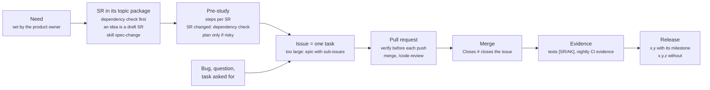

# Way of working

How work on ReqSeq goes from a need to a release (product owner decision, 2026-11-07). The rules are in `CLAUDE.md` (Issues, Traceability) and the skills it names; this page is their picture.

## Dependency check

Every spec change and every fix of a bug against an AK starts with a check of what it touches; trace finds relations and inline references, the text search finds the words (product owner decision, 2026-11-09).

| Path | Check | Then |
| --- | --- | --- |
| New or changed requirement, decision or glossary term | `trace affected`, `hint list`, one `element search` per term and synonym (`spec-change`) | Risky (CLAUDE.md, How we work): concept with edge cases, review by `fable-reviewer` (spec and issues), decision card. Otherwise questions, then the spec PR, which names each touchpoint. |
| Bug against an AK | `trace related` parents and children, one `element search` per term of the AK (CLAUDE.md, Issues) | Fix it. A fix that needs an interpretation of the AK wording becomes a `question`. |
| Bug without an SR | none | Fix it. |
| Spec review, only when the product owner asks | `fable-reviewer` (prompt: `Case: spec review`, the packages, the result file) reads them and writes a finding list | An Opus agent at effort high checks each finding against code and tests; decision cards; one spec PR; implementation gaps become `bug` issues (#1298). |
| Pre-study of a planned SR | the steps; when they change the SR, the first row | Issues for the steps the product owner chooses. |

## Issues

| What | Rule |
| --- | --- |
| Scope | One task that one PR finishes. Several PRs: an `epic` with sub-issues. |
| Title | English, what is different afterwards or what is wrong, keyword first, about 70 characters, no prefix. |
| Body | Opens with 1–3 sentences without jargon. `SR: SR-112 (AK1, AK2)` when it implements or breaks an AK. |
| Milestone | Only when version x.y needs it. |
| Closing | The merged PR, with `Closes #`. Without a PR only with the product owner's approval. |

## Labels

Exactly one type, area and priority per open issue; `scripts/labels.sh` holds the list and its descriptions.

| Axis | Values | On every open issue |
| --- | --- | --- |
| Type | `bug`, `feature`, `task`, `question` | exactly one |
| Area | `core`, `cli`, `api`, `mcp`, `app`, `spec`, `dev` | exactly one, where the main change is |
| Priority | `P1` must, `P2` should, `P3` could | exactly one |
| Waiting | `needs-human` | while it waits for the product owner |
| Structure | `epic`, `agent:working` | when it applies |

`nightly-check` opens an issue when a nightly run of CI or Performance is red. `evidence` opens one when the verification degree of a view falls. Workflows set `main-red`, `perf`, `dependencies` and `github_actions`; `issue-working` also sets `agent:working` on the issues a PR closes and removes it when the PR is closed. The board (`project-sync`) shows Category (type, or Epic), Area, Priority, Agent state and Status from these labels; its old fields Stage, Kind, Thema and SR are no longer written.

## Skills

| Step | Read first |
| --- | --- |
| Change the spec | `spec-change` |
| Push a change | `verify` |
| Open, review and merge a PR; release | `merge` |
