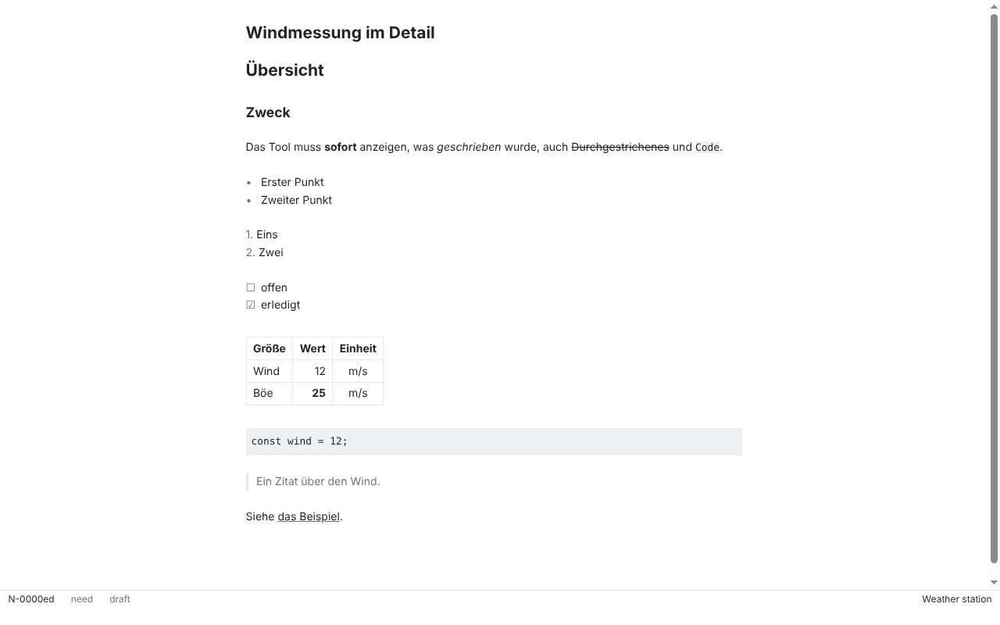
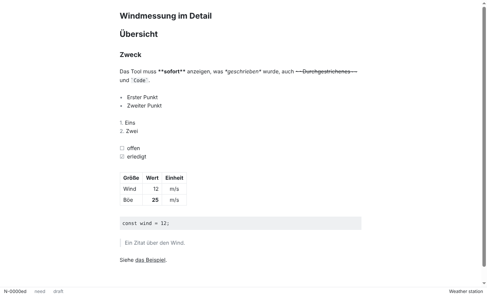
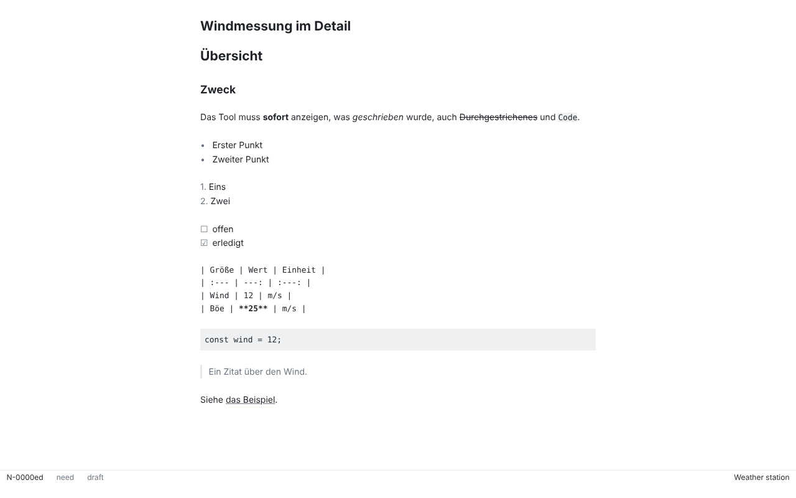
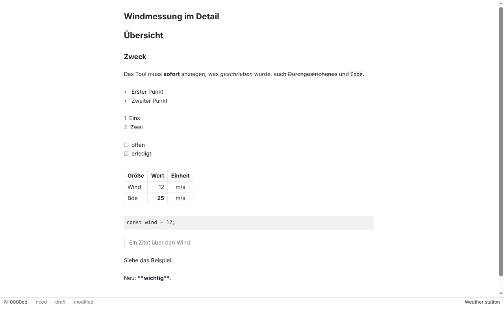
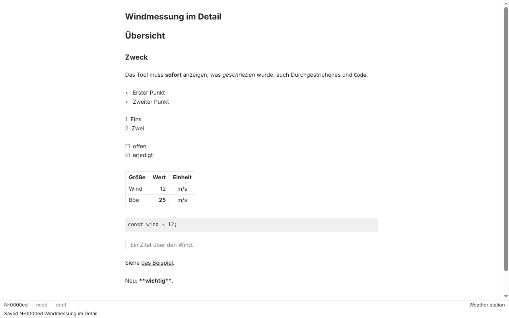
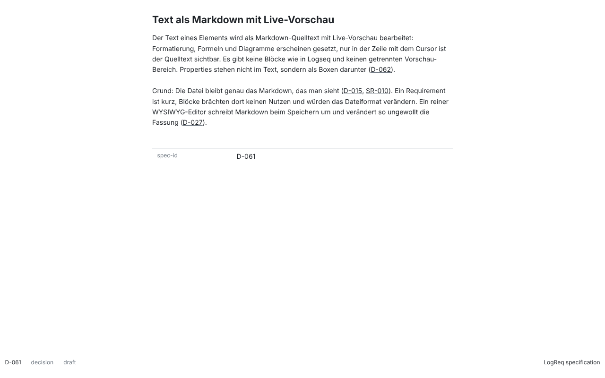

# SR-065: Text im Markdown-Editor schreiben

Verification method: Demonstration. Record written by an agent (Claude Code) on 2026-10-26 for issue #77, branch `sr-065-markdown-editor`. **Confirmed** by the product owner at the stage 3 acceptance (product owner decision, 2026-10-29).

> Das Tool muss den Text eines Elements in einem Markdown-Editor mit Überschriften, Hervorhebungen, Listen, Tabellen, Code-Blöcken und sofortiger Vorschau bearbeiten lassen.

## The reading (decision D-061, assumptions A1 to A3)

D-061: "Der Text eines Elements wird als Markdown-Quelltext mit Live-Vorschau bearbeitet: Formatierung, Formeln und Diagramme erscheinen gesetzt, nur in der Zeile mit dem Cursor ist der Quelltext sichtbar. Es gibt keine Blöcke wie in Logseq und keinen getrennten Vorschau-Bereich. Properties stehen nicht im Text, sondern als Boxen darunter (D-062)."

So "sofortige Vorschau" is the live preview in the same view: the text is Markdown source, the formatting appears set, and only the lines the cursor touches show their source. The editor never rewrites the Markdown (D-027): the preview only decorates the document, and the file holds exactly what is in the editor (core adds the final line break, ADR-0004). Formulas and diagrams (#108), images (#109), `[[` link search (#78) and the property boxes (#400) are separate issues; the editor has extension points for them.

- **A1** (spec question #420, option 1): a table shows its whole source while the cursor is in any of its rows, because a row cannot be shown set while the next one is source. Code block content is source anyway; only its fences are hidden.
- **A2**: the text is saved explicitly with Ctrl/Cmd+S (action "Save element", `element.update`). Autosave comes with #401. A draft keeps the text, the file text and the bytes of the file it was typed on; a file changed outside under unsaved text follows the rule of SR-106 (#402, `packages/app/README.md`): nothing is saved until the user chooses which version holds. Changes made outside the app are read again when core's watcher reports them (SR-116, #412). quitting the app with unsaved text loses it. `element.update` has no `repository` input, so an element whose UUID exists in two repositories (SR-088) cannot be saved (the error is shown); see the follow-up on #348.
- **A3**: Enter on the element puts the cursor into the text, Escape comes back to the element (the keys of the buffer, SR-073).

## AK1: headings, emphasis, lists, tables and code blocks with an immediate preview

> Gegeben der Editor, wenn Text geschrieben wird, dann unterstützt er Überschriften, Hervorhebungen, Listen, Tabellen und Code-Blöcke mit sofortiger Vorschau.

### What was demonstrated

On a demo element (a German sample text, fixture content, not spec text) with every construct: headings level 1 and 2, `*emphasis*`, `**strong**`, `~~strikethrough~~`, `inline code`, a bullet list, an ordered list, a task list, a table with alignment and emphasis in a cell, a fenced code block, a block quote and a link.

1. The element is opened and the editor is not focused: every construct is set and none of its Markdown characters is visible (`editor-preview.png`).
2. The cursor is placed in the line with the strong text: that line shows its source (`**sofort**`, `~~Durchgestrichenes~~`), every other line stays set (`editor-cursor-line.png`).
3. The cursor is placed in the table: the table shows its source (A1) (`editor-table-source.png`).
4. Text is typed: the modeline says `modified` (`editor-modified.png`). Ctrl/Cmd+S saves it: the minibuffer says `Saved <ID> <title>` and `modified` is gone (`editor-saved.png`).
5. On a decision of the specification (D-061) the inline references, `[D-062](logreq:...?version=...)`, read as their text, underlined; the source is not shown (`editor-spec-element.png`).

### How

- The Playwright test `[SR-065/AK1] the editor shows headings, emphasis, lists, tables and code blocks set, and the source only on the cursor line` (`packages/app/test/editor.spec.ts`) checks 1 to 3 on the built app: the preview classes and the table widget are there, none of `**`, `~~`, a code fence, `# `, `| :`, `](` or `> ` is visible, the source of exactly the cursor line appears, and the table widget is replaced by its source and back.
- The screenshots (1280×800, Linux, Electron 44, Xvfb) come from `packages/app/test/editor-screenshots.spec.ts`.
- The unit tests (100 % of the code) cover the decorations of every construct with and without the cursor on the line (`editor/preview.test.ts`).

### Result

Headings, emphasis, lists, tables and code blocks are typed as Markdown and appear set at once, without a preview pane; the source shows only on the cursor lines. This matches AK1 under D-061 and is confirmed.

## AK2: the saved file is CommonMark with GitHub extensions

> Gegeben eine Datei, die im Editor bearbeitet wurde, wenn sie in einem Texteditor geöffnet wird, dann ist sie gültiges CommonMark mit GitHub-Erweiterungen.

### What was demonstrated

A text with headings, emphasis, strong, strikethrough, inline code, a link, an inline reference to another element, a bullet list (the second item made by Enter, which continues the list), an ordered list, a task list, a table with alignment, a fenced code block with an info string and a block quote is written in the editor and saved. The element file is read from disk:

1. the front matter is byte-identical to before;
2. the body is exactly the text that was typed, plus the final line break that core adds (ADR-0004); the inline reference got its `?version=...` from core (ADR-0004), nothing else changed;
3. an independent reference parser, `micromark` with `micromark-extension-gfm` (dev dependency, not the editor's own parser), turns the body into the expected HTML: `<h1>`, `<em>`, `<strong>`, `<del>`, `<code>`, `<ul>`, `<ol>`, task list checkboxes (checked and unchecked), `<table>` with `align`, `<pre><code class="language-ts">`, `<blockquote>`, `<a href>`;
4. `element get` (CLI) gives the same text as the file (SR-080).

### How

- The unit test `[SR-065/AK2] a text written in the editor is saved as it is and parses as CommonMark with GitHub extensions` (`packages/app/src/renderer/editor/round-trip.test.ts`) builds the text with input transactions on the editor state with the editor's Markdown extensions, saves it with the public `invoke("element.update")` of core on a copy of a fixture workspace and checks 1 to 4.
- The Playwright test `[SR-065/AK2] a text typed in the app is saved with Ctrl/Cmd+S and the file is CommonMark with GitHub extensions` does the same in the built app with real key presses (one Enter for the list continuation, then `Ctrl/Cmd+S`) and reads the file and the CLI.
- **A human repeats it** by writing some Markdown in the editor, saving with Ctrl/Cmd+S, opening the element file in a text editor and on GitHub: the text there is the Markdown that was typed.

### Result

The file holds exactly what was typed, and the reference parser reads every construct as CommonMark with GitHub extensions. This matches AK2 and is confirmed.

## Further checks

- Undo (Ctrl/Cmd+Z) goes back one step and redo (Ctrl/Cmd+Shift+Z) forward (Playwright). The Undo item of the Edit menu, which is the native role, also goes back one step (Playwright, through the menu item). **By hand (the product owner, once, on macOS and Windows or Linux):** type a few words in separate bursts, press the real keys Ctrl/Cmd+Z and check that exactly one burst goes away, not two. The Playwright keys do not pass the menu accelerators.
- Nothing from a file is interpreted as HTML (the widgets use text nodes; a test shows `<b>` in a table cell as text), links are not followed, and the app makes no request while the editor is used (Playwright, `[SR-078]` style check of the request log; the Content Security Policy is unchanged and the test fails on any violation in the console).
- Unsaved text is kept per buffer while another buffer is shown (modeline `modified`), "Close buffer" asks once and discards when repeated, opening another workspace drops all drafts.
- The interim reload message "your unsaved changes are kept. Saving overwrites the file." is replaced by the rule of SR-106 (#402): the block "On disk" and "Resolve change on disk".

## Screenshots

| | |
| --- | --- |
|  |  |
|  |  |
|  |  |

## Known limits of this record

- Properties and relations stay read-only boxes and lists below the text (#400). Formulas, diagrams, images, `[[` link search, clickable links and syntax colouring inside code blocks are not part of this issue.
- A table that does not start a line (inside a list item or a quote) shows its source always.
- Checked on Linux only; the macOS and Windows runs of the Electron tests are the CI's.
- The `[SR-100/AK1]` test was changed for the editor: the one `textbox` of the sheet is the text editor, `article .cm-content` (`verification/SR-100.md` says so).
