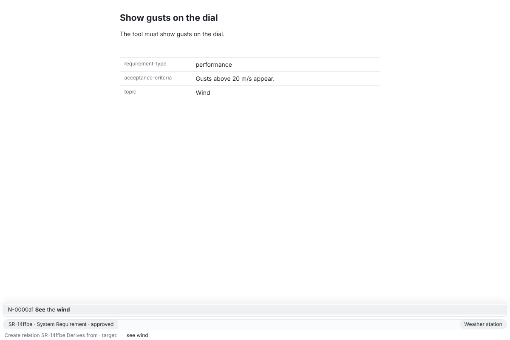
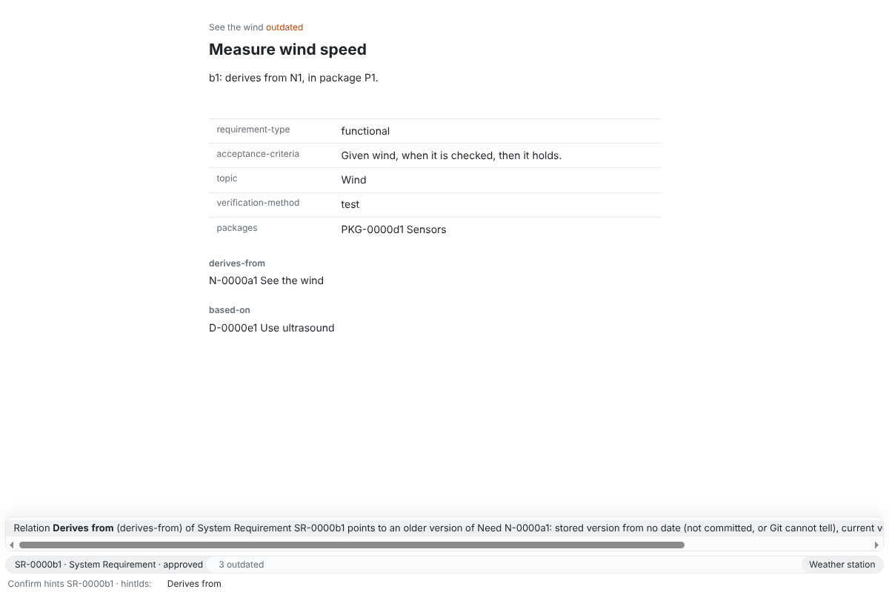
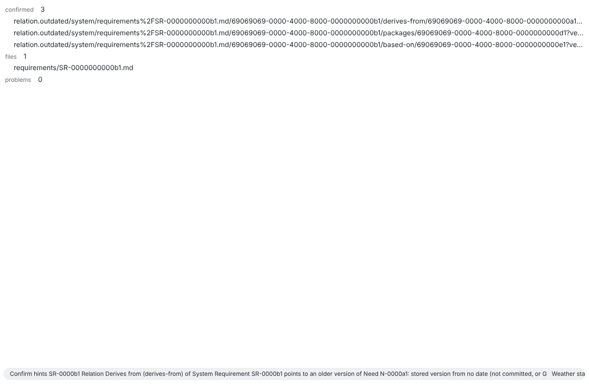
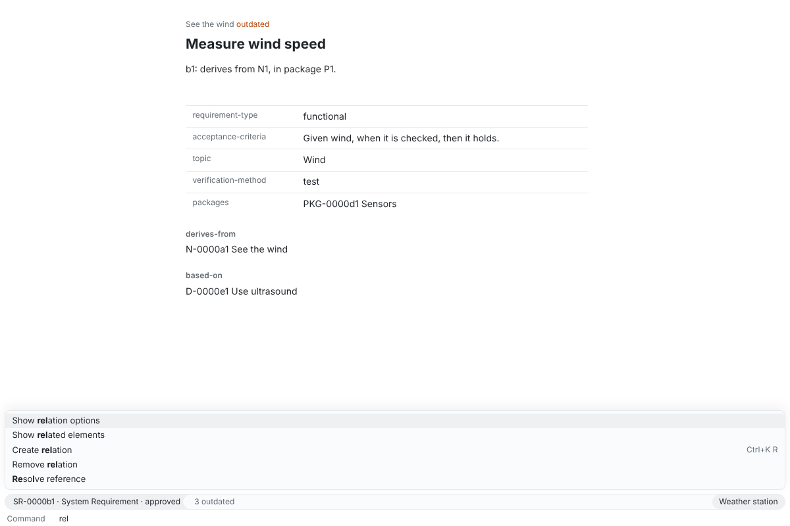
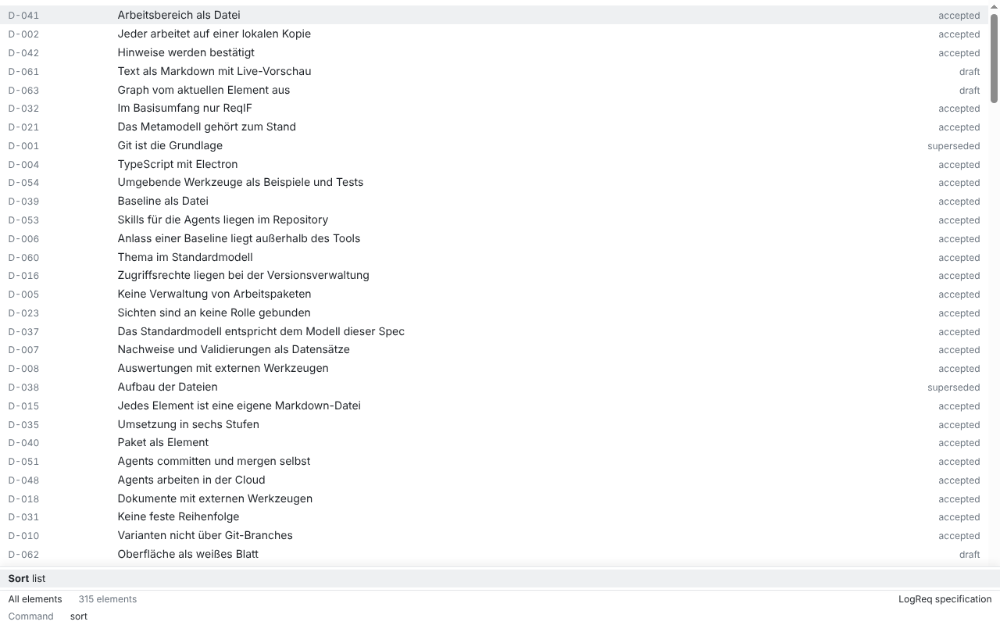
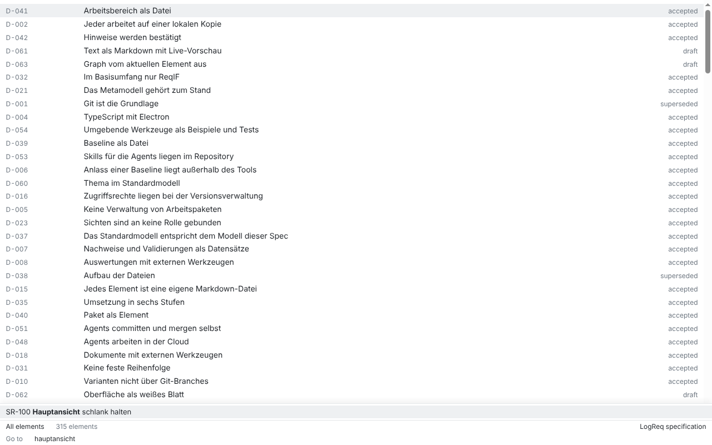

# SR-073: Mit der Tastatur bedienen

Verification method: Demonstration. Record written by an agent (Claude Code) on 2026-10-28 for issue #746, branch `sr-073-demonstration-rerun`; it replaces the record of #727, which found AK1 not met and AK2 partly met because the app had no write commands (#718, done by #734, #739 and #743). **Confirmed** by the product owner at the stage 3 acceptance (product owner decision, 2026-10-29).

> Die App muss vollständig mit der Tastatur bedienbar sein.

The requirement derives from N-032. ADR-0010 ("Minibuffer") and `packages/app/README.md` ("Keys") give the keys.

## On which build and workspace

- **Build:** `main` at commit `ff7a6d4` (2026-10-28, #743 merged), built with `pnpm build` and `pnpm --filter @reqseq/app build:electron`, run on Linux (Electron 44, Xvfb), in the window the app opens (1200×800, `src/main/shell.ts`).
- **Workspace:** a fresh copy of the fixture "Weather station" (`fixtures/SR-069/filter`, 14 elements, 14 hints) for each run; for the case without a workspace, an empty folder.
- **How:** the agent drove the built app with a Playwright script written for this record and not committed. It presses keys only (`window.keyboard`); a listener on the page counted trusted `mousedown`, `click` and `pointerdown` events and counted 0. After each step the script read the result back with the CLI on the same workspace (`element get`, `element list`, `hint list`). It wrote the screenshots in `SR-073/`.
- **Reused:** the screenshots `SR-100/commands.png` and `SR-100/jump.png` of the record of SR-100 (on a copy of `spec/`, taken by `test/screenshots.spec.ts`).

## AK1: create, search, filter, edit, set relations and confirm hints with the keyboard

> Gegeben die App, wenn sie ohne Maus bedient wird, dann lassen sich Anlegen, Suchen, Filtern, Bearbeiten, Beziehungen setzen und Hinweise bestätigen vollständig mit der Tastatur ausführen.

### What was demonstrated, step by step

One run of the app, keys only, in this order:

| Activity | Keys | What the app and the CLI showed | Result |
| --- | --- | --- | --- |
| Anlegen | Ctrl/Cmd+Shift+P, "Create element", Enter; type "System Requirement", Enter; title "Show gusts", Enter; requirement type "perf", Enter; one acceptance criterion, Enter, Enter on the empty input | The new element opened in its buffer. `element get`: type `system-requirement`, status `draft`, `requirement-type: performance`, the criterion, no problems | Met |
| Suchen | Ctrl/Cmd+Shift+F, "gusts", Enter; then Ctrl/Cmd+P, "Show gusts", Enter | The search buffer listed "Show gusts"; Ctrl/Cmd+P opened the element | Met |
| Filtern | On "List all elements": "Filter list by type", "system-requirement", Enter; "Filter list by status", "draft", Enter | Modeline "type: system-requirement · status: draft", "4 elements"; the rows are the four titles that `element list` gives for the same selection | Met |
| Bearbeiten | Tab to the title, Enter, " on the dial", Enter; Escape, Escape, Enter into the text, typing, Ctrl/Cmd+S; Ctrl/Cmd+Alt+A, "Topic", Enter, "Wind", Ctrl/Cmd+S; "Set status", Enter, Enter, "appr", Enter | `element get` after each step: title "Show gusts on the dial", the text, `topic: Wind`, status `approved`. The prompt of "Set status" offered "Draft", "Approved", "Obsolete" | Met |
| Beziehungen setzen | "Create relation", Enter (source: the shown element), "derives", Enter (kind "Derives from"), "see wind", Enter (target); the same for "Based on" D-0000e1; then "Remove relation", Enter, "based", Enter, Enter | The kind prompt offered the kinds `relation options` gives (Refines, Derives from, Based on, Supersedes, Replaces), the target prompt only "N-0000a1 See the wind" (`SR-073/create-relation.png`). `element get`: `derives-from N-0000a1` added; `based-on D-0000e1` added, then removed (the remove prompt offered the element's kinds "Derives from", "Based on", then the target "D-0000e1 Use ultrasound") | Met |
| Hinweise bestätigen | Ctrl/Cmd+P to SR-0000b1 "Measure wind speed" (modeline "3 outdated"), "Confirm hints", Enter (ref: the shown element), at `hintIds` "Derives from", Enter, Enter on the empty input | The `hintIds` prompt offered the element's three hints by their message (`SR-073/confirm-hints.png`). The result buffer said "confirmed 3", and `hint list` has no hint of SR-0000b1 left (`SR-073/confirm-result.png`). All three were confirmed, not only the one chosen (finding F1) | Met with assumption F1 |

### Result

Every activity of AK1 was done with the keyboard alone, and the CLI read each result back. **Met** as demonstrated, with assumption F1: confirming hints counts as done although a single chosen hint cannot be confirmed on its own. Confirmed.

## AK2: the command prompt finds every function of the app by its name

> Gegeben eine Befehlspalette, wenn sie per Tastenkürzel geöffnet wird, dann findet sie jede Funktion der App über ihren Namen.

"Befehlspalette" is the command prompt of the minibuffer, Ctrl/Cmd+Shift+P (`COMMAND_SHORTCUT`, `actions.ts`); everywhere else the spec calls it „Befehlszeile“ (spec question #642, F2).

### What was demonstrated, step by step

1. **The functions of the app**, counted for this record: the 39 commands of `schemas/commands/catalog.json` implemented in core (`packages/core/src/commands/index.ts`; the 10 commands of variants, baselines and ReqIF are not implemented yet) and the 45 action titles of `packages/app/src/renderer/actions.ts`.
2. **The views.** The script opened the command prompt with an empty input in 15 views (overview, list, matrix, element, neighbourhood, graph, graph with one relation kind, metamodel, metamodel as text, search result, split window, list with two filter steps, dark mode, an element whose file changed under the input, following an agent) and collected every name offered there.
   An action is offered only in the views where it applies, as the rationale of SR-133 says: „die Befehle der App zeigt sie nur dort, wo sie ausführbar sind“ (a quote from its rationale, not from an AK). The catalog commands are offered in every view with a workspace, except "Bulk update elements", which needs the selection of a list and is offered on a list.
3. **Each name typed.** In the first view that offers it, the script typed each name in full; the function stood first among the candidates every time (76 names: 37 catalog titles and 45 actions, 6 of them the same title).
4. **The two catalog commands without their own name:** "Get element" (`element.get`) is covered by "Go to element or buffer" (Ctrl/Cmd+P), and "Update element" (`element.update`) by "Save element", "Edit title", "Add property" and "Clear property". The prompt lists such a command once, by the action (`catalogItems`, `catalog-commands.ts`); typing "Get element" or "Update element" finds nothing. That these two count as found by the names of their actions is assumption F3 (spec question #761).
5. **Without a workspace** (an empty folder open): the prompt offers "Open workspace" and "Initialise workspace".
6. **Initials and parts of names:** "crel" on an element puts "Create relation" first (the example of SR-108 AK1), and "rel" offers "Show relation options", "Show related elements", "Create relation" (with its key Ctrl+K R), "Remove relation" and "Resolve reference" (`SR-073/catalog-prompt.png`).

The tests of the app that check the same: `[SR-108/AK1]` in `src/renderer/actions.test.ts`, `[SR-133/AK1]` in `src/renderer/usage.test.ts`, the write commands in `src/renderer/catalog-commands.test.ts` (#734, #743), and the Electron tests in `test/command-line.spec.ts`.

### Result

Every function the app has, each implemented catalog command and each action, is found by its name in the command prompt opened with Ctrl/Cmd+Shift+P, in the view where it applies. **Met** as demonstrated, with assumption F3 for "Get element" and "Update element". Confirmed.

## Findings

- **F1 (AK1, assumption):** "Confirm hints" asks `ref` first and offers the shown element, so `ref` is always given, and core confirms all hints of `ref` together with the chosen `hintIds`. A single hint cannot be confirmed in the app. Issue #759. This record assumes AK1's „Hinweise bestätigen“ is met by confirming the element's hints.
- **F2 (AK2, wording):** the AK says „Befehlspalette“, the rest of the spec „Befehlszeile“. Spec question #642 is open; this record reads both as the command prompt.
- **F3 (AK2, assumption):** "Get element" and "Update element" have no entry of their own; this record counts them as found by the actions that run them. Spec question #761.

## Screenshots

| | |
| --- | --- |
|  |  |
|  |  |
|  |  |

## Known limits of this record

- Checked on Linux only; the macOS keys (Cmd, the physical Ctrl+P and Ctrl+T in the text editor) are those of ADR-0010 and were not tried.
- The keys were sent by Playwright, not typed by a person. No screen reader or focus-order audit; AK1 asks for the activities with the keyboard, not for accessibility in general.
- The list of functions in AK2 is the catalog and `actions.ts` of this commit; a function added later needs its name in the prompt too.
- **A human repeats it** at stage acceptance, without a mouse: open a workspace (Ctrl/Cmd+O or "Open workspace"), create an element, search it, filter the list, edit its title, text and a property, set its status, add and remove a "Derives from" relation, and confirm an outdated hint with "Confirm hints" (it confirms every hint of the element, F1).
