# SR-096: Formeln und Diagramme darstellen

Verification method: Demonstration. Record written by an agent (Claude Code) on 2026-10-28 for issue #108, branch `sr-096-demonstration-record`. **Confirmed** by the product owner at the stage 3 acceptance (product owner decision, 2026-10-29).

> Der Editor muss Formeln in LaTeX und Diagramme in Mermaid mit sofortiger Vorschau darstellen.

## What was demonstrated and how

- **The built app** on Linux (Electron 44, Xvfb, window 1280×800), built with `pnpm build` and `pnpm --filter @logreq/app build:electron` from the branch of #732 (the Mermaid diagrams; the formulas came with #719 and are on `main`): AK1 and AK2 at head `6180d02`, AK3 again at head `a329547`, which has the fix of #747. KaTeX 0.19.0 and Mermaid 11.17.2 are bundled in the app.
- **The workspace:** a copy of the fixture workspace "Weather station" of the editor tests (`fixtures/SR-069/filter` with the demo files), element N-0000ed „Windmessung im Detail“, its text emptied and typed anew with real keys.
- **The run:** a Playwright script, used only for this record and not committed, launched the app once in the light and once in the dark scheme (`colorScheme`), typed the texts below, moved the cursor and took the screenshots. In both runs the console showed no Content Security Policy violation and the main process blocked no request (offline, SR-078).
- **Screenshots:** `verification/SR-096/`; the AK3 screenshots are from the second run at `a329547`, in which the AK1 and AK2 screens looked the same as before, each in `-light` and `-dark`.
- **Tests that back the demonstration** (they do not replace it): `packages/app/test/formulas-diagrams.spec.ts` (`[SR-096/AK1] a LaTeX formula typed in the editor appears set`, `[SR-096/AK3] a formula with a syntax error shows the error and its source`) and `packages/app/test/diagrams.spec.ts` (`[SR-096/AK2] a Mermaid diagram typed in the editor appears drawn`, `[SR-096/AK2] sequence and state diagrams appear drawn, in the colours of the scheme`, `[SR-096/AK3] a diagram with a syntax error shows the error and its source`), plus the unit tests of `editor/diagram.ts`, `editor/mermaid-renderer.ts` and the formula rules.

## AK1: a LaTeX formula appears set in the preview

> Gegeben eine Formel in LaTeX, wenn sie geschrieben wird, dann zeigt der Editor sie gesetzt in der Vorschau.

### What was done

Typed: `Energie $E = mc^2$ im Fließtext.`, an empty line, a display formula `$$` / `\sum_{i=1}^{n} i = \frac{n(n+1)}{2}` / `$$`, an empty line, `Ende.`

1. With the cursor in the inline formula (`formula-typing-light.png`, `formula-typing-dark.png`): the line shows its source `$E = mc^2$`, and directly below the formula a small card shows it set by KaTeX; the display formula, which has no cursor, is set and centred.
2. With the cursor out of the text (Escape; `formula-light.png`, `formula-dark.png`): both formulas are set in place of their source, the inline one in the line of text, the display one centred on its own line. In the dark scheme the formulas are drawn in the light text colour of the sheet.

### Result

A LaTeX formula is set in the preview as it is written: in a card while the cursor is in it, in place of the source when the cursor has left. **Met** in this demonstration. Confirmed.

## AK2: a Mermaid diagram appears drawn in the preview

> Gegeben ein Diagramm in Mermaid, wenn es geschrieben wird, dann zeigt der Editor es gezeichnet in der Vorschau.

### What was done

1. **Flowchart.** Typed: `Ablauf:`, an empty line, then a fenced block ```` ```mermaid ```` with `flowchart TD`, `Anforderung --> Entwurf`, `Entwurf --> Prüfung`, `Prüfung -->|bestanden| Freigabe`, `Prüfung -->|abgelehnt| Entwurf` and the closing fence.
   - With the cursor still in the block (`flowchart-typing-light.png`, `flowchart-typing-dark.png`): the source shows as a code block, and the drawing is directly below it, with the four boxes, the arrows and the labels "bestanden" and "abgelehnt" of the edges. It appeared while typing, after the short pause of the preview (assumption A1 of #732, spec question #420).
   - With the cursor out of the text (`flowchart-light.png`, `flowchart-dark.png`): the drawing stands in place of the source, centred, in the greys of the scheme.
2. **Sequence diagram.** Typed a fenced `mermaid` block with `sequenceDiagram`, `Nutzer->>Editor: Diagramm schreiben`, `Editor->>Mermaid: Quelltext`, `Mermaid-->>Editor: Zeichnung`, `Editor-->>Nutzer: Vorschau`. With the cursor out of the text (`sequence-light.png`, `sequence-dark.png`): the three participants at the top and the bottom, their lifelines, the two calls as solid arrows and the two answers as dotted arrows, each with its label.

### Result

Flowchart and sequence diagram are drawn in the preview while they are written and in place of their source afterwards, in both schemes. **Met** in this demonstration. Confirmed.

## AK3: a formula or a diagram with a syntax error shows the error and the source

> Gegeben Formel oder Diagramm mit Syntaxfehler, wenn die Vorschau erscheint, dann zeigt sie den Fehler und den Quelltext.

### What was done

Typed: `Formel mit Fehler: $\frac{1}{$ offen`, an empty line, and a fenced `mermaid` block with `flowchart TD`, `A -->`; then the cursor left the text (`error-light.png`, `error-dark.png`; the diagram part enlarged in `error-zoom-light.png`, `error-zoom-dark.png`).

1. **Formula.** The source `$\frac{1}{$` stays in the line, followed in grey by "**Error** KaTeX parse error: Unexpected end of input in a macro argument, expected '}' at end of input: \frac{1}{", then the rest of the line. Font size 11.9 px, readable. **Met.**
2. **Diagram.** No drawing; the source lines `flowchart TD` and `A -->` stay in the code block, and below them, in grey, "**Error** Parse error on line 3:", the source line with Mermaid's pointer, and "Expecting 'AMP', 'COLON', … got 'EOF'". The computed font size of the error is **11.9 px** (body text 14 px, source lines 12.88 px), the same as the error of a formula; it is readable in both schemes. In the first run, before the fix of #747 in #732, it was 4.76 px and unreadable (F1). The Electron test `[SR-096/AK3] a diagram with a syntax error …` now also checks that the error is at least 0.8 of the body text. **Met.**

### Result

For a formula and for a diagram the preview shows the error and the source, readable. **Met** in this demonstration. Confirmed.

## Findings

| | AK | Finding | Issue |
| --- | --- | --- | --- |
| F1 | AK3 | The error of a diagram with a syntax error was drawn at 4.76 px in the closing fence line and could not be read. Fixed by #732: now 11.9 px, as the error of a formula. | #747 (`bug`), fixed |

## Screenshots

| | |
| --- | --- |
| 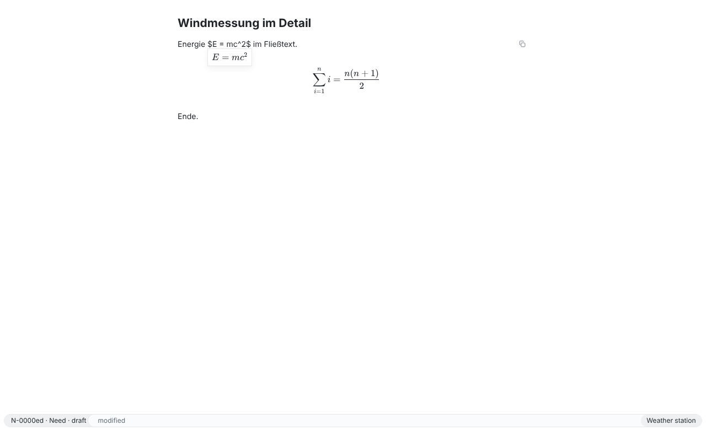 | 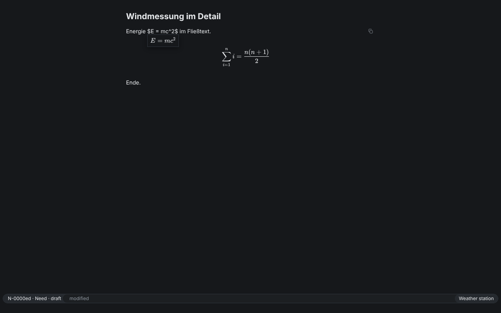 |
| 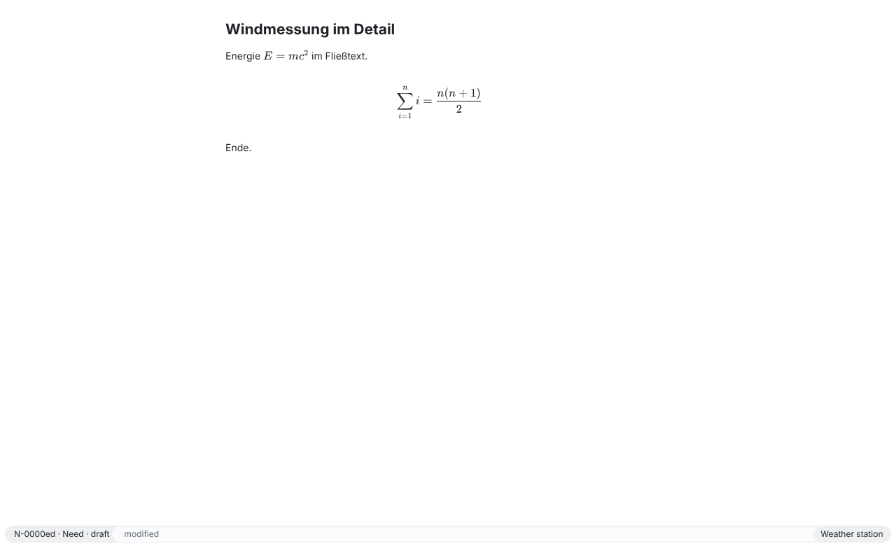 | 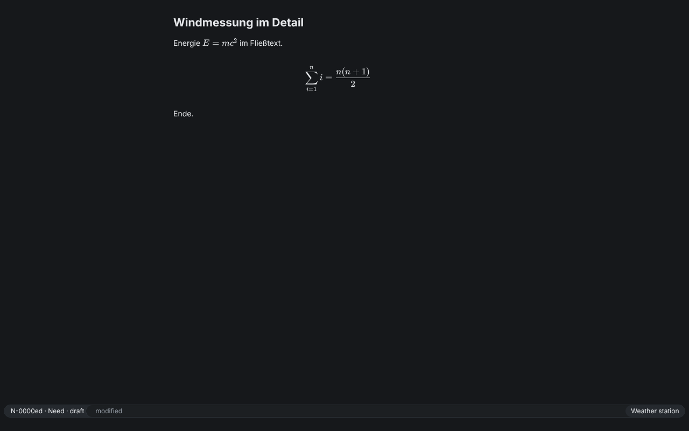 |
| 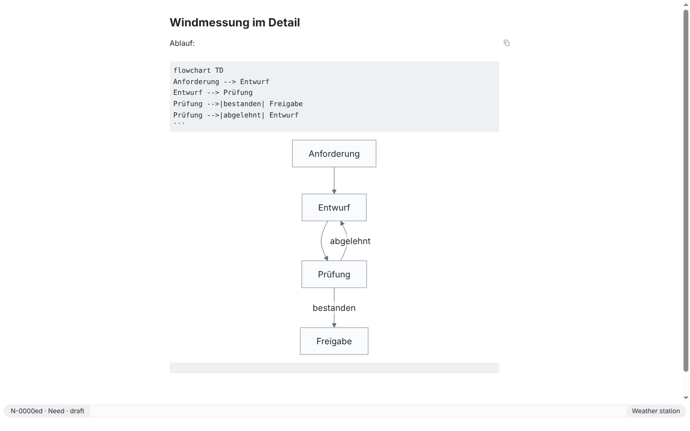 | 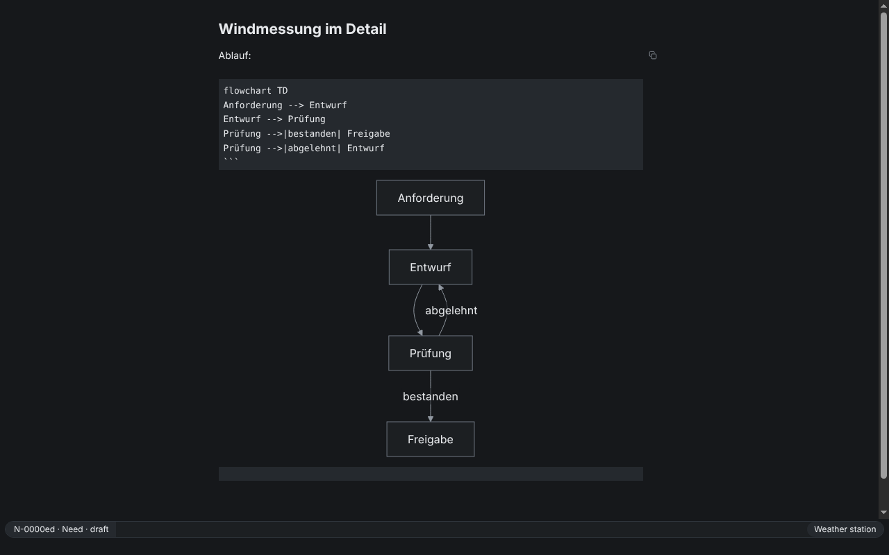 |
| 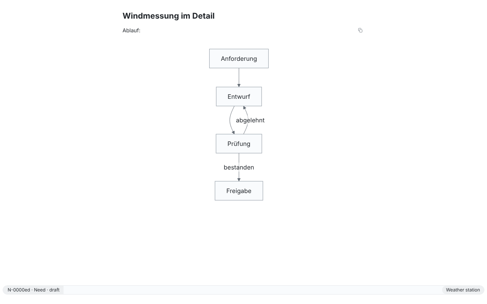 | 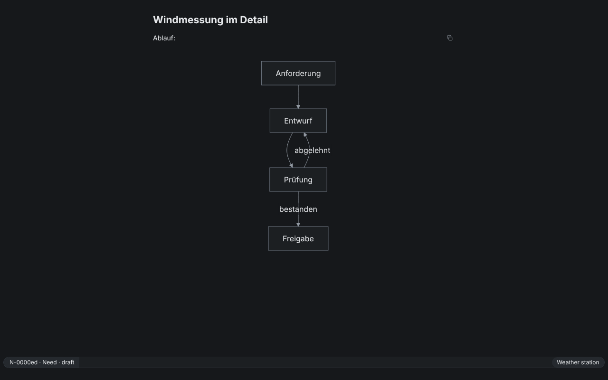 |
| 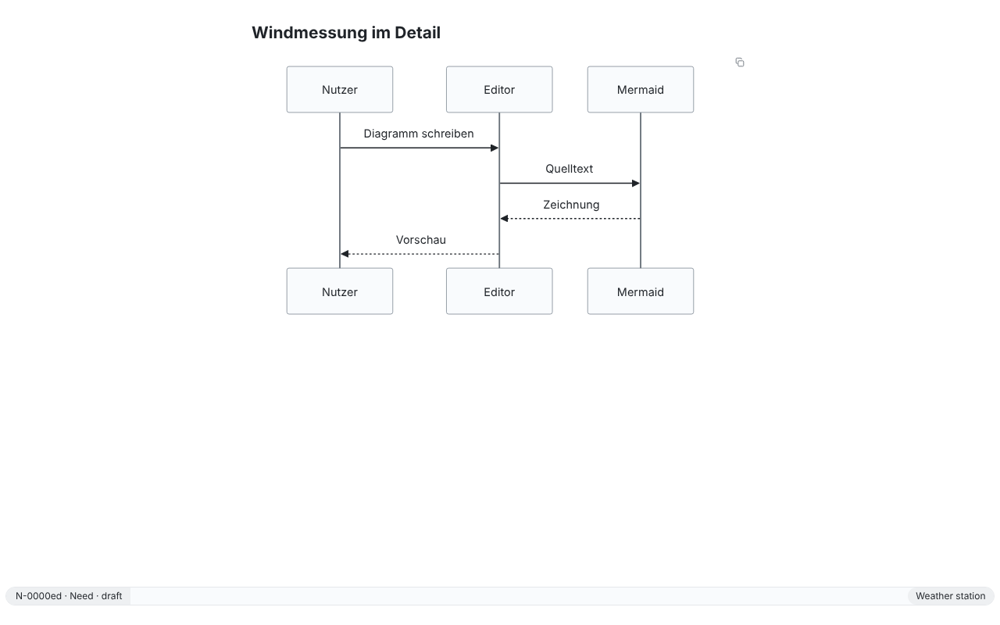 | 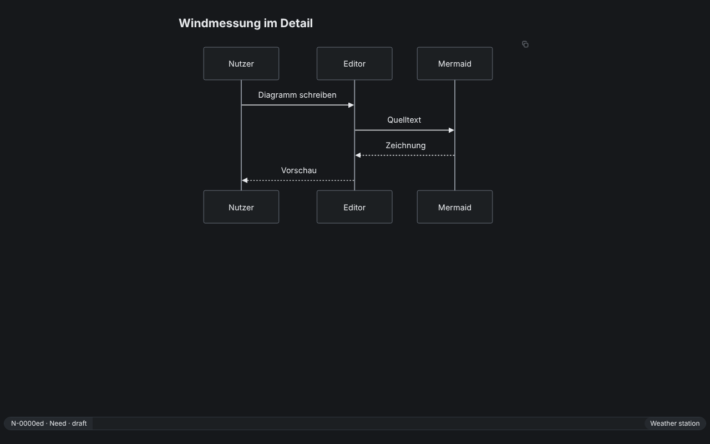 |
| 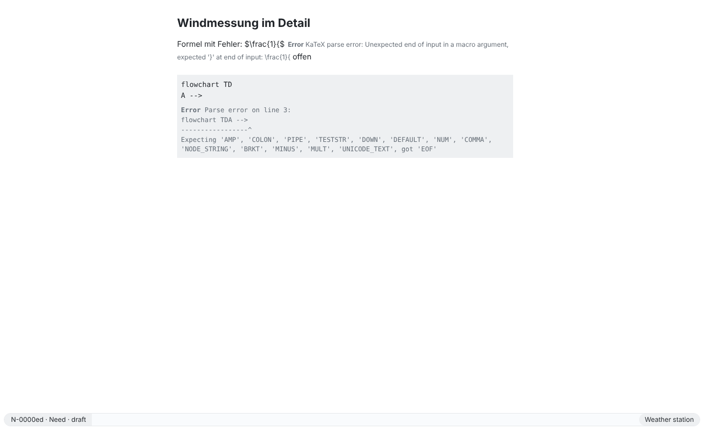 | 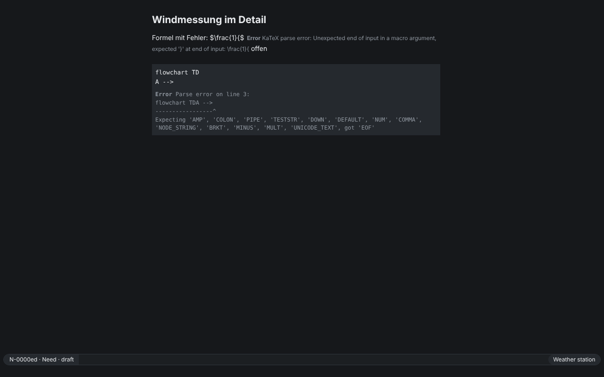 |
| 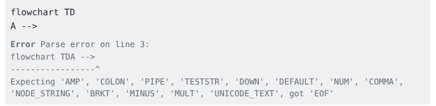 | 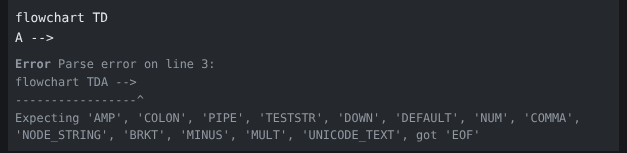 |

## Known limits of this record

- Demonstrated on Linux only; macOS and Windows were not seen (the drawing is the same bundled KaTeX and Mermaid in the same renderer).
- Demonstrated on the branch of #732 before its merge; if #732 changes after `a329547` before it lands, the demonstration has to be repeated for what changed.
- Only flowchart and sequence diagram were demonstrated; the state diagram is covered by the Electron test named above. Formulas in table cells and in property boxes are not part of this record (follow-up of #732).
- The display formula with a syntax error and the limits of large diagrams were not demonstrated here; the Electron tests named above and in #732 cover them.
