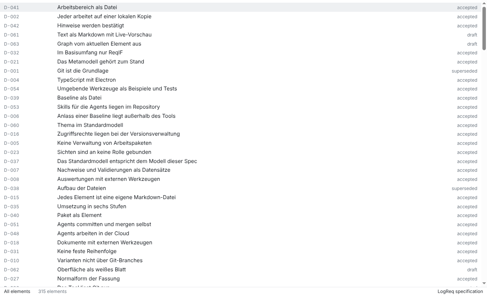
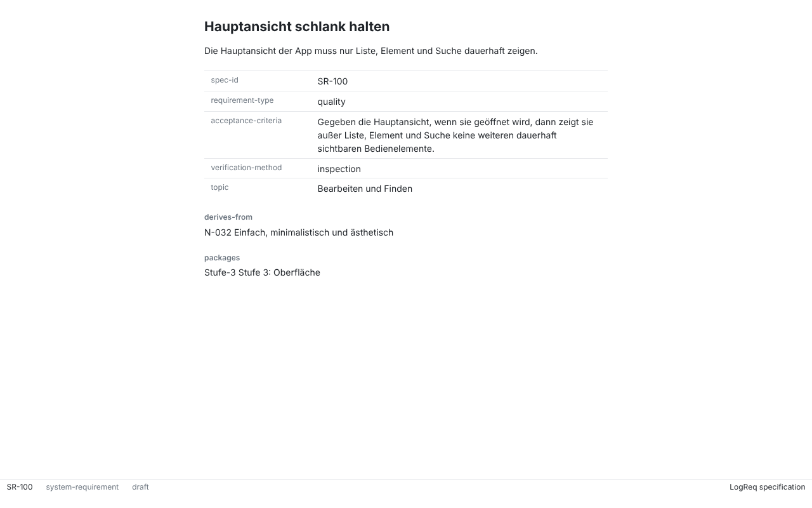
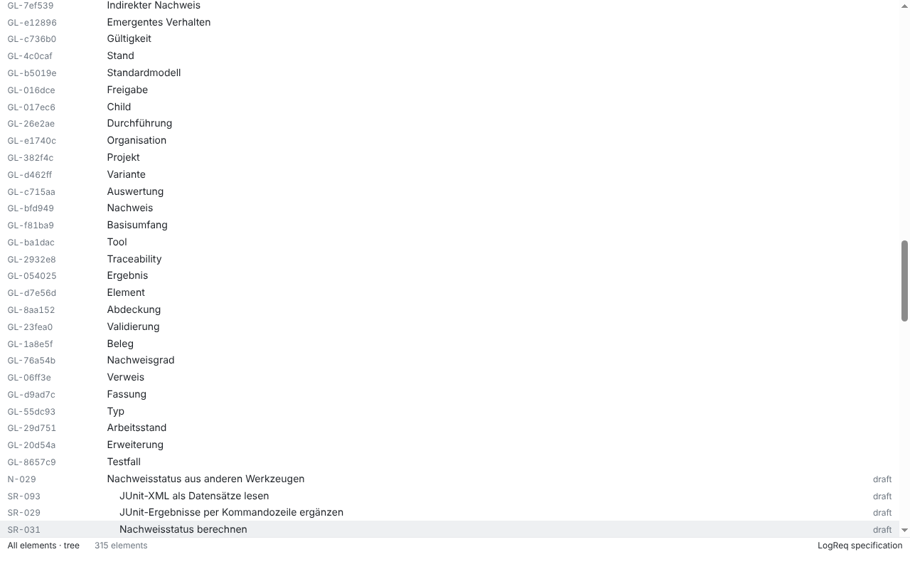
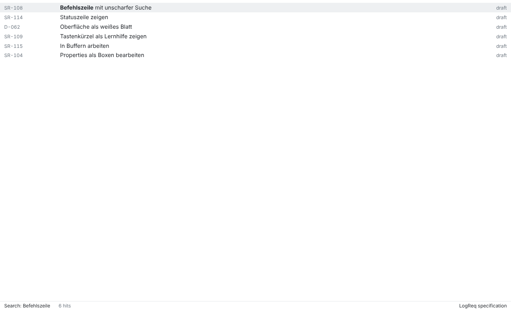

# SR-100: Hauptansicht schlank halten

Verification method: Inspection. Record written by an agent (Claude Code) on 2026-10-26 for issue #112, branch `sr-100-main-view`. Revised by an agent on 2026-10-28 to the wording of SR-100 after #399 and #419; the checks, screenshots and counts are those of the 2026-10-26 run. **Not confirmed.** A human confirms it at stage acceptance (D-050, the UI gate of N-032, #8).

> Die Hauptansicht der App darf außer dem aktuellen Buffer, der Statuszeile und der Befehlszeile nichts dauerhaft zeigen.

History: the earlier wording („nur Liste, Element und Suche“) could be read in two ways; spec question #399 was answered with buffers (product owner decision, 2026-10-26), and #419 reworded the requirement to that.

## The terms

Under the approved interaction concept (#326 phase B, D-061..D-063) the main view shows **one buffer at a time**: a list, a search result or an element. Above the bottom edge it has the **modeline**, a display and not a control, and below it the **minibuffer**, which is the search and the only control. „Statuszeile“ is the modeline, „Befehlszeile“ the minibuffer: Ctrl/Cmd+Shift+F opens its search, Ctrl/Cmd+P finds an element, Ctrl/Cmd+Shift+P runs an action. „Der aktuelle Buffer“ is the one list, search result or element on the sheet.

## AK1: nothing else is permanently visible

> Gegeben die Hauptansicht, wenn sie geöffnet wird, dann zeigt sie außer dem aktuellen Buffer, der Statuszeile und der Befehlszeile nichts dauerhaft an.

### What was checked

Every permanently visible thing of the main view, with the list open and with an element open, and what it says:

| Visible | Where | What it says |
| --- | --- | --- |
| One list buffer (rows: ID, title, status) | sheet, with the list open | the elements of the workspace (`element.list`); the selected row in light grey |
| One element buffer (title, text, the properties that are set, relations) | sheet, with an element open | the element (`element.get`); its text in the Markdown editor (SR-065), the rest read-only |
| Modeline, left | bottom | what the shown buffer is: list: filter, sort, count; element: ID, type, status |
| Modeline, right | bottom | the name of the workspace, and marks only when they apply (`read-only`, errors, warnings, `stopped`) |
| Minibuffer line | very bottom | empty, or the last message (error of a command, why no workspace is open) |

Not permanently visible, and shown only on request: the candidates of the prompt and its input (Ctrl/Cmd+Shift+P, Ctrl/Cmd+P, Ctrl/Cmd+Shift+F; Escape ends them), the UUID and the date of the version (action "Show element ID and version"), properties without a value. There is no tab bar, toolbar, menu bar in the window (the application menu is hidden until Alt on Windows and Linux), sidebar, tree, form, button, dialog or placeholder text. The only colours are greys and one accent for "outdated".

### How

1. Screenshots of the app on a copy of the specification of LogReq itself (`spec/`, 315 elements; the number in the modeline is the CLI's total), 1280×800, taken by `packages/app/test/screenshots.spec.ts` on Linux (Electron 44, Xvfb):
   - `SR-100/list.png`: the main view as it opens.
   - `SR-100/element.png`: an element open (SR-100 itself).
   - `SR-100/tree.png`: the list sorted by hierarchy (derivation tree).
   - `SR-100/search.png`: a search buffer.
   - `SR-100/commands.png`: the command prompt asked for ("sort"), the one time something appears that was not there.
   - `SR-100/jump.png`: Ctrl/Cmd+P ("hauptansicht").
2. The Playwright test `[SR-100/AK1] the main view shows only the list, the element and the search line` (`packages/app/test/main-view.spec.ts`) lists the DOM with the list open, with an element open and after the prompt was closed: no visible element with the role `button`, `tab`, `tablist`, `navigation`, `complementary`, `dialog`, `form`, `menu`, `menubar`, `toolbar`, `tree`, `combobox` or `searchbox`, and `textbox` only for the text editor of an element (`article .cm-content`, SR-065), which is the element itself, not an extra control; no `button`, `input`, `textarea`, `select`, `form`, `nav`, `aside` or `dialog` element; the window has exactly three regions (sheet, modeline, minibuffer) and the sheet has exactly one buffer. The test supports this inspection; it does not replace it.
3. The unit tests of the renderer (100 % of the `.ts` modules; components `.tsx` have no threshold since #537) cover the behaviour behind each of these.

### Result

With the list open and with an element open, the main view shows one buffer, a display line (modeline) and the minibuffer, and nothing else permanently. The prompt candidates appear only on request and disappear with Escape. This matches AK1 and is not confirmed.

### Screenshots

| | |
| --- | --- |
|  |  |
|  |  |
|  |  |

## Known limits of this record

- Dark theme, window split and the graph are not part of this view yet.
- The element buffer shows the text in the Markdown editor with live preview (SR-065). The `[SR-100/AK1]` test was changed for it (agreed in the review of #77): the one `textbox` of the sheet is the editor, `article .cm-content`.
- Checked on Linux only; the macOS and Windows runs of the Electron tests are the CI's.
