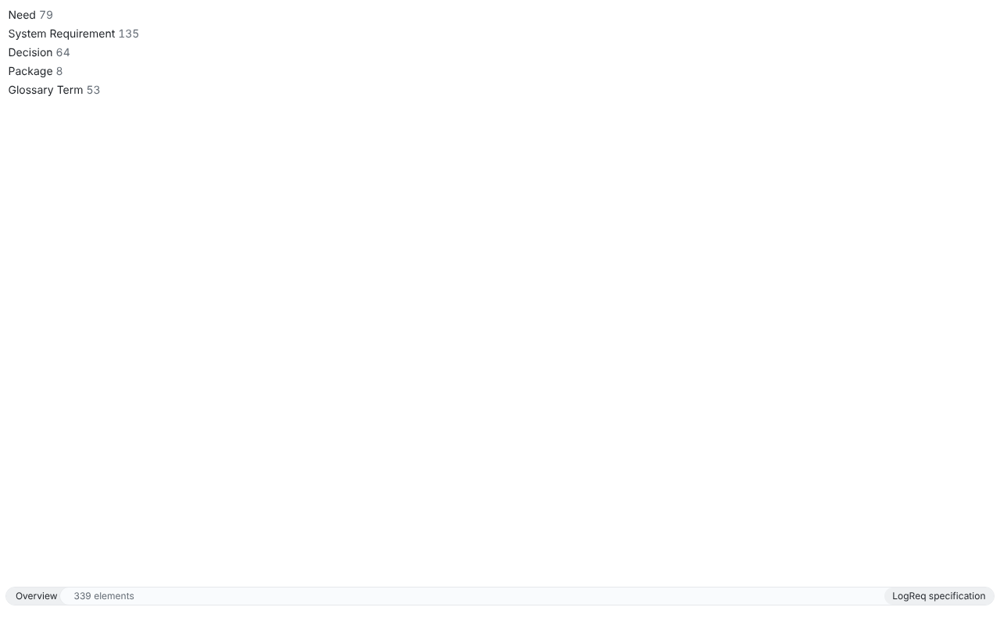
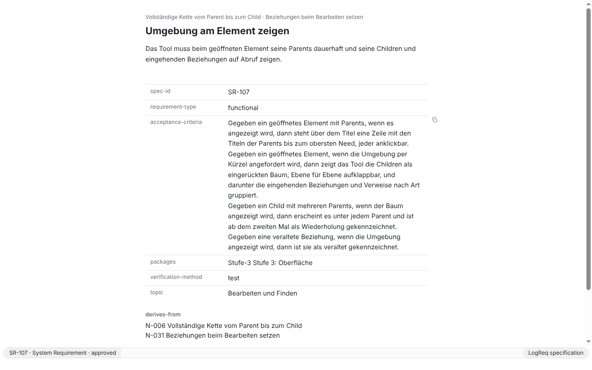
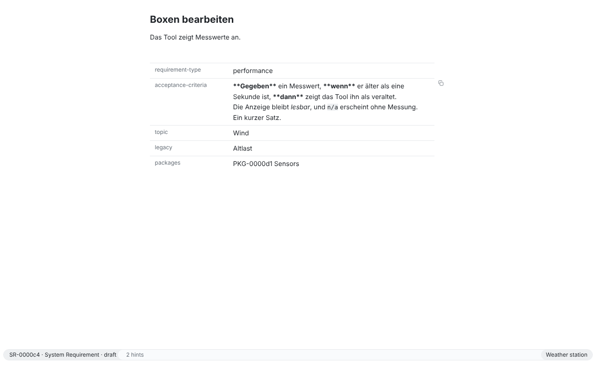
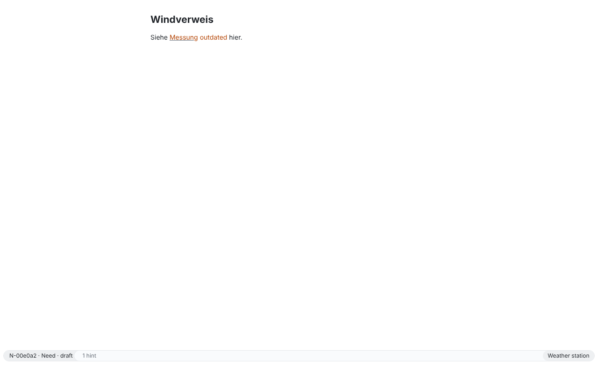
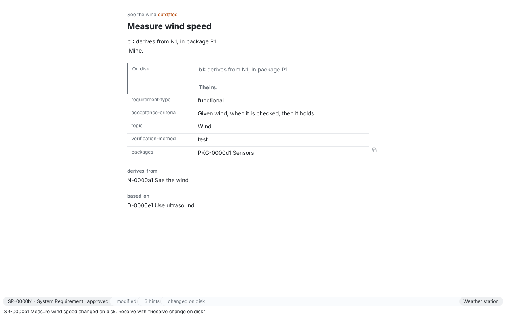
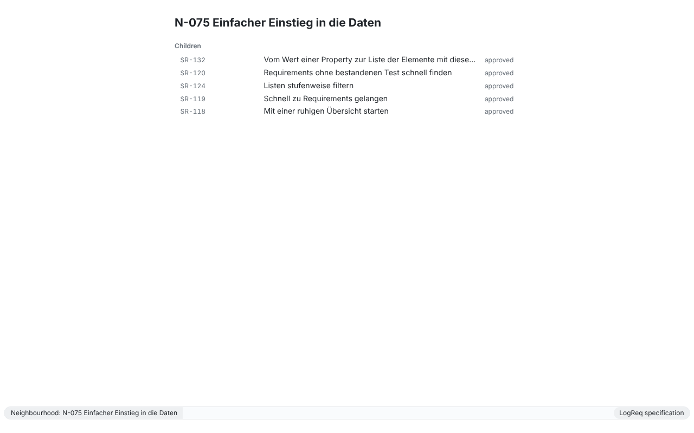
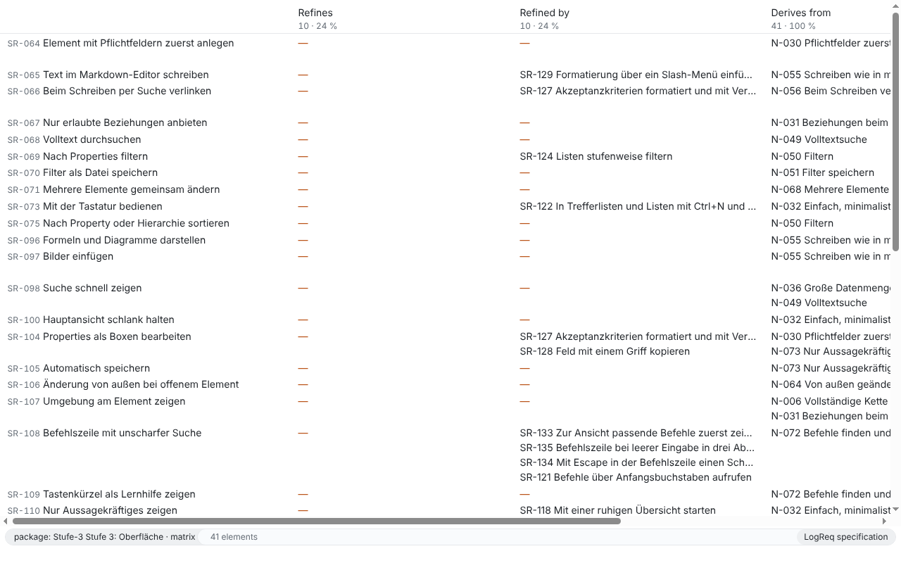
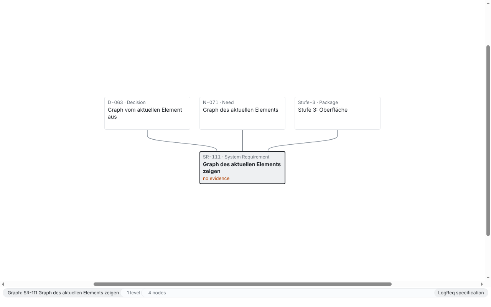
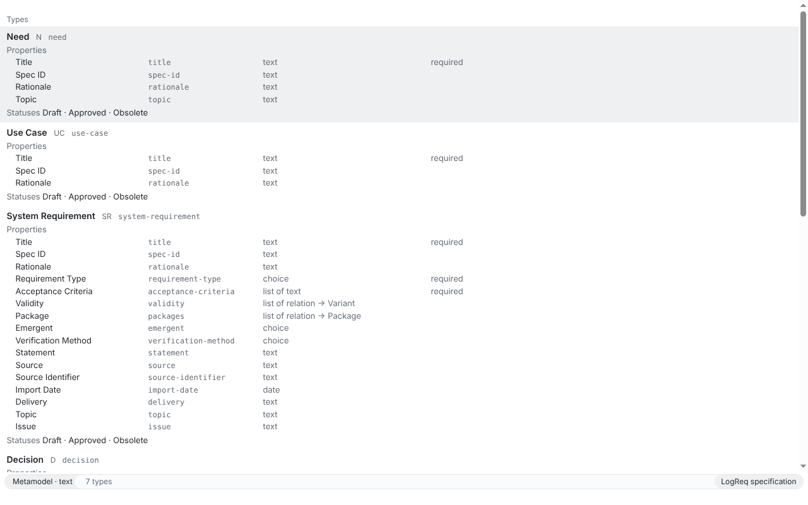
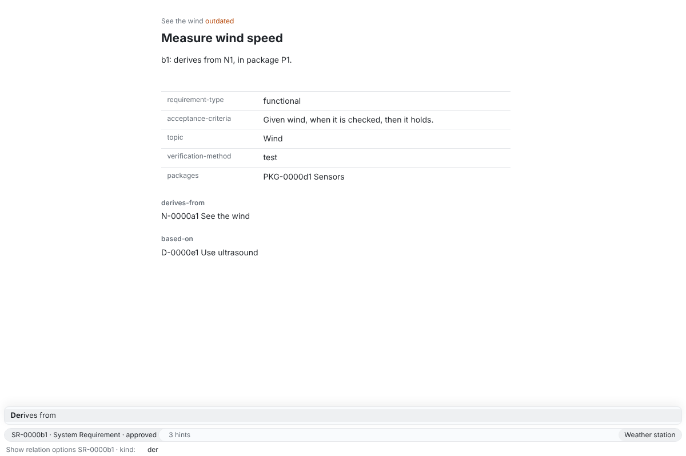

# SR-110: Nur Aussagekräftiges zeigen

Verification method: Inspection. Record written by an agent (Claude Code) on 2026-10-28 for issue #406, branch `sr-110-inspection-record`. **Not confirmed.** A human confirms it at stage acceptance (D-050, the UI gate of N-032, #8).

> Die App darf nur zeigen, was im jeweiligen Moment etwas aussagt; alles andere muss sie auf Abruf zeigen.

The requirement derives from N-032 and N-073 and is based on D-062 („Oberfläche als weißes Blatt“): „Alles, was zu sehen ist, muss in diesem Moment etwas aussagen. Was nichts aussagt, erscheint nicht; wer es trotzdem sehen will, fordert es per Befehl, Tastenkürzel oder Klick an.“ The inspection reads each criterion against D-062 and, for the version, against D-013 („Angezeigt wird nicht der Prüfwert, sondern das Datum der Fassung.“).

## What was inspected and how

- **The code of the app** on `main` (commit `c04d54c`, 2026-10-28): every view of the renderer in `packages/app/src/renderer/` (`App.tsx`, `OverviewView.tsx`, `ListView.tsx`, `ElementView.tsx` with `ParentsLine.tsx`, `TitleBox.tsx`, `TextBox.tsx`, `FieldBox.tsx`, `NeighbourhoodView.tsx`, `MatrixView.tsx`, `GraphView.tsx`, `MetamodelView.tsx`, `MetamodelTextView.tsx`, `ResultView.tsx`, `ModelineBar.tsx`, `Minibuffer.tsx`), the display rules behind them (`modeline.ts`, `element-view.ts`, `editor/references.ts`, `actions.ts`), the colour tokens and rules in `styles.css` and the editor theme in `editor/Editor.tsx`, and the main process (`src/main/shell.ts`, `menu.ts`, `close.ts`) for dialogs. The rules of the UI in ADR-0010 ("UI") and `packages/app/README.md` ("Main view") were read first and checked against the code where this record cites them.
- **Searches** over `packages/app/src` (product code, tests left out) for forms, dialogs, sidebars and form controls (`<form`, `<dialog`, `showModal`, `showMessageBox`, `window.confirm`, `window.alert`, `<aside`, `<nav`, `<button`, `<input`, `<select`, `<textarea`, `role="dialog"`, `aria-modal`) and for colours outside the tokens (hex, `rgb(`, `hsl(`).
- **Screenshots** of the built app on Linux (Electron 44, Xvfb, 1280×800), written by the Electron tests of the app on 2026-10-28 (the code of the app of that day), on a copy of the specification of LogReq (`spec/`) and on the fixture workspace "Weather station" of the editor tests: `verification/SR-110/` (which test wrote each one is named below), and the screenshots of the records SR-100, SR-113 and SR-065. The app was not started by the agent for this record (docs-only change, the Electron suite stays with CI).
- **Tests that support the inspection** (they do not replace it): `[SR-100/AK1]` in `packages/app/test/main-view.spec.ts` (the DOM of the main view: no form, dialog, navigation, sidebar, toolbar, tab bar or button), `[SR-105/AK3]` in `test/autosave.spec.ts` (no button and no dialog to save), and in `packages/app/src/renderer/styles.test.ts`: "uses no colour of its own outside the tokens: not in styles.css, not in the editor theme", `[SR-125/AK3]` (the gap mark by a token), `[SR-111]` (the accent stays on an outdated link), `[SR-128/AK1]` (the copy symbol is hidden until hover or focus) and `[SR-116/AK2]` (the highlight of an outside change fades within 3 s).

## AK1: every visible control and datum says something at that moment

> Gegeben jede Ansicht der App, wenn sie geprüft wird, dann lässt sich für jedes sichtbare Bedienelement und jede Angabe sagen, was es in diesem Moment aussagt.

### What was checked

Every view the app has on `main`, and everything that is visible in it. The window is a grid of three rows (`styles.css` `.shell`, lines 47 to 51): the sheet with one buffer, the modeline, the minibuffer line; nothing else (SR-100). On macOS a strip of the sheet at the top carries the window title and the traffic lights (`App.tsx` line 747, `.titlebar`; ADR-0010 "Title bar").

| View (file) | Visible | What it says at that moment |
| --- | --- | --- |
| Overview (`OverviewView.tsx`, `overview.ts`; `SR-110/overview.png`, `test/screenshots.spec.ts`) | one line per element type with a count; under "Recent" the elements opened last, at most five | the types of the metamodel and how many elements each has (`element.facets`); which elements were opened last. "Recent" and its rows are not there before an element was opened (SR-118) |
| List and search result (`ListView.tsx`, `lists.ts`, `rows.ts`; `SR-100/list.png`, `tree.png`, `search.png`) | one row per element: ID, title, status; a selected row on the `--select` tone; in tree mode the indentation | the elements the filter or search gives (`element.list`, `element.search`), their status as stored (never coloured); which row the keys act on; the derivation tree. A fresh list has no selected row (SR-122) |
| Element (`ElementView.tsx`; `SR-110/element.png`, `test/neighbourhood-screenshots.spec.ts`; `SR-110/boxes.png`, `test/property-boxes.spec.ts`) | the parents line above the title; the title; the text in the live preview; one box per property that is set; the relations by kind; on a package page the members below | the chain from the top need to the direct parents (there only when the element has parents, SR-107); the title; the text, Markdown marks only on the line with the cursor (D-061); the stored values of the properties that have one (empty ones are not shown, D-062; `element-view.ts`); the relations and their targets with the state of a target that is not there ("missing", `.state`); the elements of the package (SR-112). An untitled element shows its short ID muted in the heading (#621) |
| Element, on demand only | the copy symbol of a field (`FieldBox.tsx` lines 15 to 37, a `button`; `styles.css` lines 374 to 383: `visibility: hidden` unless `:hover` or `:focus-within`); the block "On disk" under a field whose file changed under the input (`SR-110/on-disk.png`, `test/outside-conflict.spec.ts`); the slash menu at the caret after `/` (SR-129) | that this field can be copied (SR-128); that the file holds another value than the input (SR-106); the Markdown constructs that can be inserted here (whether D-062 allows the menu is spec question #453) |
| Neighbourhood (`NeighbourhoodView.tsx`; `SR-110/neighbourhood.png`, `test/neighbourhood-screenshots.spec.ts`) | the title; "Children" as an indented tree, each row ID, title, status; below it the incoming relations by kind; "repeated" on a child seen before | the derivation children of the element and what points to it (`trace.neighbourhood`, SR-107); a child under several parents is marked from the second time |
| Traceability matrix (`MatrixView.tsx`; `SR-110/matrix.png`, `test/matrix-screenshots.spec.ts`) | one row per element of the list; one column per relation kind and direction that occurs, with "<count> · <share> %" in the header; in a cell the elements at the other end, "—" in the accent for an empty cell, "outdated" and "missing" where they hold | the relations of the list as `trace.matrix` gives them (SR-125); the share of rows that have such a relation; a gap in the chain (the "—") |
| Graph (`GraphView.tsx`; `SR-110/graph.png`, `test/graph-screenshots.spec.ts`) | boxes with ID, type and title; curves between them; the element with a dark border, the selected box on the `--select` tone; marks "outdated", "no evidence" (accent) and "superseded" (grey, title struck through) at the bottom of a box; no legend, arrowheads, labels or controls | what hangs on the element in layers, parents above and children below (`trace.graph`, SR-111); which box is the element and which is selected; a box whose relations are outdated, a requirement without a child or evidence (the gap rule of `trace.chain`; until stage 4 brings evidence, every requirement without a child says "no evidence", which is true then), a superseded element |
| Metamodel as graph and as text (`MetamodelView.tsx`, `MetamodelTextView.tsx`; `SR-110/metamodel-text.png`, `test/metamodel-screenshots.spec.ts`) | a box or section per type with name, prefix, key, "abstract", "extends", properties (inherited ones muted), statuses; curves with a label per link and an arrowhead; "Any type" for an open side | the metamodel of the workspace as `metamodel.get` gives it (SR-130); the selected type on the `--select` tone |
| Result of a catalog command (`ResultView.tsx`, `result.ts`) | the output as rows (elements, problems) or a quiet indented outline in greys; at most 2,000 lines | the output of the command that was run from the command line (SR-073 AK2) |
| Modeline (`ModelineBar.tsx`, `modeline.ts`; the bottom of every screenshot) | left: the parts of the shown buffer; right: the workspace and its marks; between them nothing | an element: "ID · type · status" (SR-114 AK1), then only what holds: "<n> elements" of a package page, `modified`, `read-only`, "<n> outdated", "<n> hints", "changed on disk" or "deleted on disk", "not saved" (`modeline.ts` lines 123 to 147: each part only when it is not 0 or not false); a list: its name, filter, sort and count, "incomplete: a repository is missing" only then; a graph: depth, the kinds followed only when some are chosen, the number of nodes, "more not shown" only then; the workspace: its name, and `read-only`, "<n> errors", "<n> warnings", `following agent` only when they hold (lines 32 to 49). Nothing says the default sort (D-062, ADR-0010). The copy symbol of the ID is the one control of the modeline (SR-128), seen on hover |
| Minibuffer idle (`Minibuffer.tsx`) | one line: empty, or the last message (`SR-110/on-disk.png`: "… changed on disk. Resolve with …") | the answer of the last command or why something was not done; nothing when there is nothing to say |
| Minibuffer asked (`SR-110/prompt.png`, `test/command-line.spec.ts`; `SR-100/commands.png`, `jump.png`) | a label, an input, the candidates as a card above the modeline, each with its name, its shortcut or hint, the matched letters marked | the question asked (the label names the command and the argument); what can be chosen now (the actions that apply to the shown buffer, SR-133; the choices of a property; the elements found); the candidates are gone with Escape or Enter (SR-100) |
| macOS title strip (`.titlebar`) | the window title, centred and quiet | the name of the open workspace ("<workspace> - LogReq", `modeline.ts` `windowTitle`); it is the drag region, not a control |

Not visible, and shown only on request (`packages/app/README.md` "Not shown unless asked", confirmed in the code): the UUID and the version (AK2), properties without a value (`element-view.ts`), the shortcut of an action (only in the prompt), the candidates of a prompt, the copy symbol, the children and incoming relations (Ctrl/Cmd+J), the graph (Ctrl/Cmd+Shift+G), the matrix (Ctrl/Cmd+T), the metamodel ("Show metamodel"), the full list ("List all elements", SR-118).

What is on screen without a meaning of its own: the greys of the surfaces (`--sheet`, `--raised` for the modeline and the card, `--rule` for the joints and the lines of a box, `--shadow` under the card), which D-062 allows („Alles andere ist in Graustufen gehalten“); see AK4.

### Result

In every view of `main` each visible control and each datum could be named with what it says at that moment (the table). The app has two visible controls, the minibuffer (the one control of D-062) and, on hover or focus only, the copy symbol of a field. The marks of the modeline and the graph appear only while they hold. **Met** under this inspection. Not confirmed.

## AK2: UUID and version only on demand, the version also at an outdated reference

> Gegeben ein Element, wenn es angezeigt wird, dann erscheinen UUID und Fassung nur auf Abruf, die Fassung außerdem bei einem veralteten Verweis.

### What was checked

1. **UUID and version on demand.** The element buffer renders neither `element.id` nor `element.version`: `ElementView.tsx` uses only `identifier` and `shortId` (lines 1029 and 1713, the modeline's name of the element), the list rows show ID, title and status (`ListView.tsx`), the overview and the neighbourhood the same. The action "Show element ID and version" (`actions.ts` lines 981 to 991) calls `element.get` with `versionDate: true` and echoes `versionLine` (lines 649 to 651) in the minibuffer: `<UUID> · version of <date> · <repository>:<file>`, the date of the version and not the hash (D-013; "unknown date" when Git cannot tell, ADR-0005). The line disappears with the next message. Nothing else in the renderer shows a UUID or a version (search over `packages/app/src/renderer` for `.id` renderings and `version`: only the `logreq:` links written into the text by the editor, which the live preview hides off the cursor line, SR-065). **Met.**
2. **The version at an outdated reference.** Where the app marks an outdated reference and what it shows there:
   - Inline references in the text and in Markdown property boxes (`editor/references.ts` lines 146 to 191, `TextBox.tsx` lines 48 to 117): the label in the accent colour with the word " outdated" (`SR-110/outdated-reference.png`, `test/theme-screenshots.spec.ts`: "Messung outdated"), and as hover text of the label the message of the `relation.outdated` hint (`attributes: { title: message }`, line 173). The element buffer reads the element with `element.get` without `versionDate` (`ElementView.tsx` line 974, `App.tsx` line 709), so core gives the undated message "… points to an older version of …" (`packages/core/src/hints/element.ts` lines 24 to 35: the dates are added only `withDate`; `packages/core/src/hints/outdated.ts` lines 271 and 285; the dated form "…: stored version from <date>, current version from <date>" is line 621).
   - The parents line (`ParentsLine.tsx` line 47), the neighbourhood (`NeighbourhoodView.tsx`), the matrix (`MatrixView.tsx`, `styles.css` lines 675 to 677) and the graph (`GraphView.tsx`, marks and edges): the word "outdated" in the accent, nothing else.
   - The relation rows and relation boxes of the element (`ElementView.tsx` line 248): the word "outdated" is in the code but never appears, because `element.get` sets no `relations[].outdated` (#665, open).
   - The dated message is reachable through the catalog command "List hints" (`hint.list`, which always dates its hints) in a result buffer: not at the reference, and the user has to know to ask for it.

   So at an outdated reference the app shows that it is outdated, but not the version (its date, D-013) the reference stores. **Not met** for the second half of the criterion: finding F1, issue #702.

### Result

UUID and version appear only on request, by one action, as the date of the version. The version is not shown at an outdated reference anywhere in the app. **Partly met**; #702 is open for the second half. Not confirmed.

## AK3: no forms, no modal dialogs, no permanent sidebars

> Gegeben die App, wenn sie geprüft wird, dann öffnet sie keine Formulare, keine modalen Dialoge und keine dauerhaften Seitenleisten.

### What was checked

1. **The renderer.** The search over `packages/app/src` finds no `form`, `dialog`, `showModal`, `aside`, `nav`, `select`, `textarea`, `role="dialog"` or `aria-modal`. The controls that exist: the input of the minibuffer (`Minibuffer.tsx` lines 251 to 270: one `input` with `role="combobox"` and its `label`, the one control of D-062) and the copy symbol of a field (`FieldBox.tsx` line 15, a `button` without a tab stop, hidden until hover or focus, SR-128). The property boxes are editors, not inputs (`TextBox.tsx`; the value of a choice or relation property is set in the minibuffer, `property-prompts.ts`); the title is edited in its heading (`TitleBox.tsx`). The test `[SR-100/AK1]` (`test/main-view.spec.ts` line 45) lists the DOM with the list open, with an element open and after the prompt was closed: no visible element with the role `button`, `tab`, `tablist`, `navigation`, `complementary`, `dialog`, `form`, `menu`, `menubar`, `toolbar`, `tree`, `combobox` or `searchbox`, and no `button`, `input`, `textarea`, `select`, `form`, `nav`, `aside` or `dialog` element; three regions, one buffer. "Resolve change on disk" and the choice when input cannot be saved ask in the minibuffer (`outside-change.ts`, `switch.ts`), the slash menu is a transient list at the caret (`editor/slash-menu.ts`; spec question #453).
2. **The main process.** Closing the window asks nothing: `src/main/close.ts` saves and, when that fails, keeps the window open once and says so in the minibuffer (`[SR-105/AK3]`, `test/autosave.spec.ts` line 269). The menu (`src/main/menu.ts`) has File > Open Workspace…, Close or Quit, the edit menu and, only with `options.developer`, Reload and DevTools; on Windows and Linux the menu bar is hidden until Alt. The one dialog of the app: File > Open Workspace… and Ctrl/Cmd+O open the folder chooser of the operating system (`src/main/shell.ts` line 87, `electron.dialog.showOpenDialog(window, …)`, modal to the window on macOS and Windows). Since SR-131 the same is done in the minibuffer ("Open workspace": the recent workspaces, or a typed folder path, SR-131 AK5); the README and ADR-0010 keep the folder dialog for the menu. Whether AK3 covers this dialog of the operating system is spec question #703 (finding F2); this record assumes it does not, since D-062 is about the surface the app draws and every way to open a workspace exists in the minibuffer.
3. **Sidebars.** The window has the three rows of `.shell` and nothing beside the buffer; the parents line is a group above the title, not a navigation (`ParentsLine.tsx` header comment, SR-100); the candidates of a prompt rise above the modeline only while it is asked (`styles.css` lines 522 to 539); the modeline and the minibuffer line are one line each.

### Result

The app draws no form, no modal dialog and no sidebar; the minibuffer is its one control. The folder chooser of the operating system behind File > Open Workspace… is the one modal dialog in the process, reachable only from the menu or Ctrl/Cmd+O, and whether AK3 means it is #703. **Met** under the assumption of #703. Not confirmed.

## AK4: every colour marks a meaning

> Gegeben eine Farbe in der Oberfläche, wenn sie geprüft wird, dann kennzeichnet sie eine Bedeutung wie veraltet, Lücke oder aktuelles Element.

### What was checked

Every colour of the app is a token on `:root` in `styles.css` (lines 7 to 19), with a light and a dark value (`light-dark()`, SR-113); the editor theme (`editor/Editor.tsx` lines 119 to 189) and every rule use the tokens only, which `styles.test.ts` asserts ("uses no colour of its own outside the tokens"; the one literal outside is the sheet colour the main process gives the window at start, `src/shared/theme.ts`, equal to `--sheet`). The tokens and what each one marks:

| Token (light / dark) | A colour or a grey | Marks | Where |
| --- | --- | --- | --- |
| `--accent-outdated` `#b54708` / `#f0883e` | the one hue | **outdated**: a relation, reference or link whose target changed since | inline references (`.cm-lr-outdated`, `.cm-lr-outdated-word`, `Editor.tsx` lines 143 and 144), relations and parents (`.element .outdated`, `styles.css` line 479), neighbourhood (line 479), matrix (line 675), graph edges (line 726, kept on a selected box) and marks (line 780) |
| `--accent-gap` (the same values) | the one hue | **gap in the chain**: an empty cell of the matrix ("—", line 679), a requirement without a child or evidence in the graph ("no evidence", line 784) | matrix, graph |
| `--select` `#eef0f2` / `#25292e` | grey | **the current one**: the selected row of a list (line 501, only while the list has the focus), the selected box of the graph and the metamodel, the shown buffer and the workspace segments of the modeline; in the editor the selection and the active line (`Editor.tsx` lines 125 and 138), inline code and code blocks (line 151, 182) | lists, graph, metamodel, modeline, editor |
| `--outside-change` `#ebeef1` / `#292e34` | grey | **changed outside the app just now**: a tint on the field or row that fades within 2.5 s (lines 178 to 197, SR-116 AK2) | element fields, list rows, matrix rows, overview |
| `--text`, `--muted` | greys | the text; secondary data: a status, a count, a hint of a candidate, an inherited property, the label of a box, the quote bar, a target that is not there (`.unavailable`, `.state`, lines 473 to 476) | everywhere |
| `--edge` | grey | a link of the graph (line 708; derivations in `--muted`, line 713; the links of the selected box in `--text` when that says something, line 721), an arrowhead and the open side "Any type" of the metamodel (lines 835, 848, 893) | graph, metamodel |
| `--rule`, `--raised`, `--sheet`, `--shadow` | greys | surfaces and lines without a meaning of their own: the sheet, the modeline bar and the card of the candidates, the joints of the modeline, the lines of the property boxes, the edge of the "On disk" block (line 432), the quote bar and table lines of the editor | everywhere |

Focus is shown by the same tokens, never by a colour: the browser's focus ring is turned off where a view has its own mark (`outline: none`, lines 65, 353, 434, 494, 516, 598), and the mark is the `--select` row (line 501), an underline on a link (lines 467 to 469 and 587 to 589), or the darker edge of the "On disk" block (lines 437 to 439). The status of an element is a word in `--muted`, never a colour. Links of the text are underlined in `--muted` (`Editor.tsx` line 140); only an outdated one takes the accent. Scrollbars, the caret and the selection follow `color-scheme` and the tokens (`Editor.tsx` lines 122 and 127).

Observed, not a deviation: `--accent-gap` has the value of `--accent-outdated` (ADR-0010 names it), so the one hue of the app says "look here: outdated or a gap", and the word beside it ("outdated", "—", "no evidence") says which. D-062 names both as the meanings a colour carries, and the words make them distinguishable.

### Result

The app has one hue, for "outdated" and for a gap, and greys for everything else; the current row, box or buffer and a change from outside are marked by grey tones. Every coloured thing on screen could be named with its meaning. **Met.** Not confirmed.

## Findings

| | AK | Finding | Issue |
| --- | --- | --- | --- |
| F1 | AK2 | At an outdated reference the app shows the word "outdated" only, never the date of the stored version (D-013); the element buffer reads `element.get` without `versionDate`, so even the hover text of an inline reference has no date. | #702 (`bug`) |
| F2 | AK3 | File > Open Workspace… and Ctrl/Cmd+O open the folder chooser of the operating system, modal to the window; whether AK3 covers a dialog of the operating system is open. | #703 (`spec-frage`) |

Related, found before this record: #665 (the relation rows of the element never show "outdated"), #453 (whether D-062 allows the slash menu).

## Screenshots

| | |
| --- | --- |
|  |  |
|  |  |
|  |  |
|  |  |
|  |  |

## Known limits of this record

- Inspected on the code and on Linux screenshots; the macOS title strip and the native frames of Windows and Linux (the operating system's own look, ADR-0010) were not seen.
- The views of stage 4 (evidence records, SR-136, SR-137) do not exist yet; images, formulas and diagrams in the text (#108, #109) are not themed yet (SR-113 record). A later inspection has to cover them.
- The dark scheme was checked only through the tokens and the screenshots of SR-113: every rule uses a token with two values, so what holds for light holds for dark.
- The result buffer of a catalog command was inspected in the code (`result.ts`) only; no screenshot.
