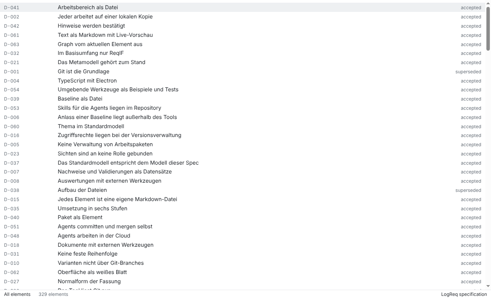
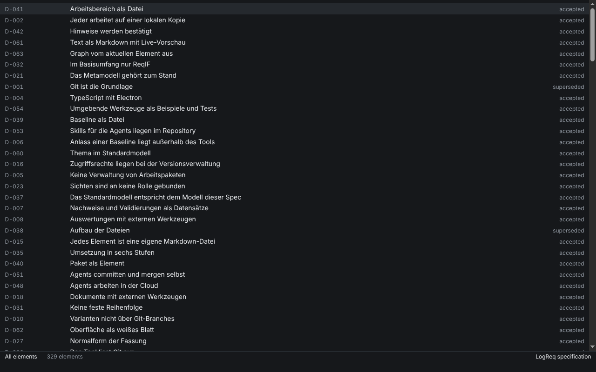
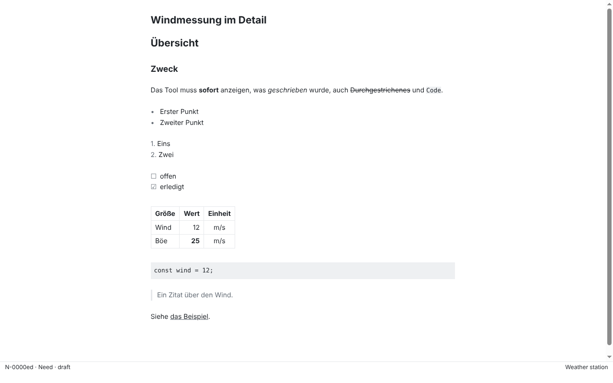
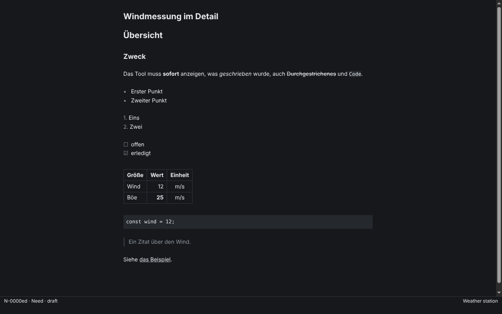
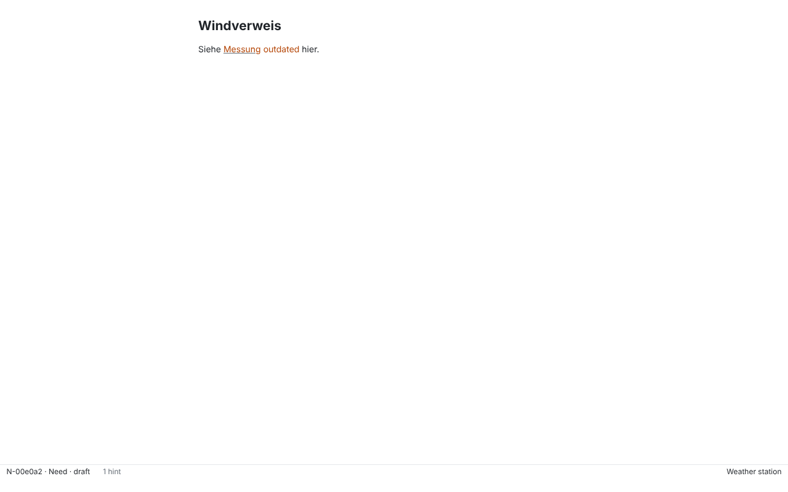
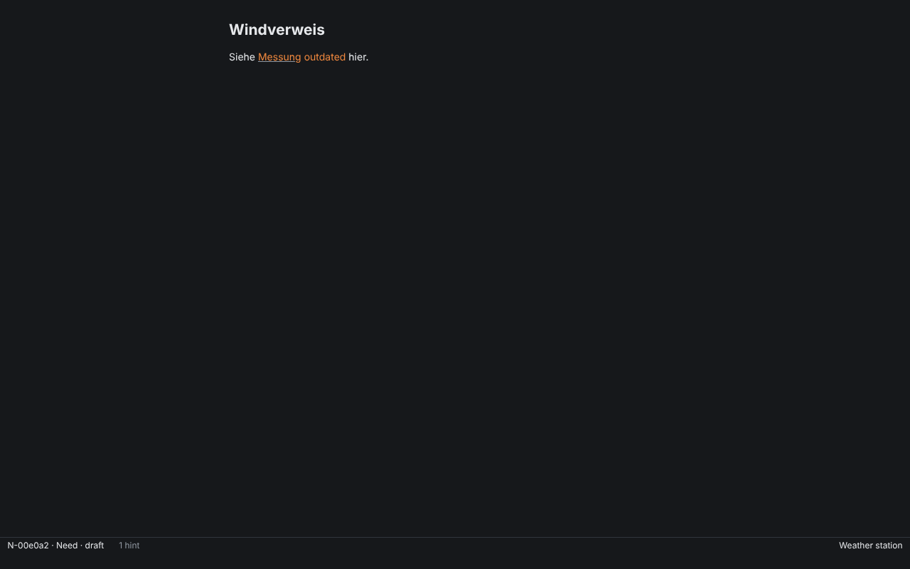
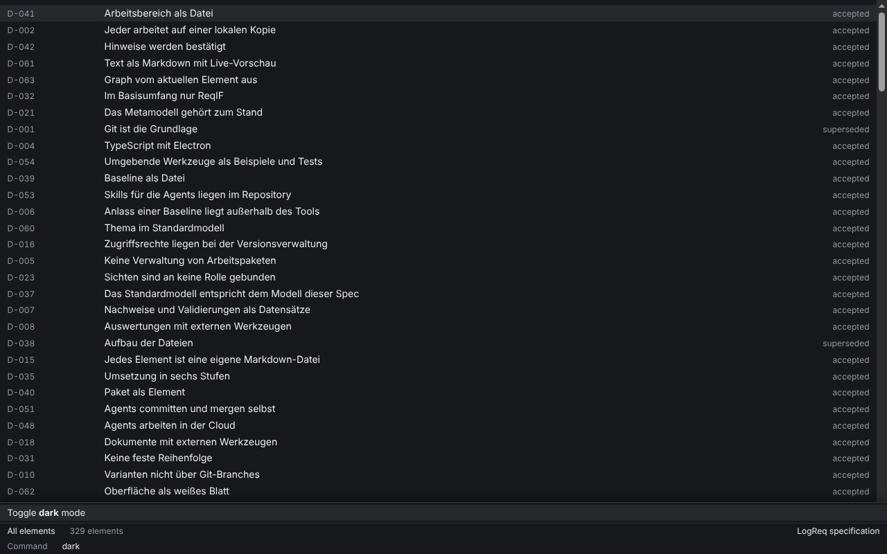

# SR-113: Hell und dunkel darstellen

Verification method: Demonstration. Record written by an agent (Claude Code) on 2026-10-26 for issue #409, branch `sr-113-dark-mode`. **Confirmed** by the product owner at the stage 3 acceptance (product owner decision, 2026-10-29).

> Die App muss eine helle und eine dunkle Darstellung bieten.

## The reading (assumptions)

- **A1: the command's choice lasts until the app quits and is stored nowhere.** AK1 says that every start follows the operating system; a stored choice would break that. A remembered choice first needs a change to AK1.
- **A2: "Befehl" is an action of the command prompt** (Ctrl/Cmd+Shift+P, D-062: the minibuffer is the only control). "Toggle dark mode" has no menu item and no shortcut; the prompt finds it by name and by initials (`tdm`).
- **A3: without a choice the app also follows changes of the system setting while it runs.** AK1 demands it only at start; it is what `prefers-color-scheme` does anyway.

"Follow system light or dark mode" is offered only after a choice, so the prompt stays quiet otherwise. Both actions need an open workspace, like every action (the prompt does not open without one).

## How the colours work

Every colour is a token on `:root` in `packages/app/src/renderer/styles.css` with a light and a dark value (`light-dark()`); the editor theme (CodeMirror) uses only these tokens. `color-scheme: light dark` makes the page follow the system, also for scrollbars and the caret. The action sets `data-theme="light"` or `"dark"` on the root element, which sets `color-scheme` to that scheme. Dark greys are neutral: greys plus one accent for "outdated" (D-062).

The light `--muted` changed from `#6e7781` to `#656d76`: on `--select` the old value reached 3.98:1, which fails WCAG 2.2 AA. This changes the light look slightly; the screenshots of SR-100 and SR-065 stay valid.

Contrast (WCAG 2.2 AA, all text is normal size, so 4.5:1 is the bound). `styles.test.ts` asserts the bounds (4.5:1 for text, 1.1:1 for selection and rules) from `styles.css`; the numbers were computed for the plan and the plan review:

| pair | light | dark |
| --- | --- | --- |
| text / sheet, text / select | 15.80, 13.83 | 14.49, 11.92 |
| muted / sheet, muted / select | 5.25, 4.59 | 6.11, 5.02 |
| accent (outdated) / sheet, accent / select | 5.43, 4.75 | 7.03, 5.78 |
| select / sheet, rule / sheet (quiet by design, not text) | 1.14, 1.23 | 1.22, 1.46 |

## AK1: the app follows the system at start

> Gegeben die App, wenn sie startet, dann folgt sie der Einstellung des Betriebssystems.

### What was checked and how

1. `[SR-113/AK1] the app starts light as the system says` and `... starts dark ...` (`packages/app/test/theme.spec.ts`): the built app starts with the renderer's `prefers-color-scheme` set to light or dark; the root element has the sheet colour of that scheme, the text and the editor text have the text colour of that scheme, and no `data-theme` is set.
2. `[SR-113/AK1] without a choice the app follows a change of the system setting`: the app starts without an override and the test sets Electron's `nativeTheme.themeSource` to dark and back; the page turns dark and light. This is the path from the system's setting (`nativeTheme`) to the page.
3. `[SR-113/AK1] gives the window the sheet colour of the system's scheme, so that a start does not flash` (`src/main/shell.test.ts`): the window background at creation is the sheet colour of `nativeTheme.shouldUseDarkColors`.

### What these tests prove and what they do not

The start tests (1) use Playwright's `colorScheme`, which is `Emulation.setEmulatedMedia` in the renderer only. Under Xvfb the main process's `nativeTheme` stays light. These tests prove that the page follows `prefers-color-scheme`, not that the operating system's setting reaches the window. That path (`nativeTheme` to Chromium) is covered by test 2 and by the unit test 3, and end to end only by the manual demonstration below.

### Result

The page follows `prefers-color-scheme` at start and while it runs, and the window background at start follows `nativeTheme`. The real operating-system path was not exercised on macOS or Windows by the agent. Confirmed.

## AK2: the command switches without a restart

> Gegeben die App, wenn die Darstellung per Befehl gewechselt wird, dann wechselt sie ohne Neustart.

### What was checked and how

`[SR-113/AK2] the command switches light and dark without a restart` (`packages/app/test/theme.spec.ts`): the app starts light, an element is open with unsaved text in the editor, and the test sets a marker on the page and notes the process ID of the main process. Ctrl/Cmd+Shift+P, "toggle dark", Enter: the root element has the dark sheet colour, the editor text the dark text colour, the minibuffer says "Dark mode until the app quits", the process ID and the marker are unchanged (no restart, no reload) and the unsaved text is still there (the modeline still says `modified`). A second "toggle dark" returns to light. After a third, "follow system" drops the choice: the page shows the (emulated) system's scheme again and `data-theme` is gone. The unit tests `[SR-113/AK2] "Toggle dark mode" switches to the other scheme and says so` and `[SR-113/AK2] "Follow system light or dark mode" is offered only after a choice, and drops it` (`actions.test.ts`) cover the actions.

### Result

The command switches the whole window, the editor included, without a restart and without losing unsaved text. Confirmed.

## Manual demonstration for acceptance (macOS)

1. System Settings > Appearance: Dark. Start the app: the sheet is dark from the first frame.
2. Ctrl/Cmd+Shift+P, `tdm` (or "toggle dark"), Enter: the sheet turns light at once; the window stays open and an element's unsaved text stays.
3. Quit and start the app: dark again (nothing was stored).
4. Switch the system to Light while the app runs: the sheet turns light.

## Screenshots

On a copy of the specification (`spec/`) and on the demo and reference elements of the editor tests, 1280×800, Linux (Electron 44, Xvfb), taken by `packages/app/test/theme-screenshots.spec.ts`. Checked by eye in dark: selection row, code, quote, table, task list, link, the accent for "outdated", the prompt.

| Light | Dark |
| --- | --- |
|  |  |
|  |  |
|  |  |
| |  |

## Known limits of this record

- **Title bar.** The native title bar (Windows, Linux) keeps the system's look: with the system dark and the command set to light, a dark title bar sits over a light sheet (and the other way round). Setting `nativeTheme.themeSource` from the renderer would need a fifth bridge function (ADR-0010 allows four); not done. Since #490 macOS has no native title bar (`hiddenInset`): the strip at the top is part of the sheet and follows the system and the command; Windows and Linux keep the native frame as described (ADR-0010).
- **Window background after a change.** After a toggle or a change of the system setting while the app runs, the native window background keeps the colour of the start. It shows only for a moment while the window is resized.
- Linux follows the GTK or portal setting of the desktop; not checked here beyond the emulation.
- Images (#109) and diagrams (#108) are not themed yet: Mermaid must pick its theme from `color-scheme`, KaTeX inherits the text colour.
- Checked on Linux only; the macOS and Windows runs of the Electron tests are the CI's.
